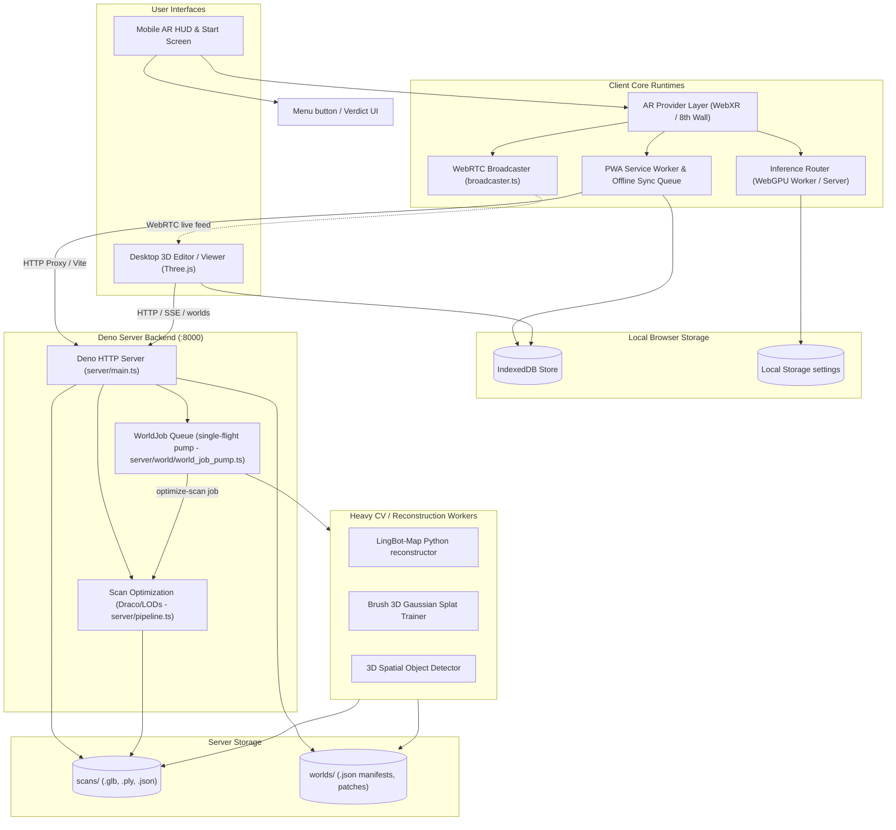
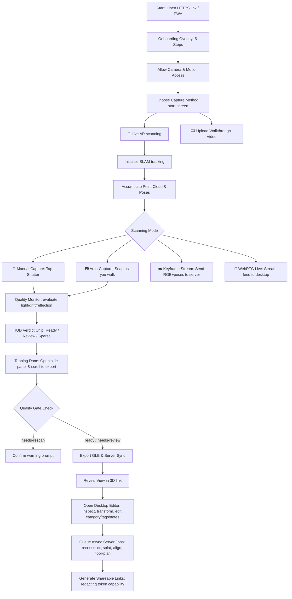
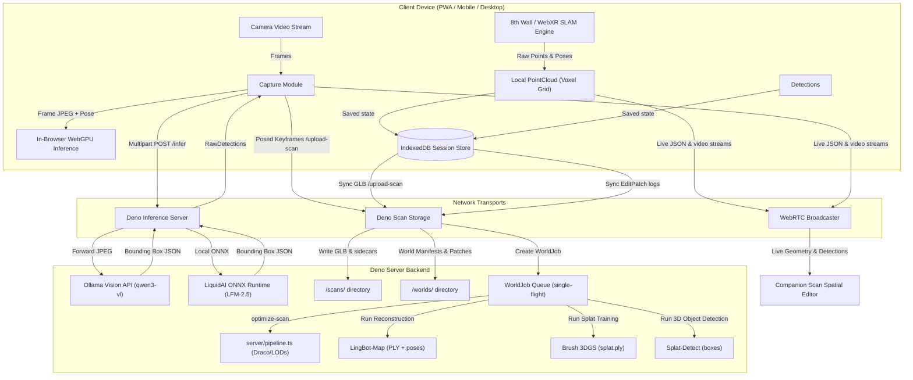

# Companion Scan

Companion Scan turns AR captures and uploaded media into a private, structured record of a **Place**. It uses 8th Wall/WebXR for capture, an engine-agnostic vision layer for object detection, and Three.js for the **Companion Scan Spatial Editor** at `/editor`. Several scans combine in one Place, are assigned to Areas such as rooms or floors, and remain independently traceable through layers and Things. Inference defaults to local Ollama; bundled ONNX and deterministic mock CV engines are alternatives selected via `INFERENCE_MODE`.

The current product contract is [Place-First Product Design](docs/product/PLACE_SCAN_DESIGN.md). `WorldProject` remains the internal ENU scene format during the compatibility migration; it is not the primary user-facing noun.

---

## Quick setup

The scanner web app on its own:

```bash
npm install
npm start          # Deno API server (:8000) + Vite dev server (:5173, self-signed HTTPS), together
```

Then open `https://localhost:5173` (accept the self-signed cert warning, or run
`tailscale cert <your-machine>.<tailnet>.ts.net` first and restart — see `vite.config.ts` for how
it picks that up automatically). Point a phone at the same URL over Tailscale to scan for real;
`npm run qr` prints a scannable link.

**Plus the gimbal-driven capture subsystem** ([`subsystems/osmo-ble/`](subsystems/osmo-ble/),
full details in [docs/operations/GIMBAL_INTEGRATION.md](docs/operations/GIMBAL_INTEGRATION.md)) — controls a DJI Osmo
Mobile 6 over Bluetooth for automated pan/tilt capture sweeps:

```bash
cd subsystems/osmo-ble
npm install
npm run backend    # must run in a real terminal — macOS Bluetooth permission can't be scripted
```

The `osmo-gimbal` MCP server is already registered in this repo's [`.mcp.json`](.mcp.json) —
Claude Code picks it up automatically once the backend above is running.

---

## Architecture & Flows

### 1. System Architecture
The application coordinates Volumetric SLAM tracking, local/remote VLM inference, IndexedDB state caching, and live WebRTC streaming to desktop editors, backed by Deno and Vite servers.



### 2. User Flow
The onboarding overlay guides new users through motion permissions, tracking speed guidelines, and capture pipelines. Real-time verdict updates indicate scan quality.



### 3. Data Flow
Posed video keyframes and voxelized points feed into local spatial stores and remote reconstruction pipelines.



---

## Features

- **AR scanning** — 8th Wall OSS SLAM tracks the environment and accumulates a colourised point cloud in real time.
- **Engine-agnostic inference** — object detection runs through a local Deno server whose engine is chosen by `INFERENCE_MODE`: `ollama` (default, runs whatever `OLLAMA_MODEL` names — `qwen3-vl:4b` by default, with the context window pinned by `OLLAMA_NUM_CTX`), `onnx` (bundled `LiquidAI/LFM2.5-VL-1.6B-ONNX` via `onnxruntime-node`), or `mock` (deterministic colour-blob CV engine for CI/tests). An on-device WebGPU path exists in the tree but is **gated off and not offered in the UI** — it has never worked, and is being rebuilt in `docs/factory/05-on-device-inference/`. Note `npm run bench:models` cannot currently rank vision models: it scores them on a synthetic corpus that a working model and a fabricating one both fail identically (see `docs/factory/06-detection-ground-truth/`).
- **3D object pins** — detected objects are placed at their SLAM-resolved world positions as live 3D labels tracking the scene.
- **Onboarding Overlay** — 5-step interactive overlay guiding users through permission prompts, movement speeds, the 3 capture pipelines, real-time quality diagnostics, and desktop editing. Bypasses automatically on CI/mocks and replays on help button click.
- **HUD Quality Verdict** — Real-time rendering of `qualityMonitor.summary()` status directly on the phone HUD as a colorized verdict chip (`✓ Ready`, `⚠ Review`, `❌ Sparse`) next to the status row.
- **HUD Menu button** — Primary affordance to the right of the capture button, on its centre line, to quickly open the Side Panel and scroll to the export and synchronization settings.
- **Accidental Leave Guards** — Intercepts navigation buttons and window unload requests if active point cloud data or poses are in memory to prevent accidental scan losses.
- **Quality-gated export** — Gating manual exports behind a confirmation prompt when scan quality is poor (`needs-rescan`). Displays a "View in 3D →" quick redirect link in the HUD status line on successful export.
- **Grouped Action Rail** — Vertically stacks and groups navigation links separate from live scanning tools with a visual divider line, while keeping direct DOM hierarchy for E2E testing compliance.
- **Session persistence** — every scan is saved to IndexedDB; browse, reload, edit, or delete past sessions from the history drawer.
- **GLTF export** — exports the full scan (point cloud + camera path + labelled boxes) as a `.glb` file, saved locally and uploaded to the server.
- **Role-scoped Place links** — view, comment, edit, scanner, and owner links carry capability tokens; regular project manifests redact stored tokens, and strict role enforcement is available with `WORLD_STRICT_AUTH=1`.
- **Processing queue foundation** — world jobs cover ingest, layer extraction, alignment, point merging, semantic passes, depth reconstruction, splat training, and world export; the local coordinator validates inputs and records artifacts while heavier Open3D/CV/splat workers remain pluggable.
- **Automatic scan optimization** — every upload is queued as an `optimize-scan` WorldJob (single-flight, crash-recovering): quantization + Draco + point-cloud LODs (`.opt.glb`, `.lodN.glb`, `.manifest.json`), roughly halving file size.
- **Keyframe streaming** — ☁ button streams pose+intrinsics-tagged keyframes to the server while you walk: reconstruction-ready `FrameObservation` sidecars under `scans/sessions/`.
- **Live geometry to desktop** — the WebRTC live stream also carries point-cloud deltas, detections, and camera pose; the desktop editor shows the scan growing in real time.
- **Companion Scan Spatial Editor** — `/editor` places scans in a shared ENU Place frame with transform gizmos, semantic tagging, layer toggles, guided processing, and progressive LOD-first loading (Draco-aware).
- **PWA** — installable on iOS/Android with app-shell caching and an offline write queue for uploads, keyframes, patches, jobs, summaries, and project writes.

---

## Requirements

| Tool | Version | Purpose |
|------|---------|---------|
| [Node.js](https://nodejs.org) | ≥ 22.18.0 | Vite dev server + build; type stripping for the `.mjs` scripts that import `.ts` |
| [Deno](https://deno.land) | ≥ 2.0 | Inference server |
| [Python 3](https://python.org) | ≥ 3.8 | Model downloader |
| 8th Wall OSS binary | any | `public/xr.js` — SLAM engine |

An iOS or Android device with camera is required for AR scanning. The 3D viewer and inference server work on desktop.

---

## Android MCP Testing (Claude Code)

The four Android remote-control MCP servers are defined in the tracked
`.mcp.json`. It uses `${ANDROID_MCP_TOKEN_*}` expansion, so keep bearer tokens
out of `.mcp.json`, `README.md`, and source control — set persistent
environment variables instead (a `.mcp.local.json` file is gitignored, but
Claude Code does not automatically merge it with `.mcp.json`, so it is not a
working alternative today). On Windows, set the four user environment
variables:

```powershell
[Environment]::SetEnvironmentVariable("ANDROID_MCP_TOKEN_TAB_S8_ULTRA", "<tab-s8 token>", "User")
[Environment]::SetEnvironmentVariable("ANDROID_MCP_TOKEN_TAB_S9_ULTRA", "<tab-s9 token>", "User")
[Environment]::SetEnvironmentVariable("ANDROID_MCP_TOKEN_BEAM_PRO_1", "<beam-pro-1 token>", "User")
[Environment]::SetEnvironmentVariable("ANDROID_MCP_TOKEN_BEAM_PRO", "<beam-pro token>", "User")
```

Close and reopen the terminal after setting them. The URLs must remain the
plain HTTP endpoints ending in `/mcp`.

Then start Claude Code from this repository, accept the workspace trust prompt,
and approve the project MCP servers when prompted:

```powershell
cd C:\devel\ci\CI-Spatial
claude
```

Verify the result in a second terminal:

```powershell
claude mcp list
```

An entry shown as `Pending approval` is configured but not enabled for this
project. If the project choices are stale, run `claude mcp reset-project-choices`,
restart Claude Code in the repository, and approve the servers again. MCP
configuration is loaded when the Claude Code session starts.

`C:\Users\<user>\AppData\Roaming\Claude\claude_desktop_config.json` is the
Claude Desktop configuration and is not the project configuration used by
Claude Code. Claude Code's user-level registry is `C:\Users\<user>\.claude.json`;
the simplest portable setup for this project is the tracked `.mcp.json`, the
four user environment variables, and one-time project approval.

For the full device table, token-variable alternative, adb fallback, and server
health troubleshooting, see [docs/testing/DEVICE_TESTING.md](docs/testing/DEVICE_TESTING.md).

---

## Quick Start

### 1. Clone and install

```bash
git clone https://github.com/companionintelligence/CI-Spatial.git
cd CI-Spatial
npm ci
```

### 2. (Optional) Download the ONNX model (2.2 GB)

The default `ollama` mode needs no bundled model — install [Ollama](https://ollama.com), then run `npm run setup:models` to see the recommended vision models and pull the ones you want. Only run the downloader below if you plan to use `INFERENCE_MODE=onnx` instead:

```bash
python3 download_models.py
```

This downloads `LiquidAI/LFM2.5-VL-1.6B-ONNX` into `public/models/LiquidAI/LFM2.5-VL-1.6B-ONNX/`.

### 3. Place the 8th Wall OSS engine

Download the 8th Wall standalone engine from [8th.io/xrjs](https://8th.io/xrjs) and copy it to:

```
public/xr.js
```

### 4. Set up HTTPS (required for camera access)

For trusted HTTPS on all devices via [Tailscale](https://tailscale.com):

```bash
tailscale cert <your-machine>.<your-tailnet>.ts.net
```

The hostname is auto-detected at Vite startup: `TAILSCALE_HOSTNAME` env var →
`tailscale status --json` → a `<hostname>.ts.net.crt` file in the repo root.
Set `TAILSCALE_HOSTNAME` explicitly only if detection picks the wrong name
(see `.env.example` for all configuration knobs).

### 5. Start both servers

```bash
npm start
```

This uses `concurrently` to run:
- **Deno inference server** on `:8000` (`npm run server`)
- **Vite dev server** on `:5173` with HTTPS (`npm run dev`)

Open `https://<tailscale-hostname>:5173` on your phone to scan or upload content from a Place, or use the Spatial Editor on desktop at `https://<tailscale-hostname>:5173/editor?project=default`.

Key routes (replace the hostname with your machine's):

- Scanner / uploader: `https://<your-tailscale-hostname>:5173/?project=default`
- Spatial Editor: `https://<your-tailscale-hostname>:5173/editor?project=default`
- WebXR scanner: `https://<your-tailscale-hostname>:5173/webxr.html`

For persistent serving from a Linux box (systemd units, GPU inference, cert renewal) see [docs/operations/DEPLOY.md](docs/operations/DEPLOY.md); for the on-device test protocol — including driving an Android device's UI directly through [android-remote-control-mcp](https://github.com/danielealbano/android-remote-control-mcp) as a Claude Code connector — see [docs/testing/DEVICE_TESTING.md](docs/testing/DEVICE_TESTING.md#remote-controlled-testing-android-remote-control-mcp).

### First-time use / everyday flow

New here? [docs/product/UX_FLOW.md](docs/product/UX_FLOW.md) walks the whole happy path as a user story — install and onboarding on the phone, scanning a room, structuring scans into the 4D world in the desktop editor, queuing reconstruction jobs, and sharing a world — plus the mental model for the four capture modes (manual tap, auto-capture, keyframe streaming, and WebRTC live). For the full documentation index see [docs/README.md](docs/README.md).

### WebXR mode (HelloXR on iOS)

`/webxr.html` runs the same scanner on a **native WebXR `immersive-ar` session** instead of the 8th Wall SLAM engine. Safari on iOS has no WebXR AR, so open the URL inside [HelloXR](https://apps.apple.com/us/app/helloxr/id6757726359), a WebXR-enabled iOS browser (Android Chrome and headset browsers work directly).
The page auto-detects support and forwards to the scanner in forced-WebXR mode (`/?ar=webxr` — `xr.js` is not loaded at all on this path); without support it shows the HelloXR install link and fallbacks. The 🥽 button in the AR app and the WebXR button in the viewer toolbar navigate between the two runtimes.
In WebXR mode the point cloud accumulates from per-frame hit-test samples (WebXR exposes no SLAM feature points), so sweep the camera slowly across surfaces.

---

## Project Structure

```
.
├── index.html                # AR scanning app entry point
├── viewer.html                # Standalone 3D viewer / World Editor entry point
├── scanner.html               # Share-link scanner redirect entry point
├── webxr.html                 # WebXR-forced runtime entry point
├── ar-hittest-sphere.html     # 8th Wall hit-test prototype (diagnostic)
├── ar-ground-anchor.html      # Ground-anchor calibration prototype (diagnostic)
├── download_models.py         # ONNX model download helper
├── vite.config.ts             # Vite + Tailscale HTTPS config (also the Rollup multi-page build input)
├── playwright.config.ts       # Playwright project configurations
├── package.json
├── deno.json
│
├── server/                    # All server-side Deno modules (grouped out of the repo root)
│   ├── main.ts                #   HTTP + WebSocket routes, CORS allowlist, capability-token auth
│   ├── inference.ts           #   Engine-agnostic inference (ollama / onnx / mock)
│   ├── prompt.ts               #   VLM prompt builder + JSON parser
│   ├── jobs.ts                 #   Legacy Job/OptimizeScanManifest shapes (queue retired — ADR 0003)
│   ├── pipeline.ts             #   Scan-optimization pipeline (dedup/LOD/quantize/Draco)
│   ├── portal_auth.ts          #   OIDC "Sign in with Companion Account" (CI-Portal)
│   ├── memory_push.ts          #   CI-Server /v1/events memory push
│   ├── scan_id.ts / scan_index.ts / session_id.ts / thing_match.ts / sensenova_vision.ts / exec_probe.ts
│   ├── repo-root.ts            #   REPO_ROOT — resolves paths outside server/ (scripts/, public/models/)
│   ├── migrations/             #   migrate_jobs.ts, migrate_scan_ids.ts (one-shot data migrations)
│   ├── world/                  #   world_job_pump.ts (single-flight WorldJob pump), world_lock.ts,
│   │                           #     world_membership.ts, world_prune.ts
│   ├── splat/                  #   splat_train.ts (Brush), splat_detect.ts (OWLv2), splat_finish.ts
│   │                           #     (@playcanvas/splat-transform), splat_train_dataset.ts
│   └── lingbot-map/            #   lingbot_map.ts, lingbot_map_glb.ts (LingBot-Map reconstruction glue)
│
├── public/
│   ├── xr.js                  # 8th Wall OSS engine (download separately)
│   ├── manifest.json          # PWA manifest
│   ├── sw.js                  # Service worker (precache + offline write queue)
│   ├── icon-192.png           # PWA icons (generated by scripts/generate-icons.mjs)
│   ├── icon-512.png
│   ├── camera-check.html / compass-bench.html / smoke.html   # device diagnostic pages
│   ├── models/                 # ONNX model files for INFERENCE_MODE=onnx (gitignored, 2.2GB;
│   │                           #   populated by download_models.py; also what the browser
│   │                           #   downloads for on-device inference — see "Inference" below)
│   └── resources/              # 8th Wall worker scripts + tflite models
│
├── scans/                     # Uploaded .glb scan files (created at runtime, repo root)
├── worlds/                    # World manifests, edit patches, and queued jobs (created at runtime)
│
├── src/                        # Frontend — unaffected by the server/ regrouping above
│   ├── main.ts                #   Frontend app bootstrap
│   ├── pwa.ts                  #   Service-worker registration + offline write queue
│   ├── ar/                     #   provider.ts, eighthwall.ts, webxr.ts, scanner.ts
│   ├── capture/                 #   capture.ts, auto-capture.ts, keyframes.ts, quality-monitor.ts
│   ├── inference/                #   router.ts, server.ts, webgpu.worker.ts, prompt.ts,
│   │                               #     lfm-driver.ts, model-provisioning.ts
│   ├── scene/                   #   store.ts, pointcloud.ts
│   ├── spatial/                  #   resolver.ts  (2D bbox → 3D world position)
│   ├── export/                    #   gltf.ts, summary.ts
│   ├── ui/                        #   overlay.ts, panel.ts, history.ts
│   ├── viewer/                     #   editor + layers: viewer.ts, editor.ts, assets.ts,
│   │                               #     geomap.ts, lingbot-map.ts, livefeed.ts, measure.ts,
│   │                               #     splat-toolbox.ts, splat-viewer.ts, splat-layer.ts,
│   │                               #     splat-detect-layer.ts
│   ├── world/                      #   types.ts (WorldProject/ScanManifest/LayerManifest/EditPatch),
│   │                                #     geo.ts, layers.ts
│   ├── geo/                         #   geo-tracker.ts  (device geolocation tracking)
│   ├── project/                      #   project-store.ts
│   ├── rtc/                           #   broadcaster.ts  (WebRTC live geometry)
│   ├── debug/                          #   remote-log.ts
│   ├── shared/                          #   cv-palette.ts, test-homes.ts, session-id.ts
│   └── test/                             #   webxr-emulation.ts
│
├── scripts/                   # ~30 Node/shell/Python dev scripts — see Development Scripts below
│
├── tests/
│   ├── *.spec.ts               # 32 Playwright specs (AR flow, API/CV-mock, house-readiness,
│   │                           #   test-homes, video-ingest, e2e-suite, editor/lingbot/splat
│   │                           #   mocks, webxr-emulated, xr8-scan, project, server) + fixtures/, support/
│   └── unit/
│       ├── deno/               #   Deno unit suites — inference_mock, lingbot_map, memory_push,
│       │                       #     portal_auth, scan_index, session_id, splat_detect/finish/train, …
│       └── node/               #   Node unit suites — detection_store, editor_pick, glb_provenance,
│                                #     lingbot_map_glb, pipeline_detection_graph, resolver
│
├── deploy/                    # systemd units + env template for a persistent Linux deployment
├── docs/                      # adr/, factory/ (ticket waves + the atlas), operations/, pipelines/,
│                               #   product/, testing/
├── video/                     # Self-contained marketing/capture tool (own package.json)
└── subsystems/osmo-ble/       # Self-contained BLE gimbal-control subsystem (own package.json)
```

`deno test` unit suites live under `tests/unit/deno/`, split out from the repo root (and from
the server modules they cover) during a later repo-tidy pass. Run them all with `deno task test`
(see `deno.json`). Six `tests/unit/node/` suites run under
`node --experimental-strip-types --test` instead:

| Suite | Script | Why not Deno |
|-------|--------|--------------|
| `lingbot_map_glb.test.ts` | `npm run test:lingbot:glb` | exercises `@gltf-transform/functions`, which pulls in the `sharp` native binary — not something Deno's npm compat layer permits today |
| `pipeline_detection_graph.test.ts` | `npm run test:pipeline:graph` | same `@gltf-transform` dependency; runs the real `optimizeScan()` |
| `editor_pick.test.ts` | `npm run test:editor:pick` | covers frontend viewer code (`src/viewer/editor.ts` + `three`), not a server module |
| `detection_store.test.ts` | `npm run test:store` | frontend code (`src/scene/store.ts`'s `indexedDB`/`navigator.storage`) — `deno test --no-check` actually passes it, but `deno.json` carries no DOM lib override the way `tsconfig.json` does for `src/`, so plain `deno check` fails on the browser globals |
| `glb_provenance.test.ts` | `npm run test:provenance` | frontend code (`src/export/gltf.ts` + `src/viewer/editor.ts`), transitively DOM-typed — same DOM-lib gap as `detection_store.test.ts` |
| `resolver.test.ts` | `npm run test:resolver` | covers frontend code (`src/spatial/resolver.ts` + `three`, DOM-typed `ARProvider.start(canvas)`), not a server module |

`test:pipeline:graph`, `test:editor:pick`, `test:store`, `test:resolver`, and `test:provenance`
are all wired into `npm run verify`; `test:lingbot:glb` is not, and is run on its own.

CI runs `deno task check` (type-check) and `deno task test` on every push/PR via
[`.github/workflows/deno-ci.yml`](.github/workflows/deno-ci.yml); the full containerized
smoke test (Docker build + `/health` + static UI gate) is manual via
[`.github/workflows/docker-publish.yml`](.github/workflows/docker-publish.yml).

---

## Development Scripts

The repo defines ~30 npm scripts. The most common:

> **Node ≥ 22.18.0 is required.** `scripts/generate-test-homes.mjs`, `scripts/generate-cv-images.mjs`
> and `scripts/smoke-pipeline.mjs` import TypeScript directly, which only works once Node strips
> types by default (22.18.0+). On an older Node they fail with a bare `ERR_UNKNOWN_FILE_EXTENSION`.
> `.node-version` is read automatically by the version managers that support it (fnm, nodenv,
> Volta); nvm and asdf read their own files (`.nvmrc`, `.tool-versions`), so on those you either
> configure them to read `.node-version` or select 22.18.0 yourself. `engine-strict=true` in
> `.npmrc` is the backstop either way — it makes `npm ci` refuse rather than warn. This stays on the same major line as the Dockerfile’s floating
> `node:22-alpine` tag.

| Script | Description |
|--------|-------------|
| `npm start` | Start both Vite and Deno servers together |
| `npm run dev` | Vite only |
| `npm run server` | Deno inference server only |
| `npm run build` | TypeScript check + Vite production build |
| `npm test` | Playwright tests (webkit-desktop) |
| `npm run test:mobile` | Playwright tests (webkit iPhone 15 emulation) |
| `npm run test:iphone` | Playwright over USB on a real iPhone |
| `npm run test:house` | Two-story-house field-acceptance suite |
| `npm run test:box` | Bounding-box readiness check |
| `npm run test:mock` / `test:api` | Mock-engine + API-only test tiers |
| `npm run smoke:pipeline` | End-to-end scan-optimization pipeline smoke test |
| `npm run setup:models` | Show the recommended Ollama vision-model catalog and install the ones you want |
| `npm run bench:models` | Benchmark Ollama vision models to pick `OLLAMA_MODEL` |
| `npm run eval:cv` | Evaluate the mock CV engine against fixtures |
| `npm run ingest:video` | Ingest a walkthrough video into a session scan |
| `npm run links:house` | Print the house-validation scanner/viewer links |
| `npm run gen:test-data` / `seed:test-data` | Generate / seed test fixtures |
| `npm run test:splat:unit` / `test:splat:make-fixture` | `deno test` for splat_train/detect/finish + Playwright fixture builder |
| `npm run test:mock:unit` | `deno test` for the mock inference engine |
| `npm run test:lingbot:glb` / `test:lingbot:fetch-video` / `test:lingbot:make-fixture` | LingBot-Map GLB test (Node, needs `sharp`) + fixture scripts |
| `npm run gen-icons` | Regenerate PWA icons |
| `npm run qr` / `logs:watch` / `logs:iphone` | Dev QR link + log tailing helpers |

Deno unit suites run with `deno test` (e.g. `deno test tests/unit/deno/splat_train.test.ts`).

---

## Server API

All endpoints are served by the Deno server on `:8000` and proxied through Vite on `:5173`.

The full, canonical route table lives in [docs/architecture.md](docs/architecture.md); the most-used endpoints:

| Method | Path | Description |
|--------|------|-------------|
| `GET` | `/health` | Returns `{ status: "ok", model: "..." }` |
| `POST` | `/infer` | Multipart `image` → `RawDetection[]` |
| `POST` | `/process-scan` | Sync scan analysis: `object-count`, `scene-description`, `floor-plan` |
| `POST` | `/upload-scan` | Multipart `file` (.glb) + optional `metadata` (JSON) → saves to `scans/` |
| `GET` | `/scans` | Returns JSON array of `{ filename, size, uploadedAt }` |
| `GET`/`DELETE` | `/scans/:filename` | Serve or delete one stored `.glb` (+ sidecars, world refs) |
| `DELETE` | `/scans?confirm=delete-all` | Clears test scan storage and prunes world manifests |
| `POST` | `/ingest-video` | Video-upload → session scan (no `.glb` on disk) |
| `GET` | `/sessions` | Lists sessions |
| `GET` | `/sessions/:id/…` | Session sidecars: `lingbot-map.manifest.json`, `.point-cloud.ply`, `.poses.json`, keyframe JPEGs |
| `POST` | `/upload-summary` | Stores a scan summary |
| `GET` | `/scan-locations` | Returns geo-located scan positions |
| `GET`/`POST` | `/worlds` | List / create world projects |
| `GET` | `/worlds/:slug` | World manifest: scans, layers, members, jobs, patches (+ `.splat` sidecars) |
| `GET` | `/worlds/:slug/share` | Compatibility endpoint returning view/comment/edit/scanner/owner links scoped to one Place |
| `POST` | `/worlds/:slug/patches` | Persists transform, label, category, notes, visibility edit patches |
| `GET`/`POST` | `/worlds/:slug/jobs` | List / queue async world jobs (`align-scan`, `semantic-pass`, `splat-train`, `lingbot-map-reconstruct`, …) |
| `GET` | `/jobs` / `/jobs/:id` | Legacy view of `optimize-scan` jobs (shimmed from WorldJob data, shape unchanged) |
| `GET` | `/worlds/:slug/frames/:scanId` | Pose, intrinsics, RGB URL, frustum for streamed keyframes |
| `POST` | `/rtc-signal` | WebRTC signalling for live geometry |
| `GET` | `/events` | Server-Sent Events stream |
| `POST` | `/client-logs` | Ingests client-side log batches |
| `GET` | `/projects` | Lists projects |

By default, world reads are open for local/Tailscale development and world member tokens are redacted from manifests. Invalid tokens are rejected. Set `WORLD_STRICT_AUTH=1` to require capability tokens for protected world actions such as share-link generation, edit patches, and processing jobs.

---

## Inference

Inference is engine-agnostic. The Deno server picks its engine from `INFERENCE_MODE`:

- **`ollama`** (default) — POSTs a JPEG to a local [Ollama](https://ollama.com) server running whatever `OLLAMA_MODEL` names (`qwen3-vl:4b` by default). Use `npm run setup:models` to see the recommended models and install the ones you want, and `npm run bench:models` to compare candidates.
- **`onnx`** — runs the bundled `LiquidAI/LFM2.5-VL-1.6B-ONNX` locally via `onnxruntime-node` (CPU/GPU). ~2–8s on Apple Silicon.
- **`mock`** — a deterministic colour-blob CV engine for CI and tests; needs no model download.

Separately, a **WebGPU in-browser path** (via `@huggingface/transformers`) can run detection without the server. It is **opt-in**: the router (`src/inference/router.ts`) uses the server by default and only switches to WebGPU when the `infer-mode` localStorage key selects it — it does not auto-detect `navigator.gpu` or ping `/health` at startup.

### On-device (browser) model provisioning

The ONNX files above are downloaded once, on a machine you control, for the **server** path. The on-device WebGPU path (still gated off — build behind `VITE_ENABLE_WEBGPU_INFERENCE=true`, and the runtime itself is still being rebuilt in `docs/factory/05-on-device-inference/`) needs the same 2.2 GB reachable over HTTP from the *phone* instead. Nothing extra is needed server-side: Vite already serves `public/models/...` once `download_models.py` has populated it.

What's new is getting those bytes onto the phone durably. `src/inference/model-provisioning.ts`:

- downloads each file with resumable `Range` requests, flushing progress to IndexedDB every few MB so an interrupted transfer resumes instead of restarting;
- verifies every file's received size against the server's before trusting it, so a truncated download is never handed to the inference runtime as a working session;
- caches the result in a dedicated IndexedDB database (survives reloads — a re-download only happens if the cache is explicitly cleared or the server's file size changes);
- requests persistent storage (`navigator.storage.persist()`) so the ~2.2 GB isn't the first thing evicted under storage pressure, and reports honestly when the browser declines;
- reports progress through the same `{stage, pct}` protocol `webgpu.worker.ts` and the AR overlay's progress bar already use — no second progress UI.

None of this starts implicitly. It's an explicit "Download" action in the side panel's AI Engine section (same `VITE_ENABLE_WEBGPU_INFERENCE=true` gate as the WebGPU toggle), and it never touches scan data to make room — `checkStorageQuota` (`src/main.ts`) accounts for the model cache alongside scan data and, when storage is tight, suggests removing the model first, since weights are re-downloadable and scans are not.

Measured on a Lume Pad 2 over a warm Tailscale link (2026-08-18): 21.6 MB/s, ~104 s for the full 2.2 GB, against a 10.04 GB origin quota. See `docs/factory/05-on-device-inference/0002-browser-model-provisioning.md` for the full measurement and design rationale.

### LingBot-Map server processing

Sessions that stream RGB keyframes can be densified server-side with [LingBot-Map](https://github.com/Robbyant/lingbot-map) — a feed-forward Geometric Context Transformer that runs streaming 3D reconstruction directly from the JPEG keyframes the mobile app uploads.

**Setup** (one-time, on the inference box):

```bash
# 1. Install LingBot-Map in a venv the Deno server can reach
git clone https://github.com/Robbyant/lingbot-map ~/lingbot-map
python3 -m venv ~/.venvs/lingbot-map && source ~/.venvs/lingbot-map/bin/activate
pip install -e ~/lingbot-map

# 2. Download a checkpoint (see lingbot-map README for variants)
huggingface-cli download robbyant/lingbot-map --local-dir ~/models/lingbot-map

# 3. Point the Deno server at the venv python + checkpoint
export LINGBOT_MAP_PYTHON=~/.venvs/lingbot-map/bin/python
export LINGBOT_MAP_MODEL_PATH=~/models/lingbot-map/checkpoint.pt
```

**Triggering a reconstruction.** The server exposes the `lingbot-map-reconstruct` world job type. Enqueue one against a scan that has a finalized session:

```bash
curl -X POST http://<host>:8000/worlds/default/jobs \
  -H 'Content-Type: application/json' \
  -d '{"type":"lingbot-map-reconstruct","scanId":"<scanId>"}'
```

The job invokes `scripts/lingbot_map_worker.py` as a subprocess and writes three sibling artifacts into the session directory:

| File | What it is |
|------|-----------|
| `lingbot-map.point-cloud.ply` | Binary PLY of merged world points (XYZ + RGB when available) |
| `lingbot-map.poses.json` | Per-frame camera-to-world matrices + intrinsics |
| `lingbot-map.manifest.json` | Run index + stats; always written, even on skip/error |

All three are served read-only at `/sessions/<id>/<artifact>`. The desktop editor consumes them via the world-job artifact metadata. If LingBot-Map / torch is not installed, or the checkpoint is missing, the worker writes a `skipped` manifest with a `remediation` hint and the world job completes with that message rather than failing — so the UI explains *why* no reconstruction was produced.

See [docs/pipelines/lingbot-map.md](docs/pipelines/lingbot-map.md) for the full architecture diagram, UI walkthrough with screenshots, test setup, and CC-BY clip provenance.

### SenseNova Vision (optional, WSL)

`sensenova_vision.ts` drives the upstream [SenseNova-Vision](https://github.com/OpenSenseNova/SenseNova-Vision) launcher for recon3d / camera-pose / depth / normal / bbox / pan-seg tasks against a session's keyframes, invoking it through WSL when `SENSENOVA_BASH` points at `wsl.exe`. Install the isolated Linux runtime with `scripts/setup-sensenova-wsl.sh` (run as root inside WSL), then set `SENSENOVA_DIR`, `SENSENOVA_MODEL_PATH`, and `SENSENOVA_BASH` — see `.env.example` for details. If unset or the runtime isn't installed, the worker returns a `skipped` result with a remediation hint instead of failing.

For the splat tools (view / train / detect / ingest-video / compress) see [docs/pipelines/splat-toolbox.md](docs/pipelines/splat-toolbox.md).
For the two-story-house field acceptance protocol see [docs/testing/HOUSE_VALIDATION.md](docs/testing/HOUSE_VALIDATION.md) (`npm run links:house`, `npm run test:house`).

---

## Testing

```bash
# Fast, hermetic gate — server type-check + full Deno suite + frontend
# type-check. No servers, browsers, or seeded corpus needed (~3s).
npm run verify

# Unit + E2E tests (desktop WebKit)
npm test

# iPhone simulator
npm run test:mobile

# Real iPhone over USB (requires ios-webkit-debug-proxy)
npm run test:iphone

# Full isolated browser loop: boots its own Deno + Vite on scratch ports and
# data dirs, seeds a corpus, runs the api + chromium-mock Playwright projects.
npm run test:box
```

See `playwright.config.ts` for project configurations.

### Pre-push guard

`.githooks/pre-push` runs `npm run verify` and refuses the push if it fails, so
a red `main` can't leave your machine. It's opt-in per clone (git doesn't track
`.git/hooks`):

```bash
git config core.hooksPath .githooks
```

The hook covers only the hermetic gates — the Playwright suites need servers, a
browser binary, and a seeded corpus, so they stay in `npm run test:box` rather
than in front of every push. Emergency escape hatch: `git push --no-verify`.

### 8th Wall Simulator

The 8th Wall engine ships with a desktop simulator that replays pre-recorded SLAM sessions. To use it for automated testing:

1. Launch the app in Chrome/Edge on desktop — XR8 will load its simulator UI
2. Load the mock XR8 driver from `public/test-fixtures/xr8-mock.js` (if present)
3. Playwright tests tagged `@simulator` can drive the capture loop headlessly

---

## License

This repository is licensed under LifeScope INC's **Commercial Standard License**
(`CI-Commercial-1.0`) — see [`LICENSE.md`](LICENSE.md) for the full text. This is a
restrictive commercial license, **not MIT** (a prior version of this section incorrectly
stated MIT).

> **Open question:** whether the Commercial Standard License is the license this repo is
> actually intended to carry (vs. MIT, as this section previously stated) has not been
> confirmed by whoever owns licensing at LifeScope INC. Do not treat this repo as
> MIT-licensed, and do not share it externally, until that's resolved. See
> [docs/factory/foundation-updates/0001-reconcile-license-contradiction.md](docs/factory/foundation-updates/0001-reconcile-license-contradiction.md).
