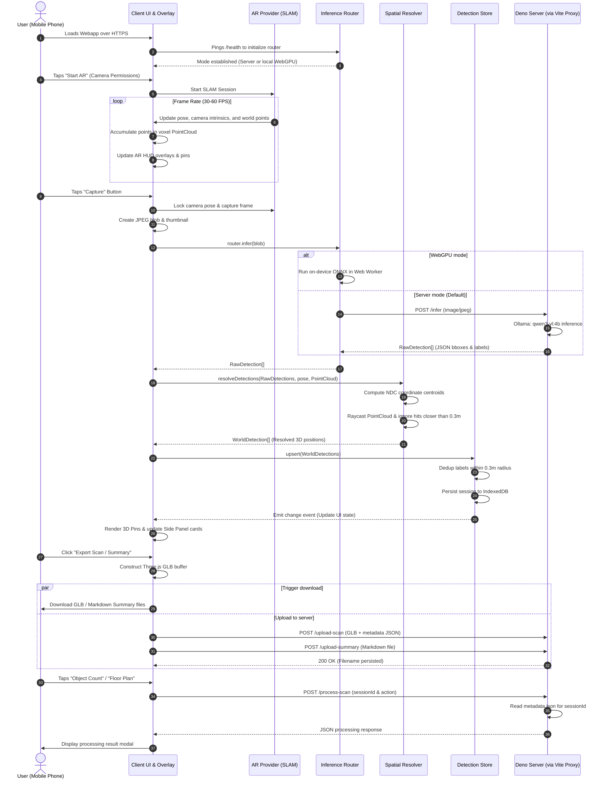
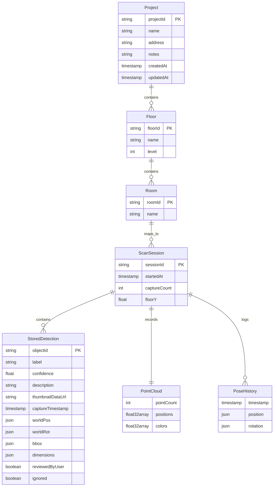
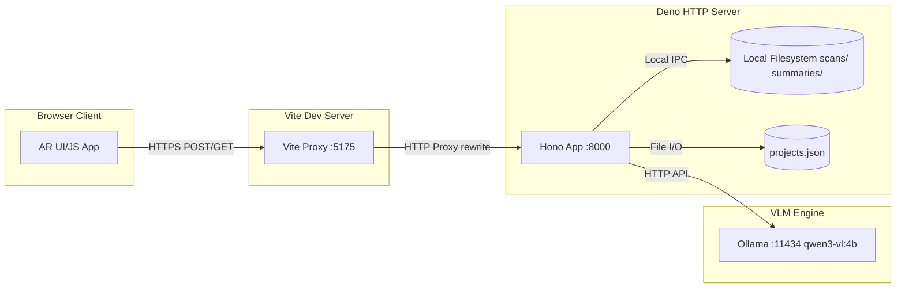
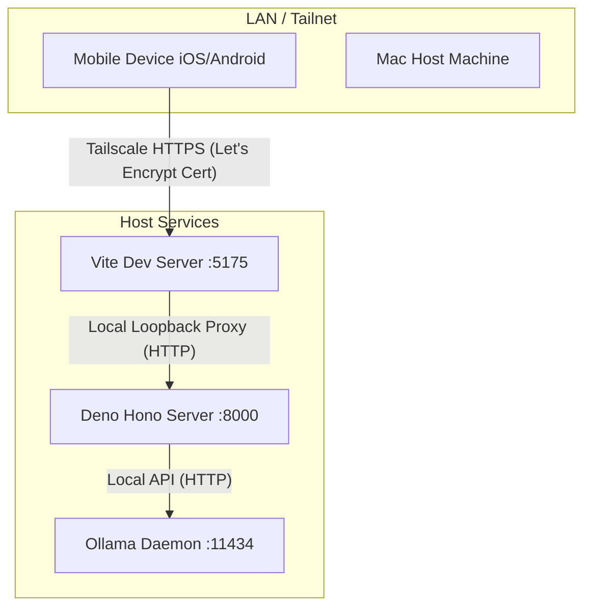
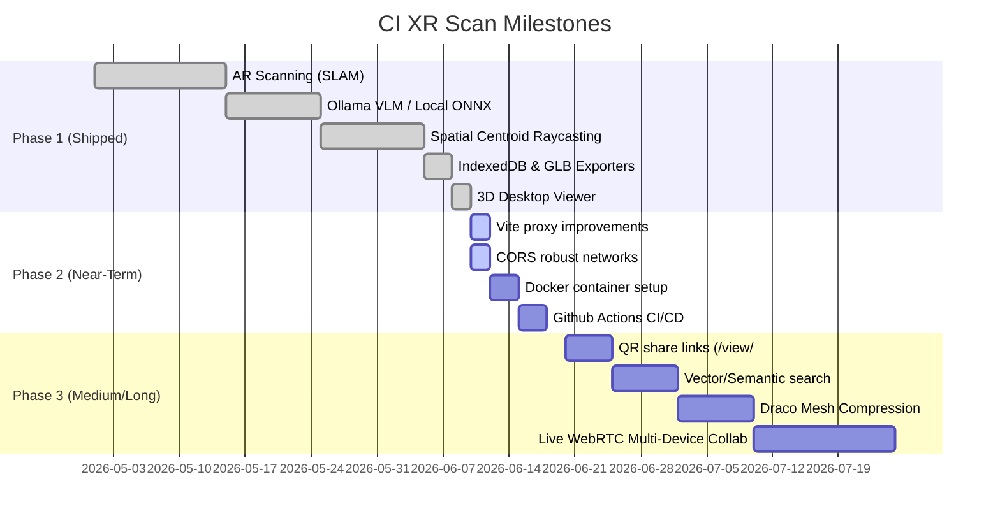

# CI XR Scan — System Architecture & Trace Documentation

CI XR Scan is a mobile-first, privacy-respecting Augmented Reality (AR) application designed to capture, reconstruct, and index physical rooms. It leverages SLAM tracking, frame capture, vision-language models (VLMs), spatial coordinate resolution, and persistent client-server storage.

---

## 1. High-Level System Architecture

The following block diagram represents the modular structure of the CI XR Scan system, showing the boundary between client-side components running in the mobile browser and server-side components running on the local host.

```mermaid
graph TB
    subgraph Mobile Client (HTTPS/Browser)
        ARProvider[AR Provider Abstraction]
        EW[8th Wall Provider]
        XR[WebXR Fallback]
        Scanner[SLAM Point Scanner]
        Capture[Capture Module]
        Router[Inference Router]
        Resolver[Spatial Resolver]
        Store[Detection Store]
        Overlay[AR HUD Overlay]
        Panel[UI Side Panel]
        History[History Drawer]
        Exporter[GLTF Exporter]

        ARProvider --> EW
        ARProvider --> XR
        EW --> Scanner
        Scanner --> PointCloud[(PointCloud Voxel Grid)]
        Capture --> Router
        Router --> Resolver
        Resolver --> Store
        Store --> IndexedDB[(IndexedDB Store)]
        Store --> Overlay
        Store --> Panel
        Store --> History
        Exporter --> ClientGLB[Download GLB]
    end

    subgraph Host Server (Deno + Ollama)
        Vite[Vite Dev Server/Proxy :5175]
        Deno[Hono HTTP Backend :8000]
        Ollama[Ollama VL Engine :11434]
        Storage[(Scans & Summaries folders)]
        ProjectsDB[(projects.json)]

        Vite --> Deno
        Deno --> Ollama
        Deno --> Storage
        Deno --> ProjectsDB
    end

    %% Network Connections
    Capture -- "POST /infer (proxied)" --> Vite
    Exporter -- "POST /upload-scan (proxied)" --> Vite
    Panel -- "POST /process-scan (proxied)" --> Vite
    History -- "POST /upload-summary (proxied)" --> Vite
```

---

## 2. Detailed User Flow

The following sequence diagram traces the user flow from initializing the AR scanner to uploading a finished room scan and summary to the server.



### Flow Phase Details
The end-to-end flow is divided into five stages:

| Stage | Process | Execution | Details |
|---|---|---|---|
| **1. Init** | AR & AI Setup | Client-Side | Checks WebGPU support and pings `/health`. Requests camera and motion permissions. |
| **2. Scan** | Continuous SLAM | Client-Side | Processes feature points, filters out degenerate points, projects 3D pins onto the camera frustum. |
| **3. Capture** | Object Detection | Hybrid | Grabs frame buffer, encodes JPEG, passes to Local Web Worker (WebGPU) or POSTs to `/infer` (Ollama qwen3-vl). |
| **4. Resolve** | Spatial Mapping | Client-Side | Resolves pixel-space bounding boxes to 3D coords by casting ray from NDC through camera, filtering distance, and deduping. |
| **5. Save / Export** | Persistence & Sync | Client-Server | Writes to IndexedDB. Generates `.glb` & `.md`. POSTs files to Deno via Vite proxy, saving files to `scans/` and `summaries/`. |

---

## 3. Data Model

The data model connects ephemeral tracking variables, client-side session records, and server-side metadata-rich scans.



### Data Fields Specification

#### StoredDetection
```typescript
interface StoredDetection {
  label: string;              // Class name returned by VLM
  confidence: number;         // Float [0.0, 1.0]
  description: string;        // Visual features/description from VLM
  bbox: [number, number, number, number]; // [x1, y1, x2, y2] normalized bounds
  worldPos: { x: number; y: number; z: number }; // 3D coordinates relative to SLAM origin
  worldRot: { x: number; y: number; z: number; w: number }; // Quaternion camera rotation
  captureTimestamp: number;   // Epoch timestamp of frame capture
  thumbnailDataUrl?: string;  // Base64 thumbnail data url
  captureIndex?: number;      // Sequence ID of capture
}
```

#### IndexedDB Session Store
The client-side persistence uses IndexedDB (via a custom wrapper) named `ci-xr-scan`.
- **Store name**: `sessions`
- **Key path**: `sessionId` (String formatted as `session-<timestamp>`)
- **Payload**: `{ sessionId: string, startedAt: number, detections: [string, StoredDetection][] }` (Map entries serialized as an array of tuples).

#### GLB Scene Node Hierarchy (`room-scan`)
When exporting, the Three.js scene graph is converted to a binary GLTF buffer. The nodes include custom metadata written to `node.userData`, which translates to the GLTF `extras` schema:
- **Scene Root**: `generator`, `pointCount`, `detectionCount`, `boundingBox`, `floorY`, and optional coordinates (`geoLat`, `geoLng`, `geoBearing`, `geoAddress`).
- **Floor Group**: Named `Floor_<ID>`, carries `{ type: "floor", floorName }`.
- **Room Group**: Named `Room_<ID>`, carries `{ type: "room", roomName, floorName, scanName }`.
- **Point Cloud Node**: Named `point-cloud`, contains raw positions and RGB height-color gradients.
- **Camera Path Node**: Named `camera-path`, contains the full camera trajectory positions.
- **Floor Plane Node**: Named `floor-plane`, carries `{ objectType: "estimated_floor", tag: "floor", widthM, depthM }`.
- **Detections Group**: Named `detections`, contains bounding meshes named `<label>_NNN`.
  - **Detections Mesh**: Contains box dimensions (`dimensions`), `objectId`, `label`, `class` (e.g. `furniture`), `description`, and `sourceScanIds`.

---

## 4. Client-Server Model

Communication is routed through Vite's dev server proxy to prevent Mixed-Content warnings in browser runtimes.



### API Routes & Interface Specification

| Endpoint | Method | Payload | Success Response (200/201) | CORS Origin Rule | Notes |
|---|---|---|---|---|---|
| `/health` | GET | None | `{"status":"ok","model":"..."}` | Allow matched origins | Liveness check; returns active server VLM identifier. |
| `/infer` | POST | Multipart Form `{ image: File }` | `RawDetection[]` | Allow matched origins | Routes to local Ollama inference engine. |
| `/upload-scan` | POST | Multipart Form `{ file: File(.glb), metadata?: JSON }` | `{"filename":"...","size":N}` | Allow matched origins | Saves `.glb` to `./scans/` and persists `.json` metadata sidecar. |
| `/scans` | GET | None | `[{ "filename": string, "size": number, "uploadedAt": string }]` | Allow matched origins | Lists uploaded files sorted by date (newest first). |
| `/scans/:filename`| GET | Filename parameter | Binary Stream (`model/gltf-binary`) | Allow matched origins | Serves GLB with cache header `public, max-age=3600`. |
| `/upload-summary` | POST | Multipart Form `{ file: File(.md) }` | `{"filename":"..."}` | Allow matched origins | Saves summary document to `./summaries/`. |
| `/process-scan` | POST | JSON `{ filename, action, sessionId }` | `{"action":"...","result":"..."}` | Allow matched origins | Triggers actions (e.g. `object-count`, `floor-plan`, `mesh-cleanup`). |
| `/projects` | GET | None | `Project[]` | Allow matched origins | Lists projects from `projects.json`. |
| `/projects` | POST | JSON `{ name, address, notes }` | `Project` (201 Created) | Allow matched origins | Creates a new project database entry with a default ground floor. |
| `/projects/:id` | GET | ID parameter | `Project` | Allow matched origins | Fetches project by ID. |
| `/projects/:id` | PUT | JSON `Project` | `Project` | Allow matched origins | Updates project by ID. |
| `/projects/:id` | DELETE| ID parameter | `{"ok":true}` | Allow matched origins | Removes project from repository. |
| `/rtc-signal` | GET | Query params: `room`, `role` | WebSocket Upgrade (101) | Handled by Deno WebSockets | WebRTC signaling relay between `phone` and `viewer`. |
| `/events` | GET | None | WebSocket Upgrade (101) | Handled by Deno WebSockets | Broadcast stream: `scan-added`, `job-update`, `session-*` events. The viewer subscribes to refresh its scan list and job chips live. |
| `/sessions` | POST | None | `{"sessionId":"sess-..."}` (201) | Allow matched origins | Opens a keyframe capture session (`scans/sessions/<id>/`). |
| `/sessions/:id/keyframes` | POST | Multipart `{ image: JPEG, meta: JSON }` | `{"ok":true,"index":N}` | Allow matched origins | Streams pose+intrinsics-tagged keyframes during a scan — the raw input for future dense reconstruction (photogrammetry / splats). |
| `/sessions/:id/finalize` | POST | JSON `{ glbFilename?, pointCount?, … }` | Session record | Allow matched origins | Links the session to its exported scan; enqueues optimization if needed. |
| `/sessions` / `/sessions/:id` | GET | — | Session record(s) | Allow matched origins | Inspect capture sessions. |
| `/scans/:filename/manifest` | GET | Filename parameter | `ScanManifest` JSON | Allow matched origins | Optimization artifact index (optimized + LODs + stage log). 404 until the job runs. |
| `/scans/:filename/optimize` | POST | Filename parameter | `Job` (202) | Allow matched origins | Manually (re-)enqueue the optimization job. |
| `/jobs`, `/jobs/:id` | GET | — | `Job[]` / `Job` | Allow matched origins | Persistent job queue state (`scans/jobs.json`). |

### Scan Optimization Pipeline (`pipeline.ts` + `jobs.ts`)

Every uploaded `.glb` is processed by an in-process, persistent job queue
(sequential worker — the box also runs VLM inference):

```
upload-scan ──▶ JobQueue('optimize-scan') ──▶ pipeline.ts (gltf-transform)
                                                  │ dedup + prune
                                                  │ point-cloud LODs (voxel 0.12 m / 0.30 m)
                                                  │ KHR_mesh_quantization (no decoder needed)
                                                  │ Draco (triangle meshes only, guarded)
                                                  ▼
        <base>.opt.glb  +  <base>.lod1.glb / .lod2.glb  +  <base>.manifest.json
```

Typical result: ~50 % size reduction from quantization alone; the coarsest LOD
is 5–20× smaller than the source. KTX2 texture compression is intentionally
deferred — scan GLBs carry no textures yet; `stats.textures` in the manifest
gates that stage when textured reconstruction meshes arrive.
Verify the pipeline standalone with `npm run smoke:pipeline` (plain Node, no
model or AR hardware required).

### Progressive Loading (World Scan Editor)

`loadScanIntoWorld` checks `/scans/:filename/manifest` first: when artifacts
exist it renders the coarsest LOD within a few hundred ms, then streams the
optimized full-quality GLB behind it and swaps atomically (camera, selection,
and visibility state preserved). `GLTFLoader` carries a `DRACOLoader`
(decoder copied to `public/draco/` by the npm `postinstall` hook). Unoptimized
scans fall back to the original single-pass load.

### Live Geometry Channel (phone → editor)

The WebRTC broadcaster's `scan-spatial-events` data channel carries, alongside
the video stream:

| Message | Payload | Cadence |
|---|---|---|
| `{t:'hello'}` | session start | on channel open |
| `{t:'pts', p:[x,y,z,…]}` | voxel-deduped point-cloud deltas | batched 500 ms / ≤1500 pts, dropped under backpressure |
| `{t:'dets', items:[…]}` | detection snapshot | throttled 1 s after store changes |
| `{t:'pose', p, q}` | camera pose | each scanner tick (~750 ms) |

The desktop editor accumulates these into a `live-scan-preview` layer
(dynamic-draw point buffer, capped at 500 k points) with live detection boxes
and a device frustum — the room appears in the editor while it is being walked.

### Keyframe Streaming (mobile capture budget)

`KeyframeStreamer` (☁ button in the AR app) triggers a keyframe when the
camera moves ≥ 0.30 m or rotates ≥ 20° (≤ 1 per 1.2 s). Frames are downscaled
to ≤ 1280 px JPEG and uploaded with pose + intrinsics. Guardrails: bounded
queue with capture-skip backpressure (memory stays flat), single upload in
flight with retry/backoff, offline pause, and suspension while the page is
hidden (battery). Exports finalize the session against the uploaded scan and
rotate into a fresh one.

---

## 5. Deployment Model

CI XR Scan is designed to be self-hosted, running either natively on local developer machines or inside Docker containers.



### Deployment Configuration & Environment Variables

The server configuration behaves dynamically based on local environments:

- `PORT`: Sets Hono's HTTP port (Defaults to `8000`).
- `ALLOWED_ORIGIN_PREFIX`: Base Tailscale origin for CORS filtering (Defaults to `https://liambook.capybara-ulmer.ts.net`).
- `SCANS_DIR`: Location where uploaded scan files are saved (Defaults to `./scans`).
- `SUMMARIES_DIR`: Location where uploaded Markdown summaries are saved (Defaults to `./summaries`).
- `PROJECTS_FILE`: Persistence path for the projects JSON database (Defaults to `./projects.json`).
- `INFERENCE_MODE`: AI runtime selection. Set to `onnx` to run Node ONNX sessions, or `ollama` (default) to utilize the local Ollama API.
- `OLLAMA_HOST`: Address of the local Ollama daemon (Defaults to `http://localhost:11434`).
- `OLLAMA_MODEL`: Target vision model running in Ollama (Defaults to `qwen3-vl:4b`).

---

## 6. Project Roadmap

The project is structured into three phases, moving from localized single-device capture to a multi-device collaborative room mapping ecosystem.



---

## 7. Shortcomings & Mitigations

The following matrix documents the architectural limitations of the current design and details their respective near-term and long-term mitigations.

| Shortcoming | Impact | Near-Term Mitigation | Long-Term Mitigation |
|---|---|---|---|
| **CORS Origin Fragility** | Client uploads fail if accessed on local IP subnets or non-standard hostnames. | Replace starts-with matching with regex allowing localhost, local IPs, and `.ts.net` domains (Done). | Implement token-based authentication session handshakes. |
| **Silent Backend Failures** | Uncaught route crashes return a generic response or drop connection without logging details. | Register Hono's `app.onError` to log full stack traces, and add handler-entry logs (Done). | Integrate central logger service (Winston / Deno log streams). |
| **Newest Scan Race Condition** | `/process-scan` processes wrong file if uploads fail or occur out of order. | Implement `sessionId` matching in companion JSON files to lookup scans (Done). | Require explicit `scanId` parameter in API request payloads. |
| **SLAM Coordinate Drift** | Detections lose alignment over long scanning durations (>10 mins). | Advise user via HUD to return to the origin/loop closure points. | Integrate visual-inertial loop closure (ORB-SLAM / WebXR anchor APIs). |
| **GLB File Size Overhead** | High point-cloud density leads to files exceeding 1 MB quickly. | Filter degenerate depth targets, voxel downsample to 5cm grid (Done). | Integrate Draco mesh encoder compression into the client export pipeline. |
| **No Authentication** | Anyone on the LAN/Tailnet can access, view, or delete stored scans. | Namespace uploads behind generated session identifiers. | Implement JWT-based auth gate on all state-modifying endpoints. |
