# CI-Spatial — UI/UX Manual

> **Current product model:** the scanner and uploader start with a Place
> selection, optionally choose an Area, and open the Companion Scan Spatial
> Editor at `/editor`. The top bar owns account, Place status, sharing, and
> view visibility; the left drawer owns Place/Scan management; the right drawer
> owns guided processing and review. See [PLACE_SCAN_DESIGN.md](PLACE_SCAN_DESIGN.md)
> for the authoritative UX contract.

A surface-by-surface guide to every screen and interactive control in CI-Spatial:
the mobile AR scanner (`index.html` + `src/main.ts` + `src/ui/*`), the WebXR landing
page (`webxr.html`), the phone smoke-test page (`public/smoke.html`), and the desktop
Companion Scan Spatial Editor (`/editor`, implemented by `viewer.html` + `src/viewer/*`).

All screenshots in `docs/ui-manual/` were captured from a live instance (Deno API in
`INFERENCE_MODE=mock`, Vite dev server, seeded with the generated test-home corpus and
the LingBot-Map fixture session) driven by Playwright — iPhone 15 viewport (393×852)
for the scanner pages, 1440×900 for the editor. Because the shots come from the
scripted XR8 mock, the "camera feed" shows the mock's colour-blob furniture palette
(sofa = orange, tv = blue, table = brown, plant = green) rather than a real room.

Contents:

1. [Start screen](#1-start-screen)
2. [Scanner HUD](#2-scanner-hud)
3. [Capture button](#3-capture-button)
4. [Action rail](#4-action-rail)
5. [Latest-scan dialog](#5-latest-scan-dialog)
6. [Side panel — Review & Export](#6-side-panel--review--export)
7. [History drawer — Scan Memory](#7-history-drawer--scan-memory)
8. [WebXR landing page](#8-webxr-landing-page)
9. [Smoke-test page](#9-smoke-test-page)
10. [Companion Scan Spatial Editor](#10-companion-scan-spatial-editor)
11. [Cross-cutting UX assessment](#11-cross-cutting-ux-assessment)

---

## 1. Start screen

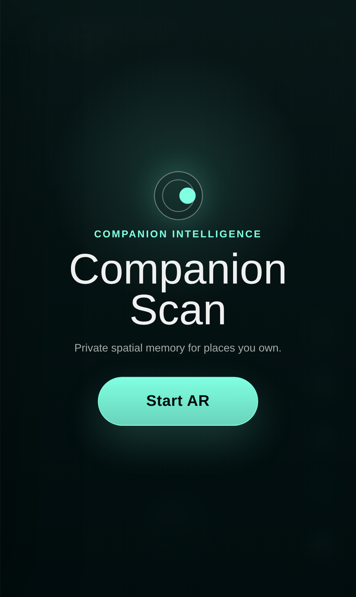

The first thing a user sees at `/`. A full-screen branded gate (`index.html:1107-1117`)
with the Companion Intelligence orbital mark, the product name, the one-line value
proposition ("Private spatial memory for places you own."), and a single call to
action.

### Controls

| Control | What it does | Source |
|---|---|---|
| **Start AR** button | Resolves the boot sequence: synchronously calls `DeviceOrientationEvent/DeviceMotionEvent.requestPermission()` (Safari requires this inside a real click handler with **no awaits before it**), removes the start screen, then starts the AR provider. | `src/main.ts:448-466`; rationale comment at `index.html:1106` and `src/main.ts:443-446` |
| **`#ar-help` hint** (hidden by default) | Populated and revealed only when no AR runtime is available — per-platform guidance (Safari/HelloXR on iOS, Chrome+ARCore on Android, "open on a phone" on desktop). | `src/main.ts:625-639`, markup `index.html:1116` |

State behaviour:

- On an insecure context (plain HTTP), the button is disabled at 40 % opacity and the
  HUD status line explains exactly what to run (`tailscale cert <host>`) —
  `src/main.ts:51-61`. This fails fast instead of letting camera/IndexedDB/XR
  permissions fail cryptically later.
- Before the tap, the status text under the HUD reads "Press Start AR to begin"
  (`src/main.ts:447`).

### Design intent

- The gate exists for **permission mechanics**, not marketing: iOS will only grant
  motion permission from a genuine user gesture, so the app cannot boot AR without a
  real button press. The screen turns that constraint into a branding moment.
- One primary action, huge tap target, mint-on-dark accent (`--ci-accent: #80ffe1`,
  `index.html:66`) that recurs across every surface — the user learns "mint = go".

### Improvement opportunities

- **No permission preview.** The tap immediately triggers motion + camera prompts with
  no explanation of *why* the app needs them. A one-line "Uses camera + motion to map
  the room — nothing leaves your network" under the button would raise grant rates and
  reinforce the privacy positioning already in the subtitle.
- **No secondary navigation.** From the start screen there is no path to the viewer,
  history, or the smoke page — a user who only wants to browse yesterday's scans must
  enter AR first. A quiet "Open 3D Viewer" text link would fix this.
- **Engine load state is invisible.** `xr.js` (~MB-scale SLAM binary) loads in the
  background; if the user taps before it's ready the app silently waits up to 3 s for
  `XR8` and then falls back (`src/main.ts:162`, `waitForXR8` at `709-724`). A tiny
  "engine loading…" indicator under the button would explain slow starts.
- **`#ar-help` appears only after failure**, below the fold of the user's attention. It
  should replace the button, not sit under it.

---

## 2. Scanner HUD

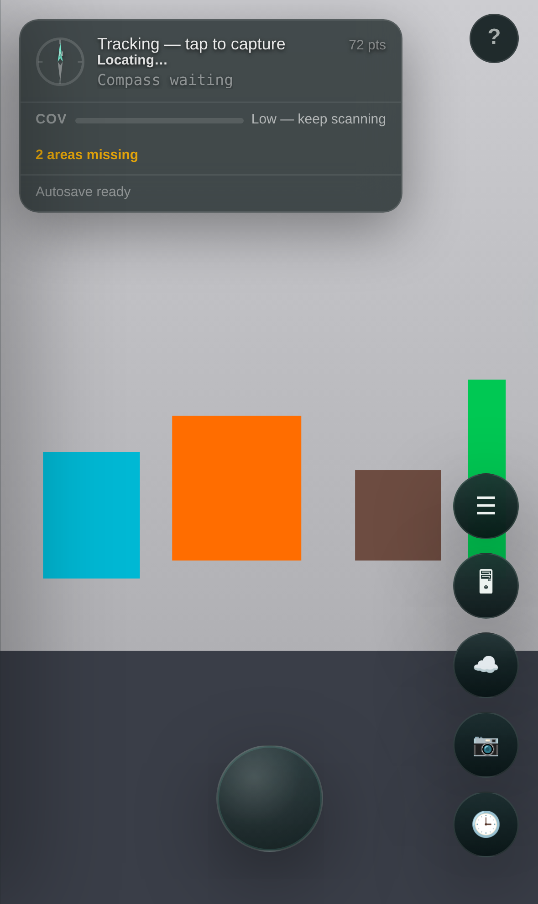

After Start AR, all passive status lives in **one unified top-left panel**
(`#hud-panel`, `index.html:1121-1192`, CSS `531-547`). It is a vertical stack of
sections separated by hairlines, each of which appears only when relevant:

1. **Status row** (`index.html:1124-1156`) — compass ring, primary status text, live
   point count, geo chip, progress bar.
2. **Coverage / quality section** (`index.html:1159-1173`) — hidden until the first
   quality tick.
3. **Autosave line** (`index.html:1175`).
4. **RTC LIVE row** (`index.html:1178-1181`) — only while broadcasting.
5. **Latest-scan dialog** (§5) — expands after a capture.

### Elements

| Element | Behaviour | Source |
|---|---|---|
| **Compass ring** | SVG needle rotates to the device bearing on each geo fix. | markup `index.html:1126-1139`, rotation `src/main.ts:862-864` |
| **`#status-text`** | The single narrative channel: engine readiness ("8th Wall ready"), tracking ("Move camera to initialise tracking…", "Tracking — tap to capture"), capture stages ("Capturing next frame...", "Analysing…", "3 objects detected"), warnings ("⚠ Moving too fast — slow down", "Tracking lost — move slowly"), and typed server-error guidance. | `src/main.ts:141,168,176,216,220,242,285-315,470,556,567-568` |
| **`#scan-stats`** | Live SLAM point count ("96 pts"), updated on every scanner tick that adds voxels. | `src/main.ts:551-553` |
| **Geo chip** | Reverse-geocoded address (ellipsised at 130 px) + raw lat/lng ± accuracy. | `src/main.ts:851-865`, CSS `index.html:510-528` |
| **Progress bar** | Determinate for model download (`overlay.setProgress`, `src/ui/overlay.ts:104-112`); switches to an indeterminate mint sweep while a capture is being inferred (`analyzing` class, CSS `index.html:597-606`, toggled `src/main.ts:222-226,238-240`). |
| **Coverage bar ("Cov")** | 0-100 % fill, red < 50 %, amber < 80 %, green ≥ 80 %, with text like "Low — keep scanning". | `src/main.ts:688-693` |
| **Quality badges** | "⚡ Fast / ↗ Speed" (drift risk), "🌑 Low light", "✦ Refl" (reflective surface), "N areas missing" — each shown only when its condition holds. | `src/main.ts:695-704`, markup `index.html:1167-1172` |
| **Autosave line** | "Autosave ready" → "Autosave queued" → "Saving scan..." → "Autosaved \<name\> · 07:54 AM". Autosave debounces 1.2 s after each capture and uploads a GLB snapshot. | `src/main.ts:344-380,606-609` |
| **RTC LIVE row** | Pulsing green dot + "LIVE · tap to stop"; the row itself is a button that stops the WebRTC broadcast. Visible only while streaming. | `index.html:1178-1181`, `src/main.ts:474-486` |

### Design intent

- **One panel, top-left**: everything passive is grouped into a single glanceable
  card, diagonally opposite the thumb zone, so no status ever sits under a finger and
  the camera view stays as clean as possible. `pointer-events: none` on the panel
  (`index.html:544`) means it never steals AR taps — only the LIVE row and dialog close
  button opt back in.
- **Safe-area aware** (`max(14px, env(safe-area-inset-*))`, `index.html:533-534`) so
  the notch/Dynamic Island never clips it.
- **Progressive disclosure**: coverage, badges, LIVE, and the scan dialog all occupy
  zero height until they have something to say.

### Improvement opportunities

- **`#status-text` is a lossy single channel.** Warnings, engine state, capture
  progress, and results all overwrite each other with no queue or timestamps — a "⚠
  Low light" can be clobbered milliseconds later by "4 objects detected"
  (`src/main.ts:229-233` races `242`). Split transient toasts from persistent state,
  or add a 2-line mini-log.
- **"Cov" is cryptic.** The label is abbreviated to three characters
  (`index.html:1161`) with no tooltip; first-time users can't know it means room
  coverage. Spell it out — the panel is 280 px wide, "Coverage" fits.
- **Type sizes are below comfortable minimums**: 10 px stats/geo coords
  (`index.html:572,404`) on a moving camera background. The panel's translucent
  backdrop helps, but 10 px monospace coordinates are decoration, not information —
  consider hiding raw lat/lng behind a tap on the address.
- **The accuracy figure can mislead**: "±0m" (visible in the screenshot, from the mock
  geolocation) should probably render as "±<1m" or be hidden below a threshold.
- **No tap affordances**: the compass and geo chip look interactive but aren't. Tapping
  the geo chip could open the history drawer's map, which already exists.

---

## 3. Capture button

The dominant control of the scanner: a 78 px circular button, bottom-centre, styled
like a camera shutter (`#capture-btn`, `index.html:1194`, CSS `121-153`).

| Behaviour | Source |
|---|---|
| Tap → `doCapture()`: waits up to 2.5 s for tracking, grabs the next camera frame, runs quality analysis, sends the JPEG to `/infer` (or the WebGPU worker), resolves detections into world space, merges them into the store, shows the latest-scan dialog, queues an autosave. | `src/main.ts:200-323` |
| While busy: `.busy` class → 50 % opacity, pointer-events off, plus `aria-busy`/`aria-disabled`. Re-entrant taps get "Capture already processing...". | CSS `index.html:150-153`, `src/main.ts:201-207,641-647` |
| During auto-capture inference a mint ring pulses around it (`.auto-busy::after`). | CSS `index.html:254-266`, toggled `src/main.ts:395-397` |
| Failures map typed `InferServerError` codes to actionable copy: timeout → "Server took too long", network → "is Tailscale connected?" / "You are offline", model-loading → "retry in a few seconds", unavailable → "try WebGPU in the panel". | `src/main.ts:288-315` |

### Design intent

- **Big, centred circle** = the universal camera-shutter convention; it's the one
  action a user performs dozens of times per scan, so it gets the largest target in
  the thumb-natural bottom-centre position, clear of both the HUD (top-left) and the
  rail (right). `bottom: calc(38px + env(safe-area-inset-bottom))` keeps it above the
  iOS home indicator (`index.html:124`).
- The glassy radial highlight and press-scale animation (`:active` scale 0.92,
  `index.html:145-148`) give physicality without any label — it reads as "shutter"
  purely by shape and placement.

### Improvement opportunities

- **Busy feedback is weak for long inferences.** Real server inference (gemma vision)
  takes ~20 s per frame; the only signals are a dimmed shutter and the indeterminate
  sweep in the far corner. Add elapsed time or progress on/near the button itself, and
  a way to cancel.
- **No shutter confirmation** (flash/haptic/sound). `navigator.vibrate` where available
  plus a 100 ms white-flash overlay would confirm the frame was taken even before
  analysis starts.
- **Disabled ≠ explained.** When tracking has not initialised, tapping produces status
  text far from the button. A brief shake animation or inline tooltip near the button
  would close the loop where the user is looking.

---

## 4. Action rail

The right-edge vertical stack of circular 48 px buttons
(`#scanner-action-rail`, `index.html:1195-1208`, CSS `761-790`).

Top to bottom:

| Button | Emoji | What it does | Appears/disabled | Source |
|---|---|---|---|---|
| `#xr-mode-link` | 🥽 | Switches AR runtime: 8th Wall → `/?ar=webxr` (native WebXR), or back to `/` when already in WebXR mode (then styled `.active`). | **Hidden entirely** when the browser can't run `immersive-ar` (why it's absent in these headless-capture screenshots). | `index.html:1196`, logic `src/main.ts:186-189,733-753` |
| `#panel-toggle` | ☰ | Opens/closes the Review & Export side panel (§6). Shows a mint badge with the detection count (`data-count` attr → `::after`). | Badge empty until first detection. | `index.html:1197`, badge CSS `743-759`, wiring `src/ui/panel.ts:75,188-193,217-219` |
| `#viewer-link` | 🖥 | Plain link to the Companion Scan Spatial Editor (`/editor`). | Always. | `index.html:1198` |
| `#stream-btn` | ☁️ | Toggles **keyframe streaming**: pose-tagged JPEG frames uploaded to the server session store during the scan (the input LingBot-Map reconstructs from). Green `.active` state + sent-count badge; title flags "OFFLINE" when uploads stall. | Always; state via `.active`. | `index.html:1199-1202`, `src/main.ts:411-441` |
| `#auto-capture-btn` | 📷 | Toggles **auto-capture**: fires `doCapture()` automatically on pose deltas ("move camera to scan"). Mint `.active` state + capture-count badge. | Always. | `index.html:1203-1206`, `src/main.ts:385-408` |
| `#history-btn` | 🕒 | Opens the Scan Memory drawer (§7) and lazily initialises its Leaflet map. | Always. | `index.html:1207`, `src/ui/history.ts:24-27`, map init `src/main.ts:130-132` |

### Design intent

- **Right-aligned, bottom-anchored column** = right-thumb reach for one-handed
  portrait scanning; `align-items: flex-end` + `env(safe-area-inset-right)` hug the
  edge (`index.html:764-770`). Frequency roughly increases downward — history and
  auto-capture (most-toggled) sit closest to the thumb, the runtime switch (rarest)
  furthest.
- Uniform 48 px circles with identical glass styling make the rail read as one
  component; state is encoded by colour (mint = mode active, green = streaming) and
  count badges rather than layout changes.

### Improvement opportunities

- **Emoji-only buttons are the rail's biggest discoverability problem.** ☁️ vs 📷 is a
  genuinely ambiguous pair — both plausibly mean "upload" or "camera". `title`
  attributes exist (`index.html:1199,1203`) but never show on touch devices. Add 8 px
  text micro-labels under each icon (the rail has room), or a first-run coach-mark
  pass.
- **Emoji render differently per platform** (and can render as monochrome tofu on some
  Android builds). Inline SVG icons would also allow the active state to recolour the
  glyph itself, not just the ring.
- **Six buttons + shutter is near the ceiling** for a 660-800 px-tall safe area; on an
  iPhone SE the top of the rail collides with mid-screen AR content. Consider
  collapsing rarely-used items (🥽, 🖥) behind a "…" overflow.
- **Two capture-ish toggles with badge + green/mint states** (stream vs auto-capture)
  encode an important conceptual distinction (server session recording vs local
  detection capture) purely by emoji. Grouping them visually with a hairline, or
  merging into a single "Recording…" mode sheet, would reduce mis-taps.

---

## 5. Latest-scan dialog

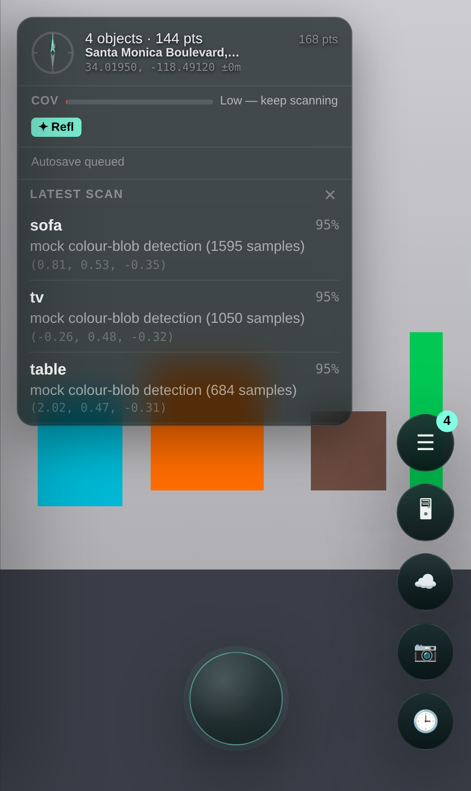

After every capture that produced detections, the bottom section of the HUD panel
expands (max-height transition, CSS `index.html:646-687`) into a "LATEST SCAN" list.

| Element | Behaviour | Source |
|---|---|---|
| Per-detection row | Label (bold), confidence %, model description, world position `(x, y, z)` in metres. | `src/main.ts:774-786` |
| **✕ close** | Collapses the dialog. | `index.html:1187`, binding `src/main.ts:767-770` |
| Auto-dismiss | Hides itself after **9 s** (15 s when reused for server-processing results, §6). | `src/main.ts:790-791,839-840` |

### Design intent

- Renders **inside** the HUD panel rather than as a modal: the user's eyes are already
  on the status text ("Analysing… → 3 objects detected"), so the results appear where
  the narrative was, without blocking the camera view or the shutter. The capture →
  result loop stays fully non-modal.
- Auto-dismiss keeps the panel from permanently eating a third of the screen during
  rapid-fire scanning; the full manifest is always available in the side panel.

### Improvement opportunities

- **9 s is tight for multi-object results.** Four detections with descriptions
  scroll past most readers; the timer isn't paused by interaction (scrolling the body
  doesn't cancel `_inferDialogTimer`). Pause auto-hide on touch, or dismiss on the
  *next* capture instead of on a clock.
- **Results appear top-left while the trigger is bottom-centre.** The eye-travel is
  mitigated by the status text, but a subtle scale/glow transition from the shutter to
  the panel would tie cause to effect for first-time users.
- **The ✕ is a 13 px target** (`index.html:675`) — well under the 44 px minimum;
  padding is trivial to add since the header row is full-width.
- **Rows are inert.** Tapping a detection should select it (the store already supports
  selection) and/or deep-link into the side panel card.

---

## 6. Side panel — Review & Export

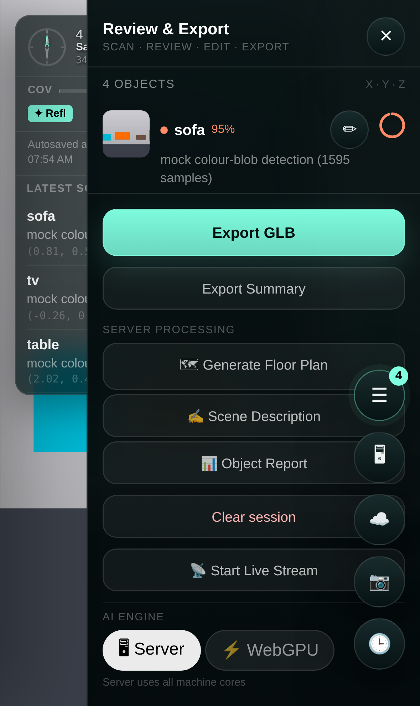

The full object manifest and every "do something with this scan" action. Slides in
from the right (`#side-panel`, width `min(312px, 86vw)`, CSS `index.html:690-709`),
opened via the ☰ rail button. Entirely constructed in `src/ui/panel.ts`.

### Header

- Title "Review & Export" with the workflow strip "SCAN · REVIEW · EDIT · EXPORT"
  (`panel.ts:59-65`) — orients the panel as the middle of a pipeline.
- **✕ close** (`panel.ts:66-71`).

### Detection cards (`panel.ts:250-401`)

Sorted by confidence descending (`panel.ts:232`). Each card:

| Control | What it does | Source |
|---|---|---|
| Thumbnail / colour swatch | Tap toggles selection of this detection (selected cards get mint left-border + tint; AR pins highlight via store subscription). | `panel.ts:274-284` |
| **✏ edit** | Reveals an inline form (label input + description textarea) with **Save**/**Cancel**; save writes through `store.updateDetection`. | `panel.ts:304-367` |
| Position badge | X·Y·Z in metres, colour-coded axes (mint/green/amber) matching the header legend "X · Y · Z". | `panel.ts:316-330,242` |
| Confidence ring | SVG arc showing confidence; tap = select/deselect (becomes a solid mint ✓ disc when selected). | `panel.ts:371-397` |

Empty state: "No objects yet. Tap the capture button to scan." (`panel.ts:221-229`).

### Footer actions (`panel.ts:77-182`)

| Button | What it does | Source |
|---|---|---|
| **Export GLB** (primary, mint) | Exports point cloud + detections + poses to GLB, downloads it *and* uploads to the server world; button self-labels through Exporting…/Exported/Export failed. If keyframe streaming is active, rotates the capture session with the uploaded filename. | `panel.ts:78-96`, callback `src/main.ts:101-114,325-342` |
| **Export Summary** | Downloads a JSON session summary (counts, quality, geo fix). | `panel.ts:98-105`, `src/main.ts:115` |
| **🗺 Generate Floor Plan / ✍ Scene Description / 📊 Object Report** | POST `/process-scan` with the action; result text is shown in the latest-scan dialog (title becomes "Server: \<action\>"). | `panel.ts:107-127`, `src/main.ts:804-841` |
| **Clear session** (danger-tinted) | Wipes the current detection store. **No confirmation.** | `panel.ts:129-134` |
| **📡 Start Live Stream** | Starts/stops the WebRTC broadcaster mirroring camera + points + detections to the Spatial Editor's Live panel; label swaps to "📡 Stop Stream". | `panel.ts:136-141`, wiring `src/main.ts:489-499` |
| **AI Engine: 🖥 Server / ⚡ WebGPU** | Switches the inference route at runtime; the note beneath flips between "Server uses all machine cores" and "On-device — no data leaves your phone". | `panel.ts:144-182,201-215`, `src/main.ts:117-121` |

### Design intent

- A **drawer, not a page**: scanning continues underneath; the AR session is never
  torn down to review results.
- The single mint **primary** (Export GLB) encodes the intended happy path; every
  other action is a ghost button. Danger (Clear session) is tinted `#ffb7b7` but kept
  visually quiet to avoid accidental taps — see caveat below.
- The AI toggle surfaces the privacy trade-off *at the point of choice*, in plain
  words rather than settings-page prose.

### Improvement opportunities

- **Clear session destroys data with zero friction** (`panel.ts:133`) and sits in the
  same visual column as Export. It needs a confirm step (or undo toast) — this is the
  single riskiest control on the phone surface.
- **Server-processing buttons are fire-and-forget with no busy state.** After tapping
  "Generate Floor Plan" the only feedback is HUD status text behind the panel
  (`src/main.ts:806`); the button itself never disables, so double-submits are easy.
- **Footer crowds out content**: with all options wired, the footer (7 buttons + AI
  section) consumes more height than one detection card on a 852 px phone. Collapse
  Server Processing behind an accordion.
- **Scroll affordance**: the object list header shows counts, but nothing indicates
  the list scrolls independently of the pinned footer — a fade-out mask at the list
  bottom would help.
- **Iconography drift**: footer emojis (🗺 ✍ 📊 📡 🖥 ⚡) again vary by platform and
  don't match any icon used in the rail for the same concepts (☁️ is streaming in the
  rail; 📡 is streaming here).

---

## 7. History drawer — Scan Memory

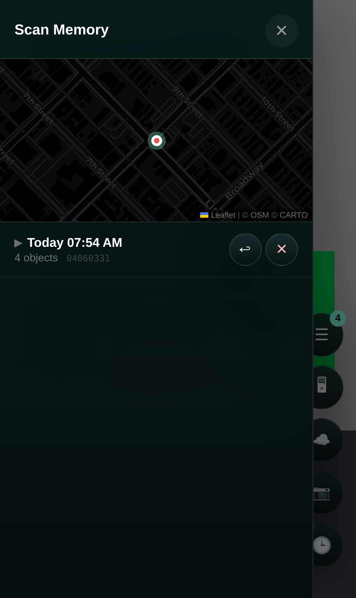

Slides in from the **left** (`#history-drawer`, CSS `index.html:352-386`), opened via
🕒. Lets the user browse and reload previous sessions from IndexedDB without
re-scanning. Implemented in `src/ui/history.ts`; map in `src/main.ts:884-947`.

| Element | Behaviour | Source |
|---|---|---|
| **✕ / backdrop / Escape** | Three ways to close. | `history.ts:26-36` |
| **Geo map** | Lazy-initialised Leaflet map on first open — dark CARTO tiles, mint dot = current GPS fix, red dots = every server-side scan location (`/scan-locations`), with address popups. Placeholder "Acquiring location…" until then. | `src/main.ts:1359-1437`, markup `index.html:1225-1232` |
| **Session card** | "Today 07:54 AM · 4 objects · \<id suffix\>"; header click expands an inline detection list (animated max-height). | `history.ts:78-179` |
| **↩ load** | Loads that session's detections into the live store and closes the drawer — pins reappear in AR. | `history.ts:117-126` |
| **✕ delete** (red-tinted) | Fades the card out and deletes the session from IndexedDB. **No confirmation.** | `history.ts:128-141` |
| Detection rows (expanded) | Colour dot, label, coords, confidence; for the **active** session only: ☑/☐ select toggle and ✏ edit popover (save/cancel). Non-active sessions are read-only. | `history.ts:233-331` |

### Design intent

- Opposite-edge drawers give the two "meta" surfaces distinct spatial identities:
  **right = current session** (review/export), **left = past sessions** (memory). The
  drawer titles reinforce it ("Review & Export" vs "Scan Memory").
- The map header immediately answers "where have I scanned?" — a spatial product gets
  a spatial index, not just a list.

### Improvement opportunities

- **Delete needs a confirm/undo** — same severity as Clear session; the 200 ms fade is
  the only warning (`history.ts:135-138`).
- **↩ is an obscure glyph for "load".** Worse, its consequence (replacing the current
  in-AR pin set) is invisible until the drawer closes. Label it "Load" and toast
  "Loaded session from Today 07:54".
- **Read-only vs editable sessions look identical** until you notice the missing
  checkboxes. A "current session" chip on the active card would explain why other
  cards can't be edited.
- **The temporary-load hack can glitch state**: `_populateDetections` loads a foreign
  session into the live store, snapshots, then pokes private fields to restore
  (`history.ts:199-213` — `this.store['_detections'] = saved`). Any subscriber firing
  mid-read (e.g. the AR overlay) briefly renders the wrong session's pins. A read-only
  store query would be safer and simpler.
- **Empty map fallback**: with no fix and no server, the drawer shows both the map
  placeholder *and* an empty session list — two stacked empty states. Collapse the map
  section entirely when there's nothing to plot.

---

## 8. WebXR landing page

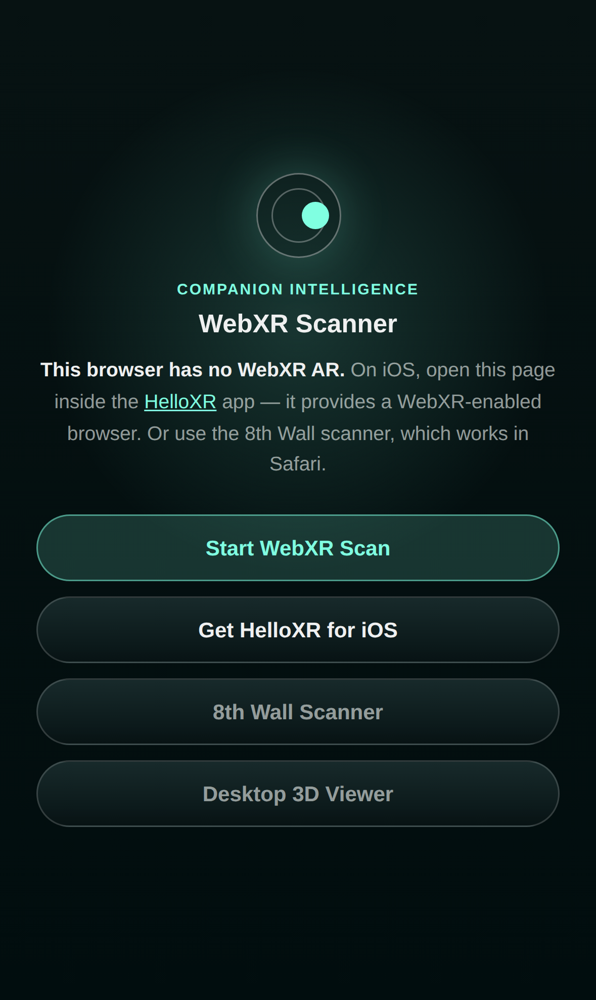

`/webxr.html` — the router/education page for the alternative AR runtime
(`webxr.html:94-139`).

| Control | What it does | Source |
|---|---|---|
| Auto-detection | On load, if `navigator.xr.isSessionSupported('immersive-ar')` resolves true, the page **immediately redirects** to `/?ar=webxr` ("Opening scanner…"). Otherwise it renders per-platform guidance in `#xr-status`. | `webxr.html:116-138` |
| **Start WebXR Scan** (primary) | Manual entry to `/?ar=webxr` — the scanner then skips loading `xr.js` entirely (`index.html:35`) and boots the WebXR provider. | `webxr.html:100`, `src/main.ts:150-162` |
| **Get HelloXR for iOS** | App Store link; hidden unless the device is iOS without WebXR. | `webxr.html:101,127-132` |
| **8th Wall Scanner** / **Desktop 3D Viewer** | Fallback navigation. | `webxr.html:102-103` |

The screenshot shows the iOS-without-WebXR state (headless Chromium reports no
`immersive-ar`, and the iPhone UA triggers the HelloXR path).

### Design intent

- The page absorbs all the "which runtime do I have?" complexity so the scanner itself
  never has to explain it: capable browsers never even see this page (instant
  redirect), incapable ones get a short diagnosis in bold plus ranked next steps —
  primary styled action first, subtle fallbacks below.

### Improvement opportunities

- **The auto-redirect can trap users**: someone who lands here to read about WebXR on
  a capable device is bounced instantly with no way back to the explanation. Delay the
  redirect by a beat with a "Continue / stay" affordance, or only auto-forward when
  arriving from the 🥽 button.
- **No explanation of *why* to choose WebXR vs 8th Wall** (native session vs SLAM
  binary; battery/quality trade-offs). One sentence per option would let users make an
  informed pick instead of a label-based guess.
- **"Start WebXR Scan" still shows when detection failed** — tapping it leads to the
  scanner's dead-end "WebXR not available" state (`src/main.ts:178-181`). Disable or
  demote the primary button in the unsupported branch.

---

## 9. Smoke-test page

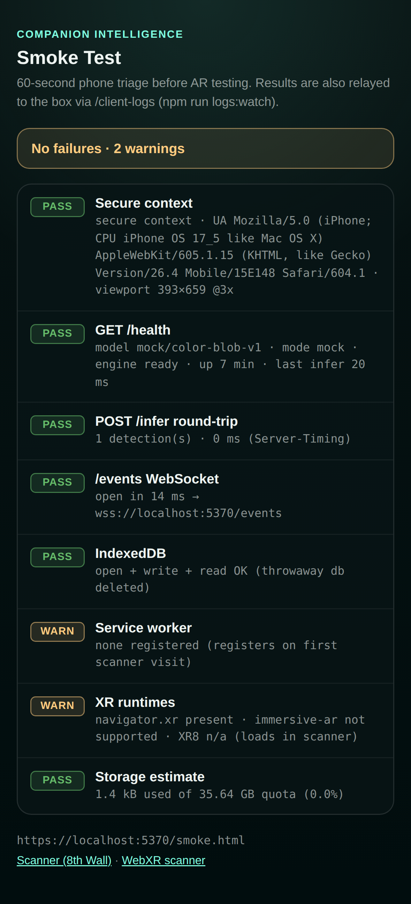

`/smoke.html` — a dependency-free, plain-script triage page ("60-second phone triage
before AR testing", `public/smoke.html:113`). Eight sequential checks, each a row with
a PASS/WARN/FAIL badge and monospace detail; the summary pill at the top aggregates
(green all-pass / amber warnings / red failures) — `public/smoke.html:317-335,353-364`.

The checks (`public/smoke.html:171-314`): secure context + UA/viewport, `GET /health`
(model/mode/engine/uptime), `POST /infer` round-trip with a synthesized sofa-orange
canvas (uses the CV palette so the mock engine must detect it), `/events` WebSocket,
IndexedDB write/read on a throwaway DB, service-worker registration state, XR runtimes
(WebXR + XR8 global), and storage quota estimate.

There are **no interactive controls** beyond two footer links back to the scanners;
results are also relayed to the box via `POST /client-logs` so a developer watching
`npm run logs:watch` sees the phone's results without touching it
(`public/smoke.html:337-351`).

### Design intent

- Built for the *device-testing loop*, not end users: zero imports and no build step
  means it loads even when the module pipeline is broken — precisely when you need it.
  The infer check deliberately times out at 75 s, past the server's 60 s cap, so a
  cold model produces the server's typed 504 rather than an ambiguous client abort
  (`public/smoke.html:206-208`).

### Improvement opportunities

- **No re-run button** — after fixing Wi-Fi/certs you must pull-to-refresh; a "Run
  again" button (and per-row retry for the slow infer check) would tighten the loop.
- **No copy/share of results** — the relay covers the connected case, but when the box
  is unreachable (the main failure mode being diagnosed!) there's no "copy results"
  for pasting into chat.
- Rows render sequentially and the page is silent about which check is *currently*
  blocking (the infer check can sit at "running…" for over a minute); elapsed-time
  ticking in the running row would show liveness.

---

## 10. Companion Scan Spatial Editor

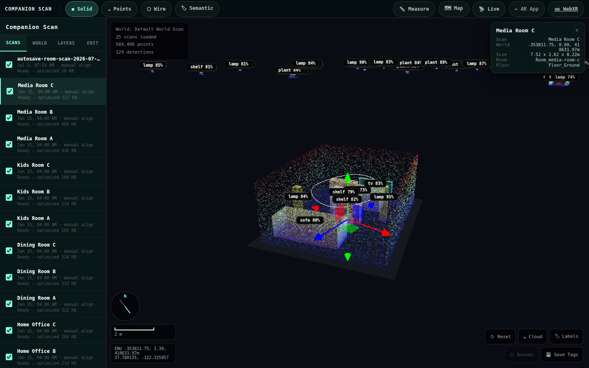

`/editor?project=<id>` — the desktop surface where scans become a persistent,
editable Place. The implementation remains `viewer.html`: the top bar owns account,
Place status, sharing, and a unified Views menu; the left drawer owns Place/Scan
management; the right drawer owns guided processing and review. The viewport
retains the Three.js scene and floating HUD elements. Logic lives in
`src/viewer/viewer.ts` (+ `measure.ts`, `geomap.ts`, `livefeed.ts`, `lingbot-map.ts`).

The screenshot shows the seeded test-home world with "Media Room C" selected: fitted
camera, per-object labels, transform gizmo, and the floating inspector (top-right).

### 10.1 Top bar

| Control | What it does | Source |
|---|---|---|
| **Companion Scan + account** | Compact two-line product mark followed by the signed-in Companion Intelligence account link. Portal OIDC identifies the user; it is separate from later Companion Memory publishing. | top bar |
| **Place status** | Current Place name, scan count, layer count, and current/total processing jobs. | top bar |
| **Share** | A compact dropdown for one Place with copyable **View**, **Comment**, **Edit**, **Scanner**, and **Owner** capability links. | `#share-menu`, `#share-links` |
| **Views** | Independent on/off controls for GIS map, hit points, ground planes, scanned objects, camera trail, image frustums, scanned images, ground grid, and tags. Render style is a view setting, not a row of persistent toolbar buttons. | `#view-menu` |
| **📏 Measure** | Toggles the two-click measurement tool (below). | `viewer.html:815`, `viewer.ts:1877-1883` |
| **🗺 Map** | Toggles the geo-map drawer (Leaflet, scan pins). | `viewer.html:816`, `viewer.ts:1866-1870` |
| **📡 Live** | Toggles the live-feed panel (WebRTC stream from a phone mid-scan; live frustum + points + detections). | `viewer.html:817`, `viewer.ts:1872-1875`, `livefeed.ts` |
| **← AR App / 🥽 WebXR** | Navigation back to the phone scanner surfaces. | `viewer.html:818-819` |

On small screens the bar prioritises the current Place, Views, Share, and the
drawer chevrons; information that does not fit moves into the relevant drawer
rather than becoming a horizontal row of tiny buttons.

#### Measurement tool

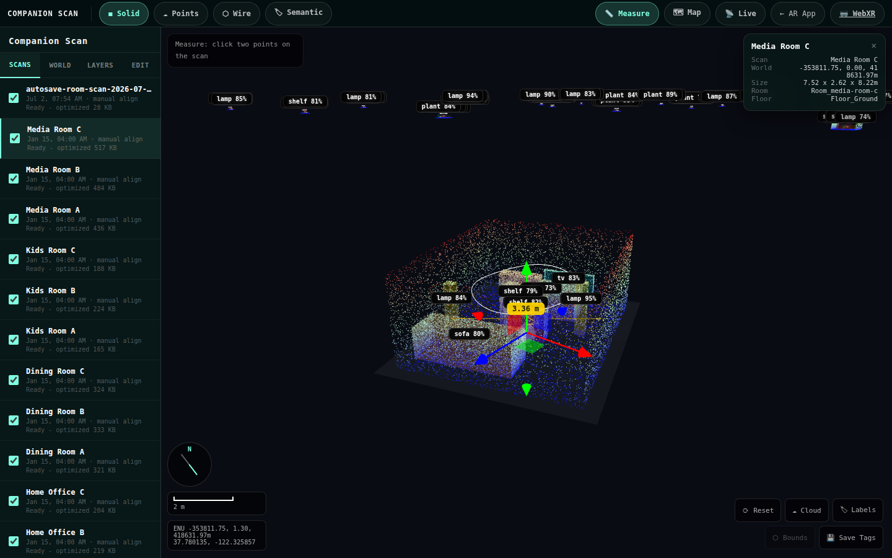

Click 📏 (button gains `.active`, HUD info reads "Measure: click two points on the
scan"), then click two points on any mesh/point cloud. A yellow marker pair + line is
drawn with a "3.36 m" pill label that re-projects every frame; a third click starts a
new measurement, and toggling off clears everything. Raycasts respect object
visibility and exclude its own overlay (`src/viewer/measure.ts:66-86,104-139`; click
routing `viewer.ts:225` region). The world is metric ENU, so measurements are
ground-truth against `expected.json` in tests. Exposed as `window.__measureTool`
(`viewer.ts:96-98`).

### 10.2 Left drawer — Place and Scan management

- **Project** = current Place details, global/GIS anchor, Area structure, sharing
  context, and time range.
- **Scan row** = visibility checkbox + name + meta (captured date, alignment/accuracy,
  Place/Area provenance)
  + status line. The checkbox toggles the scan's whole subtree without selecting it
  (`viewer.ts:444-457`); clicking the row selects the scan, attaches the transform
  gizmo, opens the inspector + Edit tab, and **fits the camera** to it
  (`viewer.ts:476-478,933-946`).
- Status lines narrate the progressive load pipeline: "Loading GLB..." → "Preview 12
  KB..." → "Preview shown - loading full quality..." → "Ready - optimized 517 KB -
  draco" (`viewer.ts:488-509`) — the coarsest LOD appears within a few hundred ms
  while the Draco full-quality GLB streams in behind it.

### 10.3 Left drawer — Project, Layers, Places, and Edit

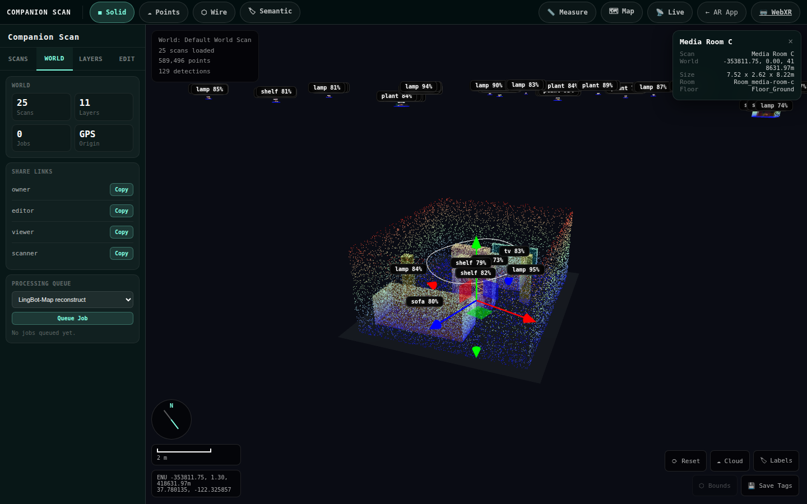

| Section | Contents | Source |
|---|---|---|
| **Project details** | Scan/layer/job counts, GIS or local origin, and the Place/Area hierarchy. | left drawer |
| **Layers** | Map quality and source layer visibility belong here, below navigation. Each layer remains independently toggleable. | left drawer |
| **Places** | Create/rename Areas (building, floor, room, zone, outdoor) and assign scans without changing their capture provenance. | left drawer |
| **Edit** | Adjust a selected scan/object transform, semantic tag, or notes. | left drawer |

### 10.4 Right drawer — guided processing and review

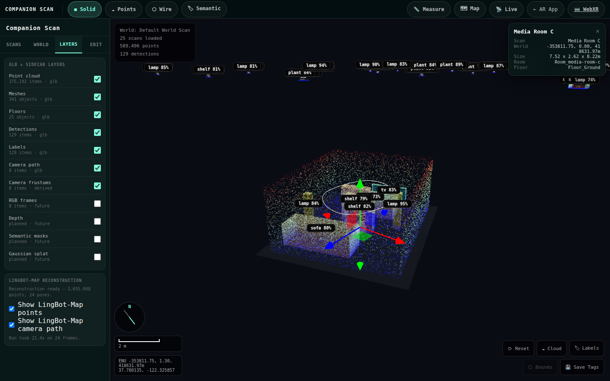

- **Guided stages**: **Prepare** (metadata/layers/alignment), **Understand**
  (semantic analysis and Things), **Reconstruct** (LingBot-Map and splats), and
  **Publish** (Companion Memory/export). Each stage requires an explicit selected
  scan where applicable and records its job history.
- **Scene layers**: one checkbox per layer type (point cloud, meshes, floors,
  detections, labels, camera path, camera frustums, RGB frames, depth, semantic masks,
  Gaussian splat) with item counts and provenance ("glb" / "derived" / "future");
  toggles drive global layer visibility (`viewer.ts:1182-1215`, counts
  `1305-1325`, visibility model `1329-1372`).
- **LingBot-Map Reconstruction** section (`viewer.html:906-920`): status text explains
  the state machine — no session → "no streamed keyframes"; no manifest → "Queue the
  lingbot-map-reconstruct job"; ready → "Reconstruction ready — 3,655,008 points, 24
  poses." with run stats (`viewer.ts:948-999`). Two checkboxes toggle the dense-point
  overlay and camera-path overlay under the selected scan (`viewer.ts:1857-1862`).
- **Trained Splat** section: when the selected scan has been through the
  `splat-train` world job (Brush), shows "Trained splat ready — N gaussians" with
  train timing, and a **Show trained splat** toggle that loads the served `.ply`
  into a SparkJS `SplatMesh` under the scan root (`src/viewer/splat-layer.ts`,
  `viewer.ts:1027-1084`). Skipped/failed runs surface their reason inline
  ("Skipped: …" / "Splat train error: …") instead of loading anything.
- **Gaussian Splats** manual loader (from the Spark viewer work): URL field + file
  picker for viewing any external `.ply/.spz/.splat/.ksplat` asset alongside
  scans — independent of the per-scan trained-splat pipeline.

*Above: a real Brush-trained splat (334,681 gaussians, 15k iterations) rendering in
the Spatial Editor next to the seeded test homes.*

**Improvement opportunities (splat layers)**
- The generic layer list still shows a "Gaussian splat — planned · future" row even
  though the Trained Splat section below it is now real — the stale row should be
  removed or wired to the same state.
- Three adjacent splat-related panels (layer row, Trained Splat, manual Gaussian
  Splats) carry different mental models (per-scan pipeline artifact vs ad-hoc viewer
  asset); a single merged section with a source badge would read better.
- Loading a 50 MB `.ply` gives no progress feedback — status flips from "Loading
  trained splat…" straight to ready; a byte-progress indicator would help on phones.

### 10.5 Review and editing

Empty-state copy: "Click a scan or object in the viewport to move it, label it, and
assign semantic categories." With a selection:

| Control | What it does | Source |
|---|---|---|
| **Move / Rotate / Scale** | Switches the viewport transform-gizmo mode. | `viewer.html:941-947`, `viewer.ts:1846-1848` |
| **Save Transform** | Persists the gizmo transform as a Place patch. | `viewer.ts:1842-1844` |
| **Semantic tag grid** | One-active chip set (sofa/table/door/...); selection recolours in semantic mode and queues a tag write. | `viewer.ts:1766-1782` |
| **Notes + Save Notes** | Free-text note stored on the object. | `viewer.ts:1784-1792` |
| **Hide Object (saved as patch)** | Non-destructive hide persisted server-side. | `viewer.ts:1885-1891` |

### 10.6 Viewport HUD

- **`#hud-info`** (top-left): world name, scans loaded, point + detection totals
  (`viewer.ts:1533-1552`); also repurposed for tool hints ("Measure: click two
  points…").
- **World HUD** (bottom-left, `viewer.html:991-1000`): compass that tracks the camera
  heading, an adaptive scale bar that picks a round metre value spanning 58-130 px at
  the current zoom, and an ENU + lat/lng readout of the orbit target
  (`viewer.ts:1554-1599`).
- **Inspector panel** (top-right, `viewer.html:1003-1007`): name, world position,
  size, room/floor of the clicked scan or object, with ✕ to clear selection
  (`viewer.ts:1036-1062`).
- **HUD controls** (bottom-right, `viewer.html:1010-1016`): **⟳ Reset** (re-fit
  camera, `viewer.ts:1805`), **☁ Cloud** (point-cloud visibility, `1815`), **🏷
  Labels** (`1822`), **⬡ Bounds** (detection boxes, `1829`), **💾 Save Tags** (flush
  pending tag edits, `1834`). Off states render at 40 % opacity
  (`viewer.ts:1354-1362`).
- **Placeholder** teaches the camera controls before any scan loads: "Mouse: rotate ·
  Scroll: zoom · Right-click: pan" (`viewer.html:982-986`).

### Design intent

- **Monospace/terminal styling** (`viewer.html:44`) deliberately contrasts with the
  phone app's humanist face: this is the operator/workbench surface.
- The four tabs mirror the data model: *Scans* (inputs) → *World* (assembly + jobs) →
  *Layers* (derived artifacts) → *Edit* (curation). Selection state flows across
  panels — clicking geometry updates the list, inspector, Edit tab, and LingBot panel
  simultaneously (`viewer.ts:933-946,1011-1022`).
- Progressive LOD loading plus per-scan status text keeps a 24-scan world interactive
  within seconds while being honest about what's still streaming.

### Improvement opportunities

- **Label storms**: with 24 scans loaded, 3D labels pile up along the horizon (visible
  at the top of the overview shot) and occlude each other. Cull labels by distance/
  screen density, or only show labels for the selected scan by default.
- **Two disconnected geo clusters silently break the overview**: a world containing
  scans geo-anchored in different cities fits the camera to a mostly-empty box (this
  happened in capture — an autosaved phone scan at one location + test homes at
  another). Detect multi-cluster worlds and offer "focus largest cluster" instead of a
  raw fit.
- **Jobs feedback is poll-once**: `queueSelectedJob` refreshes after 1 s
  (`viewer.ts:1296`), but long jobs (LingBot reconstruct) never update again without a
  manual tab revisit; the Jobs stat can read "0" even while work runs. The `/events`
  WebSocket already exists — push job status through it.
- **Measure lacks affordances beyond entry**: no escape-key exit, no "click 1 of 2"
  progress indicator, and the only reading is the 3D pill (no sidebar list of past
  measurements to copy).
- **HUD-button state = opacity only** (`viewer.ts:1354-1362`) — 40 % vs 100 % is hard
  to judge for colour-low-vision users and invisible in bright rooms; reuse the
  `.active` pill treatment the toolbar already has.
- **Copy buttons flash but don't confirm failure**: clipboard writes can reject on
  non-secure/permission-denied contexts and the catch is silent (`viewer.ts:1261-1268`
  region). Surface an error state.
- **Edit-tab save buttons don't disable while in flight** (Save Transform/Notes/Tags),
  so slow networks invite double-submission.

---

## 11. Cross-cutting UX assessment

### Information architecture

The product splits cleanly into **capture** (phone scanner), **triage** (smoke page),
and **curation** (Spatial Editor), and each surface's layout matches its job: the
scanner keeps chrome in the periphery of a camera view (status top-left, actions
right, shutter bottom-centre, two opposite-edge drawers); the editor is a classic
inspector-workbench. Cross-navigation is complete (rail 🖥 → viewer; viewer "← AR
App" / 🥽 → scanners; smoke page footer links) — but it is **one-directional in
prominence**: the phone can reach everything, while the start screen offers nothing
except AR entry. The weakest IA seam is the *conceptual* one on the phone: three
different "recording" ideas (capture, auto-capture, keyframe streaming, live RTC
broadcast) are spread across the rail (☁️/📷), the panel footer (📡), and the HUD LIVE
row, with no place that explains how they relate.

### Iconography

The design system is otherwise disciplined (one accent colour, consistent glass
surfaces, uniform pill/circle shapes), but the icon language is **emoji throughout**
(🥽 ☰ 🖥 ☁️ 📷 🕒 📏 🗺 📡 ✏ ↩ ⟳ 💾). Consequences: platform-dependent rendering,
no colour control (emoji ignore `color`, so active states only recolour rings),
several near-synonyms (☁️ rail = stream keyframes, ☁ viewer = point cloud, 📡 panel =
RTC stream), and zero text labels on touch devices where `title` never shows. A small
inline-SVG icon set with 8 px captions on the rail would resolve discoverability,
consistency, and a11y in one change.

### Feedback loops

The capture → inference loop is well-instrumented for the *fast* path (busy shutter,
"Analysing…" sweep, typed error copy, autosave narration — `src/main.ts:200-323` is
genuinely good error UX). It degrades on the *slow* path that production hardware
actually has (~20 s/frame vision inference): an indeterminate sweep with no elapsed
time, no queue position for stacked auto-captures, no cancel, and a results dialog
that can expire (9 s) faster than the inference that produced it took to run. The
editor's job system has the inverse problem — instant queueing feedback, then silence.
Both would be fixed by the same primitive: a persistent, timestamped activity feed
(the `/events` socket already carries the data server-side).

### Top 5 highest-value UX fixes (ranked)

1. **Confirm/undo for destructive actions** — "Clear session" (`panel.ts:129-134`)
   and history "✕ delete" (`history.ts:128-141`) irreversibly destroy user data in
   one unlabelled tap, adjacent to frequent controls. Cheapest fix with the highest
   downside-prevention.
2. **Label the action rail** (and swap emoji for SVG): 8 px captions under the six
   rail buttons. Nearly every "what does this button do?" failure on the phone traces
   to this one component.
3. **Honest long-inference feedback**: elapsed-time counter + cancel on the busy
   shutter, and keep the latest-scan dialog open until the next capture instead of a
   9 s timer (`src/main.ts:790-791`). This is the core loop; 20 s of dead air is
   currently the product's defining feel on real hardware.
4. **Push job/scan status over `/events` into both surfaces** — live job progress in
   the Spatial Editor's guided processing drawer and "keyframes → reconstruction ready" notifications on the
   phone. Closes the loop that currently ends at "Queued".
5. **Status-channel separation in the scanner HUD**: persistent state (tracking,
   coverage) vs transient toasts (warnings, results) so messages stop overwriting
   each other (`#status-text` today is last-writer-wins across ~15 call sites).

---

*Generated 2026-07-02 against an isolated instance (mock inference, seeded test-home
corpus, LingBot-Map fixture). Screenshots: Playwright Chromium — iPhone 15 emulation
for mobile surfaces, 1440×900 for the editor. One capture caveat: the 🥽 runtime
switch is hidden in the scanner screenshots because headless Chromium reports no
`immersive-ar` support (`src/main.ts:186-189`) — on a real phone with WebXR it appears
at the top of the action rail.*
