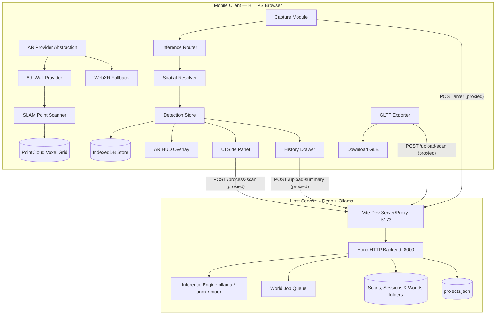
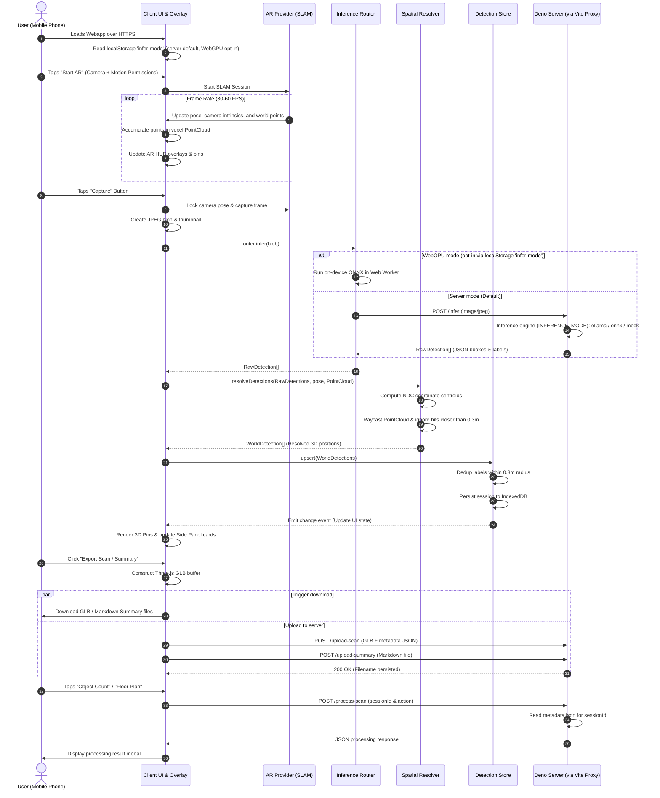
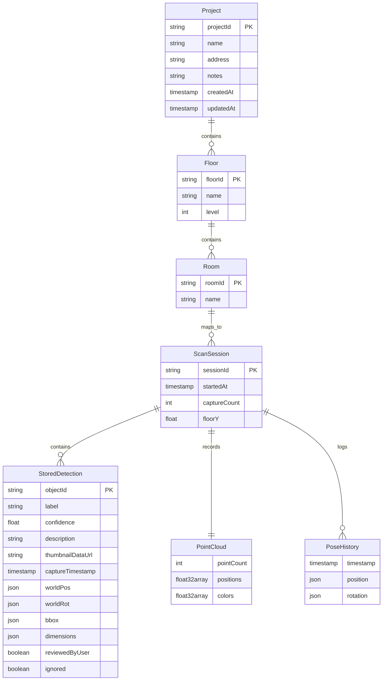
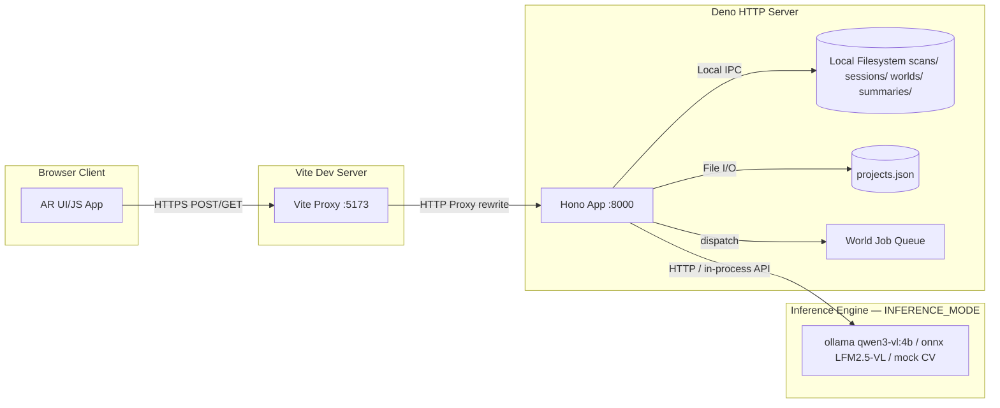
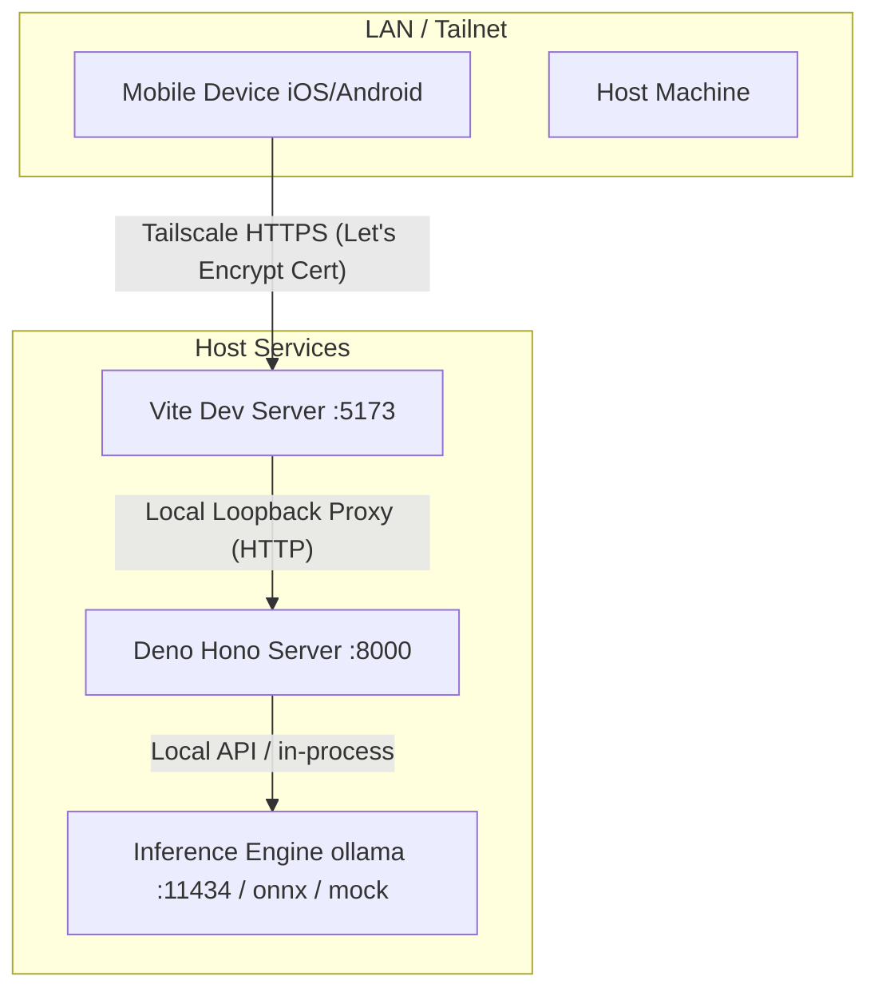

# Companion Scan — System Architecture & Trace Documentation

> **Product model note:** the user-facing hierarchy is **Place → Area → Scan
> session/segment → Scan → Layer → Thing/Observation**. `WorldProject` is the
> compatible internal ENU scene record for a Place, not a competing product
> concept. The full contract and migration rules live in
> [product/PLACE_SCAN_DESIGN.md](product/PLACE_SCAN_DESIGN.md).

Companion Scan is a mobile-first, privacy-respecting Augmented Reality (AR) application designed to capture, reconstruct, and index physical rooms into a structured **4D map**. It leverages SLAM tracking, frame capture, vision-language models (VLMs), spatial coordinate resolution, an anchored multi-scan world model, asynchronous reconstruction jobs, and persistent client-server storage.

> **Companion documents.** This file is the technical system-design authority: diagrams, data model, the complete API surface, deployment topology, and known shortcomings. The everyday-user experience — first-time-user onboarding (FTUE), the happy-path capture story, and the mental model separating manual capture vs. auto-capture vs. keyframe streaming vs. live WebRTC — lives in **[`product/UX_FLOW.md`](product/UX_FLOW.md)**. Read the two together: section 2's sequence diagram below is the *technical trace* (what the code does, frame by frame), while `product/UX_FLOW.md` is the *experience design* (what the person holding the phone sees and decides). Timelines and shipped-vs-planned status live only in [`roadmap.md`](roadmap.md).

---

## 1. High-Level System Architecture

The following block diagram represents the modular structure of the Companion Scan system, showing the boundary between client-side components running in the mobile browser and server-side components running on the local host.

Inference is **engine-agnostic**: the server exposes one `/infer` contract and `INFERENCE_MODE` selects the backend. The default is `ollama` (running whatever `OLLAMA_MODEL` is set to — `qwen3-vl:4b` out of the box; see `npm run setup:models`); `onnx` runs the bundled `LiquidAI/LFM2.5-VL-1.6B-ONNX` via `onnxruntime-node`; `mock` is a deterministic colour-blob CV engine for CI and tests. There is no `llama.cpp` in the system.



### The 4D Map Data Model (framing)

Everything the system captures composes into a single anchored **world**. The addressable hierarchy is:

```
Project ─▶ Floor ─▶ Room ─▶ Session ─▶ { Detections + PointCloud + Splat + … } over Time
```

- **Project / Floor / Room** — the human-scale organization of a place you own (see the ER diagram in section 3).
- **Session** — one capture pass (`ScanManifest`): a time-stamped, geo-anchored bundle of typed layers.
- **Detections + PointCloud + Splat** — the *structured* payload. Rather than one flat mesh, geometry, semantics, and provenance are separated into addressable **layers** (points, mesh, floor, detections, labels, cameraPath, cameraFrustums, rgbFrames, depth, splat, semanticMasks).
- **Time (the 4th dimension)** — is not a mesh property; it lives in the per-frame observation stream (each `FrameObservation` carries a `timestamp`, `pose`, `intrinsics`, and `frustum`), in `ScanManifest.capturedAt`, and in the append-only `EditPatch[]` edit log (each patch stamped `createdAt`). This is what lets a world hold **multiple scans of the same place captured at different moments** and replay the camera's trajectory. The map is 4D because it is a *time-series of posed observations composed into one anchored frame*, not a static snapshot.

The multi-scan world model and its ENU frame are detailed in section 4; the reconstruction/detection jobs that populate the layers are detailed in section 4 as well.

---

## 2. Detailed User Flow

The following sequence diagram traces the user flow from initializing the AR scanner to uploading a finished room scan and summary to the server. This is the technical trace; for the experience-design narrative of the same journey (onboarding, the "am I done?" question, the four capture modes), see [`product/UX_FLOW.md`](product/UX_FLOW.md).



### Flow Phase Details
The end-to-end flow is divided into five stages:

| Stage | Process | Execution | Details |
|---|---|---|---|
| **1. Init** | AR & AI Setup | Client-Side | Reads the `infer-mode` localStorage key to choose server-side vs. on-device WebGPU (server is the default; WebGPU is opt-in, not auto-detected). Requests camera and motion permissions on the Start AR tap. |
| **2. Scan** | Continuous SLAM | Client-Side | Processes feature points, filters out degenerate points, projects 3D pins onto the camera frustum. |
| **3. Capture** | Object Detection | Hybrid | Grabs frame buffer, encodes JPEG, passes to Local Web Worker (WebGPU/ONNX) or POSTs to `/infer` (server engine selected by `INFERENCE_MODE`: ollama / onnx / mock). |
| **4. Resolve** | Spatial Mapping | Client-Side | Resolves pixel-space bounding boxes to 3D coords by casting ray from NDC through camera, filtering distance, and deduping. |
| **5. Save / Export** | Persistence & Sync | Client-Server | Writes to IndexedDB. Generates `.glb` & `.md`. POSTs files to Deno via Vite proxy, saving files to `scans/` and `summaries/`. |

---

## 3. Data Model

The data model connects ephemeral tracking variables, client-side session records, and server-side metadata-rich scans.



### Data Fields Specification

#### StoredDetection
```typescript
interface StoredDetection {
  label: string;              // Class name returned by VLM
  confidence: number;         // Float [0.0, 1.0]
  description: string;        // Visual features/description from VLM
  bbox: [number, number, number, number]; // [x1, y1, x2, y2] normalized bounds
  worldPos: { x: number; y: number; z: number }; // 3D coordinates relative to SLAM origin
  worldRot: { x: number; y: number; z: number; w: number }; // Quaternion camera rotation
  captureTimestamp: number;   // Epoch timestamp of frame capture
  thumbnailDataUrl?: string;  // Base64 thumbnail data url
  captureIndex?: number;      // Sequence ID of capture
}
```

#### IndexedDB Session Store
The client-side persistence uses IndexedDB (via a custom wrapper) named `ci-xr-scan`.
- **Store name**: `sessions`
- **Key path**: `sessionId` (String formatted as `session-<timestamp>`)
- **Payload**: `{ sessionId: string, startedAt: number, detections: [string, StoredDetection][] }` (Map entries serialized as an array of tuples).

#### GLB Scene Node Hierarchy (`room-scan`)
When exporting, the Three.js scene graph is converted to a binary GLTF buffer. The nodes include custom metadata written to `node.userData`, which translates to the GLTF `extras` schema:
- **Scene Root**: `generator`, `pointCount`, `detectionCount`, `boundingBox`, `floorY`, and optional coordinates (`geoLat`, `geoLng`, `geoBearing`, `geoAddress`).
- **Floor Group**: Named `Floor_<ID>`, carries `{ type: "floor", floorName }`.
- **Room Group**: Named `Room_<ID>`, carries `{ type: "room", roomName, floorName, scanName }`.
- **Point Cloud Node**: Named `point-cloud`, contains raw positions and RGB height-color gradients.
- **Camera Path Node**: Named `camera-path`, contains the full camera trajectory positions.
- **Floor Plane Node**: Named `floor-plane`, carries `{ objectType: "estimated_floor", tag: "floor", widthM, depthM }`.
- **Detections Group**: Named `detections`, contains bounding meshes named `<label>_NNN`.
  - **Detections Mesh**: Contains box dimensions (`dimensions`), `objectId`, `label`, `class` (e.g. `furniture`), `description`, and `sourceScanIds`.

---

## 4. Client-Server Model

Communication is routed through Vite's dev server proxy to prevent Mixed-Content warnings in browser runtimes.



### Inference Engine (engine-agnostic)

The server exposes one `/infer` contract; `INFERENCE_MODE` picks the backend at startup:

| Mode | Backend | Model | Purpose |
|---|---|---|---|
| `ollama` (**default**) | Local Ollama daemon over HTTP | `OLLAMA_MODEL`, defaults to **`qwen3-vl:4b`** (install candidates with `npm run setup:models`, pick with `npm run bench:models`) | Production inference on the host GPU. |
| `onnx` | `onnxruntime-node`, in-process | Bundled **`LiquidAI/LFM2.5-VL-1.6B-ONNX`** (~1.5 GB via `download_models.py`) | Self-contained inference with no external daemon. |
| `mock` | Deterministic colour-blob CV | none | CI, unit tests, and offline development. |

On the client, WebGPU (on-device ONNX in a Web Worker) versus server inference is **opt-in via the localStorage key `infer-mode`** (`src/inference/router.ts`); server-side is the default. It is not auto-selected by pinging `/health` or probing `navigator.gpu`.

### API Routes & Interface Specification

Routes are registered at the top level of `server/main.ts`. (Server-side Deno modules live under **`server/`** — `main.ts`, `inference.ts`, `jobs.ts` (legacy type shapes only), and grouped subdirectories `server/world/` (`world_job_pump.ts` and friends), `server/lingbot-map/`, `server/splat/`, and `server/migrations/`; `pipeline.ts` sits directly under `server/`. `server/repo-root.ts` exports `REPO_ROOT` for resolving paths outside `server/` — `scripts/`, `public/models/` — since a caller-relative `../` breaks the moment a file's nesting changes.)

| Endpoint | Method | Payload | Success Response | Notes |
|---|---|---|---|---|
| `/health` | GET | None | `{"status":"ok","model":"..."}` | Liveness check; returns the active inference-engine identifier. |
| `/infer` | POST | Multipart Form `{ image: File }` | `RawDetection[]` | Routes to the engine selected by `INFERENCE_MODE`. |
| `/process-scan` | POST | JSON `{ filename, action, sessionId }` | `{"action":"...","result":"..."}` | **Synchronous** scan-analysis actions: `object-count`, `scene-description`, `floor-plan`. Distinct from the async world job queue. |
| `/upload-scan` | POST | Multipart `{ file: File(.glb), metadata?: JSON }` | `{"filename":"...","size":N}` | Saves `.glb` to `./scans/` and persists a `.json` metadata sidecar. |
| `/scans` | GET | None | `[{ filename, size, uploadedAt }]` | Lists uploaded files, newest first. |
| `/scans/:filename` | GET | Filename param | Binary stream (`model/gltf-binary`) | Serves GLB with `public, max-age=3600`. |
| `/scans/:filename/manifest` | GET | Filename param | `ScanManifest` JSON | Optimization artifact index (optimized + LODs + stage log). 404 until the job runs. |
| `/scans/:filename/optimize` | POST | Filename param | `WorldJob` (202) | Manually (re-)enqueue the optimization job (dedupes against an in-flight one). |
| `/scan-locations` | GET | None | `[{ filename, geoLat, geoLng, geoBearing, … }]` | Geo metadata for all scans (map view). |
| `/upload-summary` | POST | Multipart `{ file: File(.md) }` | `{"filename":"..."}` | Saves a summary document to `./summaries/`. |
| `/sessions` | POST | None | `{"sessionId":"sess-..."}` (201) | Opens a keyframe capture session (`scans/sessions/<id>/`). |
| `/sessions` / `/sessions/:id` | GET | — | Session record(s) | Inspect capture sessions. |
| `/sessions/:id/keyframes` | POST | Multipart `{ image: JPEG, meta: JSON }` | `{"ok":true,"index":N}` | Streams pose+intrinsics-tagged keyframes — raw input for dense reconstruction. |
| `/sessions/:id/finalize` | POST | JSON `{ glbFilename?, pointCount?, … }` | Session record | Links a session to its exported scan; enqueues optimization if needed. |
| `/sessions/:id/lingbot-map.manifest.json` | GET | — | Manifest JSON | LingBot-Map reconstruction sidecar. |
| `/sessions/:id/*.point-cloud.ply` | GET | — | Binary PLY | Reconstructed point-cloud sidecar. |
| `/sessions/:id/*.poses.json` | GET | — | Poses JSON | Per-frame camera poses sidecar. |
| `/ingest-video` | POST | Multipart `{ video: File, name?, fps? }` | `202 { sessionId, scanId, jobId, frameCount }` | Video-upload → keyframe session (no `.glb` on disk); extracts frames via `scripts/ingest-video.mjs`. |
| `/worlds` | GET/POST | `WorldProject` list / create | `WorldProject[]` / `WorldProject` | The multi-scan 4D editor backend. |
| `/worlds/:slug` | GET | Slug param | `WorldProject` | Fetch a world (read-only view when opened via a `shareSlug`). |
| `/worlds/:slug/frames/:scanId` | GET | — | Frame observations | Per-scan camera-path / frame stream. |
| `/worlds/:slug/*.splat` | GET | — | Splat binary | Trained 3DGS splat sidecar. |
| `/jobs` / `/jobs/:id` | GET | — | legacy `Job[]` / `Job` | Back-compat view of `optimize-scan` WorldJobs, translated to the retired JobQueue's response shape (ADR 0003) — response is byte-identical to the pre-merge API. |
| `/rtc-signal` | GET | Query `room`, `role` | WebSocket upgrade (101) | WebRTC signaling relay between `phone` and `viewer`. |
| `/events` | GET | None | WebSocket upgrade (101) | Broadcast stream: `scan-added`, `job-update`, `session-*`. The viewer subscribes to refresh scans and job chips live. |
| `/client-logs` | POST | JSON log batch | `{"ok":true}` | Remote debug-log sink from mobile clients. |
| `/projects` | GET | None | `Project[]` | Lists projects from `projects.json`. |
| `/projects` | POST | JSON `{ name, address, notes }` | `Project` (201) | Creates a project with a default ground floor. |
| `/projects/:id` | GET/PUT/DELETE | ID param / `Project` | `Project` / `{"ok":true}` | Fetch, update, or delete a project. |

CORS: allowed origins are matched against `ALLOWED_ORIGIN_PREFIX` (see section 5), covering localhost, local subnet IPs, and `.ts.net` Tailscale hostnames.

### World & Multi-Scan ENU Model

A **world** (`WorldProject`, `src/world/types.ts`) is an anchored spatial container holding one or more **scans** (`ScanManifest`), each with typed **layers**. This is the backing store for the desktop editor and the unit of sharing.

- **Local frame.** Every world declares an explicit `LocalFrame` of type `ENU_Y_UP`, `units: 'meters'`, axes `{ x: east, y: up, z: north }`, anchored at an `originGeoPose` (lat / lng / altitude / bearing). Scans placed into this frame become metric and geo-referenced.
- **Layers (`LayerType`).** `points`, `mesh`, `floor`, `detections`, `labels`, `cameraPath`, `cameraFrustums`, `rgbFrames`, `depth`, `splat`, `semanticMasks`. Separating layers is what makes the map *structured* rather than a flat mesh.
- **Alignment.** Multiple scans of the same place are placed into the shared frame. Alignment is currently a local-grid placeholder ("open3d-ready") refined by the `align-scan` / `merge-points` jobs.
- **Edits.** All edits (transforms, label changes) are append-only `EditPatch` records stamped `createdAt` — the edit history is part of the time dimension.

#### Roles & Tokens (`WORLD_STRICT_AUTH`)

Places/projects carry role-scoped membership (`MemberRole`: `owner | editor | commenter | viewer | scanner`) and share slugs. The environment flag `WORLD_STRICT_AUTH=1` (`server/main.ts`) turns on strict token enforcement: requests must present a valid role token, and anonymous access is rejected. When unset (default), routes allow anonymous access — appropriate for a single-owner LAN/Tailnet deployment. Recipients open the Spatial Editor at `/editor?project=<id>` with their granted role; a `viewer` link is read-only and a `commenter` link reserves comment capability without edit rights.

### World Job Types & Processing (`/worlds/:slug/jobs`)

The `/worlds/:slug/jobs` queue runs **asynchronous** world jobs (`WorldJobType`, status `queued | processing | completed | failed`) — this is the real job queue; `GET /jobs` is only the legacy `optimize-scan` compatibility shim described in the route table above. World jobs are distinct from the synchronous `/process-scan` actions (`object-count`, `scene-description`, `floor-plan`). Thirteen job types:

| Job type | Worker / method | Produces |
|---|---|---|
| `ingest` | frame/session intake | normalized session |
| `extract-layers` | layer separation from a GLB | typed `LayerType` sidecars |
| `align-scan` | local-grid → Open3D-ready alignment | scan transform into the ENU frame |
| `merge-points` | multi-scan point fusion | merged point cloud |
| `semantic-pass` | VLM re-pass over frames | detection/label layers |
| `depth-reconstruct` | monocular depth | depth layer |
| `lingbot-map-reconstruct` | LingBot-Map (Python, `LINGBOT_MAP_PYTHON` / `LINGBOT_MAP_MODEL_PATH`) | `*.point-cloud.ply` + `*.poses.json` + manifest |
| `pipelines/splat-train` | **Brush** (wgpu/AMD, GPU-pinned) 3D Gaussian Splatting | `*.splat.ply` |
| `splat-detect` | **OWLv2** open-vocabulary detection over the splat | `*.interactions.json` (3D boxes) |
| `splat-finish` | **@playcanvas/splat-transform** web-delivery compression | `*.sog` + `*.compressed.ply` |
| `memory-push` | CI-Server `/v1/events` push (`server/memory_push.ts`) | a `capture.scan` memory event with the GLB attached |
| `export-world` | world composition | combined GLB + semantic JSON |
| `optimize-scan` | `server/pipeline.ts` (quantize / Draco / point-cloud LODs) | `*.opt.glb` + `*.lodN.glb` + `*.manifest.json` |

The editor's Queue-Job dropdown exposes ten of these. The other three are reached differently: `splat-detect` is fired from the Splat Toolbox section, `optimize-scan` is queued automatically on every upload (never manually — and filtered out of the Processing Queue panel; see [`product/UX_FLOW.md`](product/UX_FLOW.md) § Phase 3), and `memory-push` has no UI entry point at all, only the generic `POST /worlds/:slug/jobs` API. Many runners emit a **plan/placeholder** artifact and report a "hint" when the real worker (Brush, LingBot-Map Python, Open3D) is not wired via env vars — the planned-vs-real distinction is intentional so the queue works end-to-end in CI.

### Scan Optimization Pipeline (`server/pipeline.ts`, dispatched as a WorldJob)

Every uploaded `.glb` is queued as an `optimize-scan` **WorldJob** — the same
single-flight, crash-recovering queue (`server/world/world_job_pump.ts`) that runs every
other job type (sequential worker — the box also runs VLM inference). The
standalone `JobQueue` that used to own this was retired by the 01-merge-jobs
wave (`docs/adr/0003-merged-job-system.md`); `server/jobs.ts` survives only as the
legacy `Job`/`JobStatus`/`OptimizeScanManifest` type shapes the `/jobs`
back-compat shim still responds in:

```
upload-scan ──▶ WorldJob('optimize-scan') ──▶ pipeline.ts (gltf-transform)
                                                  │ dedup + prune
                                                  │ point-cloud LODs (voxel 0.12 m / 0.30 m)
                                                  │ KHR_mesh_quantization (no decoder needed)
                                                  │ Draco (triangle meshes only, guarded)
                                                  ▼
        <base>.opt.glb  +  <base>.lod1.glb / .lod2.glb  +  <base>.manifest.json
```

Typical result: ~50 % size reduction from quantization alone; the coarsest LOD
is 5–20× smaller than the source. KTX2 texture compression is intentionally
deferred — scan GLBs carry no textures yet; `stats.textures` in the manifest
gates that stage when textured reconstruction meshes arrive.
Verify the pipeline standalone with `npm run smoke:pipeline` (plain Node, no
model or AR hardware required).

### Progressive Loading (Companion Scan Spatial Editor)

`loadScanIntoWorld` checks `/scans/:filename/manifest` first: when artifacts
exist it renders the coarsest LOD within a few hundred ms, then streams the
optimized full-quality GLB behind it and swaps atomically (camera, selection,
and visibility state preserved). `GLTFLoader` carries a `DRACOLoader`
(decoder copied to `public/draco/` by the npm `postinstall` hook). Unoptimized
scans fall back to the original single-pass load.

### PWA & Offline Write Queue

Companion Scan is an installable PWA (`src/pwa.ts`). Because scanning happens
in the field on flaky connectivity, uploads are resilient rather than
best-effort:

- **Offline write queue** — keyframe and scan uploads are queued client-side
  and drained when connectivity returns; the streamer pauses cleanly when
  offline and resumes without dropping the session.
- **Backpressure** — a single upload is kept in flight with retry/backoff; a
  bounded queue applies capture-skip backpressure so memory stays flat.
- **Lifecycle awareness** — capture suspends while the page is hidden (battery)
  and the session survives app backgrounding.

### Live Geometry Channel (phone → editor)

The WebRTC broadcaster's `scan-spatial-events` data channel carries, alongside
the video stream:

| Message | Payload | Cadence |
|---|---|---|
| `{t:'hello'}` | session start | on channel open |
| `{t:'pts', p:[x,y,z,…]}` | voxel-deduped point-cloud deltas | batched 500 ms / ≤1500 pts, dropped under backpressure |
| `{t:'dets', items:[…]}` | detection snapshot | throttled 1 s after store changes |
| `{t:'pose', p, q}` | camera pose | each scanner tick (~750 ms) |

The desktop editor accumulates these into a `live-scan-preview` layer
(dynamic-draw point buffer, capped at 500 k points) with live detection boxes
and a device frustum — the room appears in the editor while it is being walked.

### Keyframe Streaming (mobile capture budget)

`KeyframeStreamer` (☁ button in the AR app) triggers a keyframe when the
camera moves ≥ 0.30 m or rotates ≥ 20° (≤ 1 per 1.2 s). Frames are downscaled
to ≤ 1280 px JPEG and uploaded with pose + intrinsics. Guardrails: bounded
queue with capture-skip backpressure (memory stays flat), single upload in
flight with retry/backoff, offline pause, and suspension while the page is
hidden (battery). Exports finalize the session against the uploaded scan and
rotate into a fresh one.

---

## 5. Deployment Model

Companion Scan is designed to be self-hosted, running either natively on local developer machines or inside Docker containers.



### Deployment Configuration & Environment Variables

None of these are required — the server runs with sensible defaults, and `.env`
is **not** auto-loaded. Values below come from `.env.example`:

- `PORT`: Hono's HTTP port (defaults to `8000`).
- `TAILSCALE_HOSTNAME`: auto-detected from `tailscale status`; used to build the default CORS origin.
- `ALLOWED_ORIGIN_PREFIX`: base origin for CORS filtering. Defaults to `https://$TAILSCALE_HOSTNAME` (auto-detected); falls back to a historical dev host only if no Tailscale hostname is available.
- `API_TARGET`: upstream the Vite proxy forwards to (defaults to `http://localhost:8000`).
- `INFERENCE_MODE`: `ollama` (default), `onnx`, or `mock` (see section 4).
- `OLLAMA_HOST`: address of the local Ollama daemon (defaults to `http://localhost:11434`).
- `OLLAMA_MODEL`: vision model Ollama serves in `ollama` mode. **Defaults to `qwen3-vl:4b`.**
- `INFER_MAX_IMAGE_BYTES`: reject inbound inference images larger than this (defaults to `12000000`).
- `WORLD_STRICT_AUTH`: set to `1` to enforce role-token auth on world routes (default: anonymous access allowed).
- `LINGBOT_MAP_PYTHON` / `LINGBOT_MAP_MODEL_PATH`: wire the real LingBot-Map reconstruction worker.
- `VITE_URL`, `CHROMIUM_EXECUTABLE_PATH`: dev/test convenience.

Timelines and shipped-vs-planned status are tracked in [`roadmap.md`](roadmap.md), not here.

---

## 6. Design Decisions

The rationale behind the major structural choices. (These were consolidated here
from earlier standalone planning notes so that the "why" lives next to the "what".)

### Framework — Vite + vanilla JS

Vite with vanilla JS keeps framework overhead out of the per-frame AR loop.
TypeScript is used for the inference and spatial layers (where types earn their
keep); the 8th Wall pipeline hooks stay plain JS to match the engine's own API
surface.

### AR runtime — 8th Wall primary, WebXR secondary

**8th Wall** is the primary runtime because one API covers Android, iOS, and
headsets. **WebXR `immersive-ar`** is the secondary path for devices where 8th
Wall is unavailable (Quest browser, Android XR). A thin `ARProvider` abstraction
(`src/ar/provider.ts`) means the capture layer never learns which runtime is
active — it just consumes pose, intrinsics, and world points.

### Inference — two paths, one interface

The caller only ever `await`s `router.infer(imageBlob)` and receives
`RawDetection[]`; it does not know whether the work ran on-device or on the
server. Server-side inference is the **default**; the on-device WebGPU worker is
**opt-in via the `infer-mode` localStorage key** (`src/inference/router.ts`). The
router does **not** probe `navigator.gpu` or ping `/health` at startup to choose —
selection is explicit. This keeps the fast path predictable and makes the
on-device path a deliberate, testable choice rather than a device-fingerprint
guess. The server engine itself is chosen by `INFERENCE_MODE` (`ollama` /
`onnx` / `mock`; see section 4).

### HTTPS via the Vite proxy

Mobile browsers require HTTPS to unlock camera and AR APIs, while the local Deno
server runs plain HTTP on `:8000`. Rather than terminate TLS in Deno, Vite acts
as a reverse proxy: the phone talks HTTPS to `:5173`, and Vite forwards to
`localhost:8000`. This sidesteps mixed-content blocking and keeps the Deno server
simple.

### Export — Three.js scene graph → GLB on demand

The Three.js scene graph is the single source of truth for a scan: each detection
is an `Object3D` carrying its metadata in `userData` (label, confidence,
description, dimensions, thumbnail). `GLTFExporter` serializes the whole graph to
`.glb` on demand, and `userData` survives as GLTF `extras` (see the node
hierarchy in section 3). Nothing bespoke is needed to "save" — the render graph
*is* the document.

### Canonical inference prompt

The server and WebGPU paths share one structured-output prompt contract so both
return the same JSON shape:

```
You are a spatial object detector. Analyze this image and respond with
ONLY a JSON array. No other text. Format:
[{"label": "chair", "bbox": [x1,y1,x2,y2], "confidence": 0.92,
  "description": "wooden dining chair, brown"}]
Where bbox values are 0–1 normalized to image dimensions.
```

Vision models tuned for structured/OCR-style output (e.g. `moondream`,
LFM2.5-VL) follow this reliably; `server/prompt.ts` parses and validates the array.

### Privacy & CI positioning

The on-device WebGPU path is **zero-data-exfiltration by design** — frames never
leave the phone — which matches Companion Intelligence's privacy-first stance.
The `.glb` output plus the raw detection JSON (`label`, `worldPos`,
`description`, `timestamp`) are intended to feed **Digital Memory**, where rooms
and objects become first-class entities in a personal database. The Deno server
can run on Companion Core hardware so the whole pipeline stays on infrastructure
the user owns.

---

## 7. Implementation Notes

Load-bearing engineering details worth preserving — the non-obvious fixes and
wire formats behind the components above.

### WebXR camera math

The stock WebXR fallback hardcoded a 60° vertical FOV, which distorted the pin
projection. The real values are extracted from the `XRView` projection matrix at
runtime:

$$\text{fovY} = 2 \cdot \arctan\!\left(\tfrac{1}{\text{projectionMatrix}[5]}\right) \cdot \tfrac{180}{\pi}
\qquad
\text{aspect} = \frac{\text{projectionMatrix}[5]}{\text{projectionMatrix}[0]}$$

### Hit-test through NDC centroids

Centroid hit-testing originally queried only the center viewer ray, so every
detection resolved to the middle of the frame. The resolver instead builds an
`XRRay` from the camera origin through the **normalized device coordinates** of
each VLM bounding-box centroid, requesting transient hit-test sources on the fly —
so each object resolves to its own surface.

### 8th Wall capture

8th Wall provides visual-inertial odometry in WASM. It performs native feature
mapping, populating the client-side voxel `PointCloud` from `reality.worldPoints`
at ~5 cm resolution. Camera frame bytes are pulled via `XR8.CameraPixelArray` and
compressed to JPEG for inference and keyframe streaming.

### Deno FFI for ONNX

`INFERENCE_MODE=onnx` uses `onnxruntime-node`, which loads native dynamic
libraries — this requires the `--allow-ffi` sandbox flag in Deno 2.x (already in
the `npm run server` command).

### CORS matching

Allowed origins match `ALLOWED_ORIGIN_PREFIX` (default `https://$TAILSCALE_HOSTNAME`,
auto-detected from `tailscale status`), plus any origin containing `.ts.net` and
Tailscale subnet IPs within the `100.64.0.0/10` CGNAT range. `projects.json` is
written atomically to survive concurrent client writes.

### WebRTC data-channel wire format

Beyond the message table in section 4, the `scan-spatial-events` channel encodes
camera **pose at 30 Hz as a `Float32[7]` array** (`[x, y, z, qx, qy, qz, qw]`),
streams incremental voxel points as they are captured, and pushes object upserts
(label, confidence, position, dimensions) to the viewer. The channel is
**bidirectional**: tag/label edits made in the desktop editor are transmitted
back to the phone and merged into its IndexedDB session.

### Desktop LOD

Dense point clouds drop frame rate, so the editor decimates far point clouds
(rendering every N-th vertex by camera distance) and uses `THREE.LOD` to swap
detailed meshes for bounding boxes past a distance threshold. Assets load
asynchronously so the main thread never blocks on a scan download (see also the
progressive LOD-first loading in section 4).

---

## 8. Project Roadmap

The full, phase-framed roadmap — what has shipped versus what is planned — lives
in **[`roadmap.md`](roadmap.md)**, which is the single owner of status and
timelines. In brief:

- **Shipped:** AR SLAM capture, engine-agnostic inference (ollama / onnx / mock),
  spatial resolver, IndexedDB + GLB export, the Companion Scan Spatial Editor (ENU
  multi-scan model, layers, measure, transform, progressive LOD), the scan
  optimization pipeline (quantization / Draco / LODs), keyframe streaming, the
  WebRTC live-geometry channel, the async world job queue, the splat toolbox
  (Brush training / OWLv2 detection / view / compress), video ingest,
  LingBot-Map reconstruction, the PWA + offline write queue, onboarding +
  accessibility, and the house-validation kit.
- **Near-term:** surface the capture-completion verdict on the phone, close the
  export loop, optional token auth, shared-world-link polish, loop-closure /
  drift correction, and the Open3D multi-scan align/merge worker.
- **Later:** semantic/vector search over worlds, multi-device collaboration,
  cloud sync, distributed job workers, and AR-glasses support.


---

## 9. Shortcomings & Mitigations

The following matrix documents the architectural limitations of the current design and details their respective near-term and long-term mitigations.

| Shortcoming | Impact | Near-Term Mitigation | Long-Term Mitigation |
|---|---|---|---|
| **CORS Origin Fragility** | Client uploads fail if accessed on local IP subnets or non-standard hostnames. | Replace starts-with matching with regex allowing localhost, local IPs, and `.ts.net` domains (Done). | Implement token-based authentication session handshakes. |
| **Silent Backend Failures** | Uncaught route crashes return a generic response or drop connection without logging details. | Register Hono's `app.onError` to log full stack traces, and add handler-entry logs (Done). | Integrate central logger service (Winston / Deno log streams). |
| **Newest Scan Race Condition** | `/process-scan` processes wrong file if uploads fail or occur out of order. | Implement `sessionId` matching in companion JSON files to lookup scans (Done). | Require explicit `scanId` parameter in API request payloads. |
| **SLAM Coordinate Drift** | Detections lose alignment over long scanning durations (>10 mins). | Advise user via HUD to return to the origin/loop closure points. | Integrate visual-inertial loop closure (ORB-SLAM / WebXR anchor APIs). |
| **Completion Verdict Hidden on Phone** | The quality verdict (`ready` / `needs-review` / `needs-rescan`) is computed but only surfaced in the Spatial Editor — the phone user cannot tell if they have captured enough. | Surface `qualityMonitor.summary()` as a status chip plus a Done/Finish affordance (planned; see `product/UX_FLOW.md`). | Close the export loop with an in-app "Open Place in 3D" link. |
| **Placeholder Reconstruction Jobs** | Some job runners emit plan/placeholder artifacts unless the real worker is wired via env vars; the distinction is invisible to the user. | Runners report a "hint" when a worker is unset. | Surface planned-vs-real status per job in the editor; ship default workers. |
| **GLB File Size Overhead** | High point-cloud density leads to files exceeding 1 MB quickly. | Voxel downsample + KHR_mesh_quantization + guarded Draco in the optimization pipeline (Done). | KTX2 texture compression once textured reconstruction meshes arrive. |
| **No Authentication (default)** | With `WORLD_STRICT_AUTH` unset, anyone on the LAN/Tailnet can view or delete stored scans and worlds. | Namespace uploads behind generated session identifiers; opt-in `WORLD_STRICT_AUTH=1` role tokens. | Implement JWT-based auth gate on all state-modifying endpoints. |
