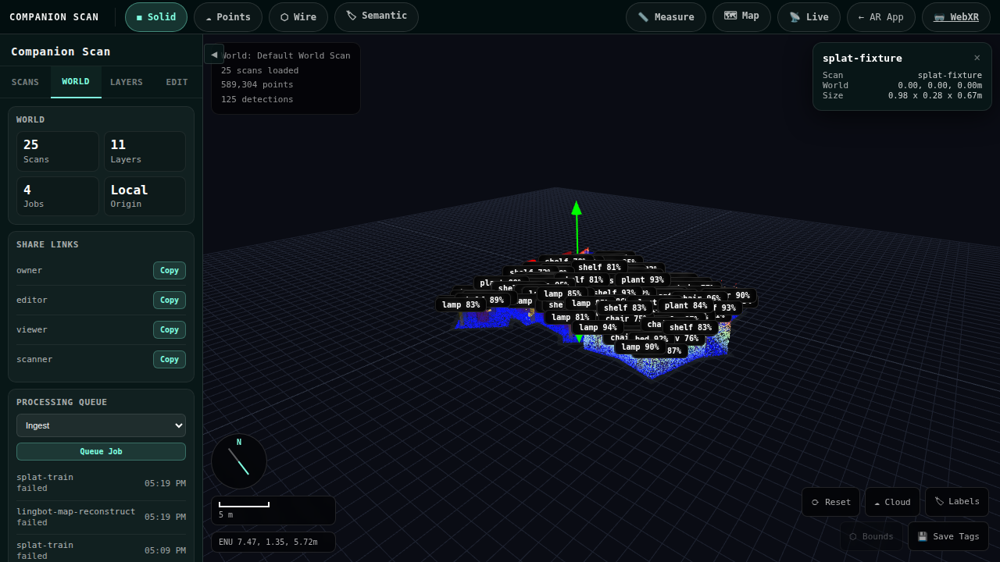
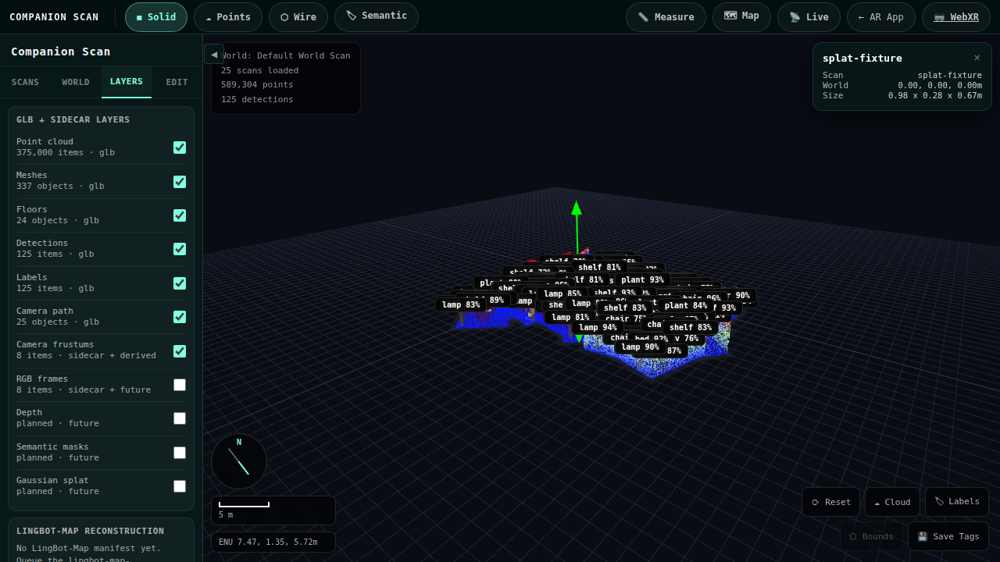

# LingBot-Map server processing

This document walks through the end-to-end integration between Companion-Scan
sessions and [LingBot-Map](https://github.com/Robbyant/lingbot-map) — a
feed-forward Geometric Context Transformer that produces a dense 3D
reconstruction from a stream of RGB keyframes.

The integration adds a new `lingbot-map-reconstruct` world-job type that
spawns a Python worker over a session's keyframe directory and lands three
sibling artifacts plus a quantised `.lingbot.glb` sidecar that the Companion
Scan Spatial Editor can load alongside the original SLAM scan.

## Architecture

```
Mobile app   ──upload .glb──►  Deno server  ──fork──►  scripts/lingbot_map_worker.py
   │                              │                          │
   └──stream keyframes──►  scans/sessions/<id>/         loads torch + LingBot-Map
                                  │                    runs streaming inference
                                  ▼                          │
                          world-job pipeline                 ▼
                                  │           writes lingbot-map.point-cloud.ply
                                  │                  lingbot-map.poses.json
                                  │                  lingbot-map.manifest.json
                                  ▼
                          PLY → GLB sidecar
                          (lingbot_map_glb.ts)
                                  │
                                  ▼
                       <scan>.lingbot.glb in SCANS_DIR
                                  │
                                  ▼
                          Spatial Editor overlay
                          (src/viewer/lingbot-map.ts)
```

## Files added by this integration

| File | Purpose |
|------|---------|
| `scripts/lingbot_map_worker.py` | Python entrypoint that runs LingBot-Map inference and writes the three sibling artifacts. |
| `lingbot_map.ts` | Deno-side driver that spawns the Python worker, parses the result manifest, and emits the GLB sidecar. |
| `lingbot_map_glb.ts` | PLY → quantised GLB POINTS primitive (via gltf-transform). |
| `lingbot_map_ply.ts` | Runtime-agnostic binary-LE PLY parser shared by server + browser. |
| `src/viewer/lingbot-map.ts` | Three.js loader that pulls the PLY + poses and overlays them under the selected scan. |
| `scripts/fetch-lingbot-test-video.mjs` | Downloads the CC-BY reference clip. |
| `scripts/make-lingbot-fixture.mjs` | Extracts keyframes via ffmpeg and synthesises the artifact triple. |
| `tests/mock-lingbot-map.spec.ts` | Playwright integration test + screenshot capture. |
| `lingbot_map.test.ts` | Deno unit tests for the spawn driver. |
| `lingbot_map_glb.test.ts` | Node `node:test` for the PLY → GLB pipeline. |

## Environment variables

| Var | Default | Used by |
|-----|---------|---------|
| `LINGBOT_MAP_PYTHON` | `python3` | Server, picks the python that has lingbot-map + torch installed. |
| `LINGBOT_MAP_MODEL_PATH` | (unset) | Path to the LingBot-Map checkpoint. If unset the worker emits a `skipped` manifest with a remediation hint. |
| `LINGBOT_MAP_SCRIPT` | `./scripts/lingbot_map_worker.py` | Override the worker location (useful for read-only deployments). |

## Setup (one time, on the inference box)

```bash
# 1. Install LingBot-Map in a venv the Deno server can reach
git clone https://github.com/Robbyant/lingbot-map ~/lingbot-map
python3 -m venv ~/.venvs/lingbot-map && source ~/.venvs/lingbot-map/bin/activate
pip install -e ~/lingbot-map

# 2. Download a checkpoint (see lingbot-map README for variants)
huggingface-cli download robbyant/lingbot-map --local-dir ~/models/lingbot-map

# 3. Point the Deno server at the venv python + checkpoint
export LINGBOT_MAP_PYTHON=~/.venvs/lingbot-map/bin/python
export LINGBOT_MAP_MODEL_PATH=~/models/lingbot-map/checkpoint.pt
```

## Triggering a reconstruction from the editor

1. Open the Companion Scan Spatial Editor (`/editor?project=<id>`).
2. Select a scan that has streamed keyframes.
3. In the right drawer, use **Reconstruct**. It queues the
   `LingBot-Map reconstruct` step for the selected scan.



4. Confirm the reconstruction action.


5. Watch the job pane — the local coordinator transitions
   `queued → processing → completed`. When `status === 'ok'`, the job
   surfaces two artifacts in its detail row:
   - `lingbot-map-reconstruction` (manifest + PLY + poses)
   - `lingbot-map-glb` (the optimised `.lingbot.glb` sidecar)

6. Switch to the **Layers** tab. The new `LingBot-Map Reconstruction`
   section starts empty until a reconstruction lands.



7. After the job completes the panel reports the point + pose counts and
   the toggles drive overlay visibility on the selected scan without a
   reload.


## Triggering a reconstruction from curl

```bash
curl -X POST http://localhost:8000/worlds/default/jobs \
  -H 'Content-Type: application/json' \
  -d '{"type":"lingbot-map-reconstruct","scanId":"<scanId>"}'
```

The server enqueues the job and returns immediately. Subscribe to
`/events` (WebSocket) to receive `world-job-update` frames as the worker
progresses.

## Artifact layout

After a successful run the session directory contains:

```
scans/sessions/<sessionId>/
├── kf-00000.jpg            …
├── keyframes.jsonl         ←  input keyframe metadata (provenance)
├── lingbot-map.point-cloud.ply
├── lingbot-map.poses.json
└── lingbot-map.manifest.json
```

And alongside the source scan:

```
scans/
├── <scan>.glb              ←  original SLAM scan from the mobile app
├── <scan>.opt.glb          ←  optimize-scan output (existing pipeline)
├── <scan>.lod1.glb         ←  optimize-scan LOD (existing pipeline)
└── <scan>.lingbot.glb      ←  LingBot-Map POINTS primitive (this integration)
```

The `.lingbot.glb` carries the reconstruction's point count + session id in
the asset.extras `lingbotMap` block, so a re-loaded scene can re-attach
provenance without re-fetching the manifest.

## Skipping / error contract

The Python worker is intentionally graceful: every run writes
`lingbot-map.manifest.json`, even when it skipped or errored. The job-pane
artifact carries the explanation:

| `status` | When | UI shows |
|----------|------|----------|
| `ok` | Inference produced a point cloud | Point + pose counts + sidecar GLB link |
| `skipped` | torch / lingbot_map not importable, model checkpoint missing, or no keyframes | The `skippedReason` and a `remediation` hint |
| `error` | Inference crashed | Exception class + message + tail of traceback |

## Tests

Three layers of test coverage:

```bash
# Deno unit tests — spawn surface + validation gates
deno test --allow-read --allow-write --allow-env --allow-run lingbot_map.test.ts

# Node unit tests — PLY parser + GLB builder
npm run test:lingbot:glb

# Playwright integration — fixture session + UI + screenshots
npm run test:lingbot:fetch-video     # one-off
npm run test:lingbot:make-fixture    # one-off
API_URL=http://localhost:8000 VITE_URL=http://localhost:5173 \
  npx playwright test --project=chromium-mock mock-lingbot-map
```

## Test video provenance

`scripts/fetch-lingbot-test-video.mjs` downloads
**Big Buck Bunny** (© 2008 Blender Foundation), licensed under
[Creative Commons Attribution 3.0](https://creativecommons.org/licenses/by/3.0/).
Primary source: `download.blender.org`; fallback:
[Wikimedia Commons](https://commons.wikimedia.org/wiki/File:Big_Buck_Bunny_4K.webm).
The clip is not redistributed by this repository; it is fetched on demand
when a contributor opts into the integration test.

For more physically meaningful reconstructions, set `SOURCE_URL` to any CC0
indoor walkthrough (a LingBot-Map example scene works well) before running
the fetch script.

## Limitations

- The Python worker has not yet been wired into the optimisation pipeline.
  When the source scan's `.opt.glb` is rebuilt, the `.lingbot.glb` sidecar
  remains valid but is not merged into the optimised file.
- `cameraToWorld` matrices in `lingbot-map.poses.json` are in the LingBot-Map
  output frame, not Companion-Scan's ENU/Y-up world frame. The viewer renders
  them under the selected scan's transform — gizmo edits move both together,
  but cross-scan alignment requires an `align-scan` pass.
- Quantising the GLB at 14 bits/position is fine for indoor scans but starts
  to clip detail past ~30 m walkthroughs. Override via a future
  `quantize: 16` option on the GLB build call if needed.
