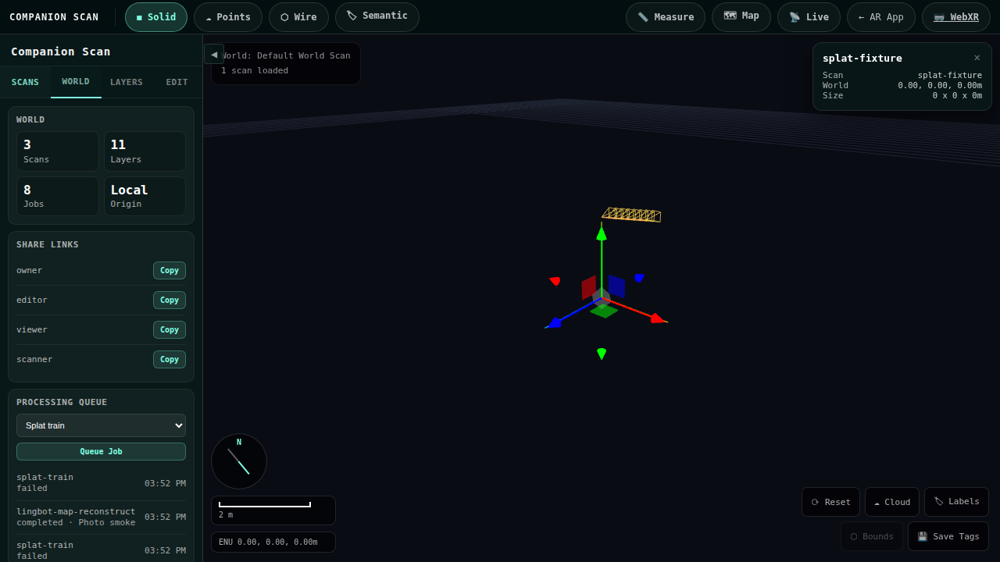
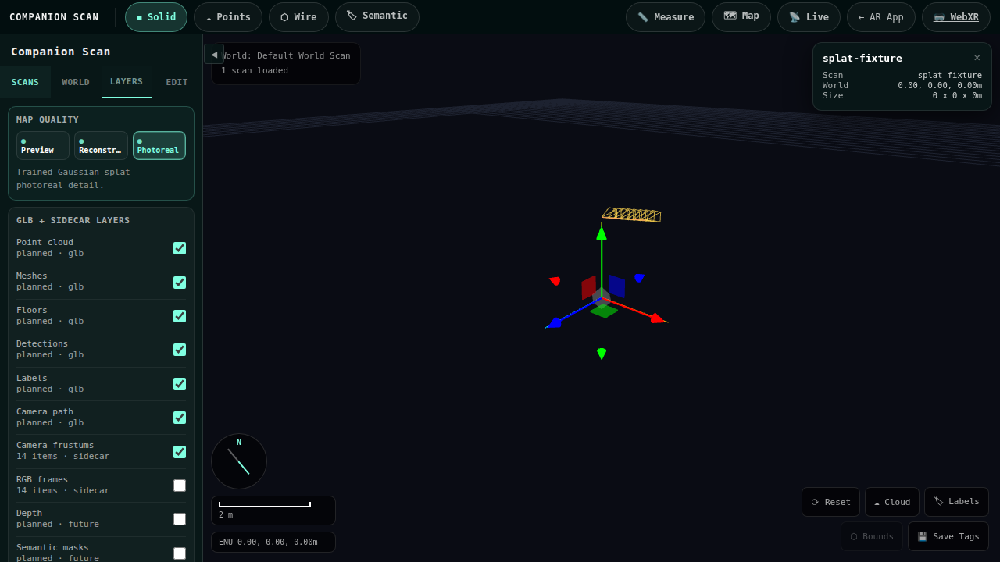
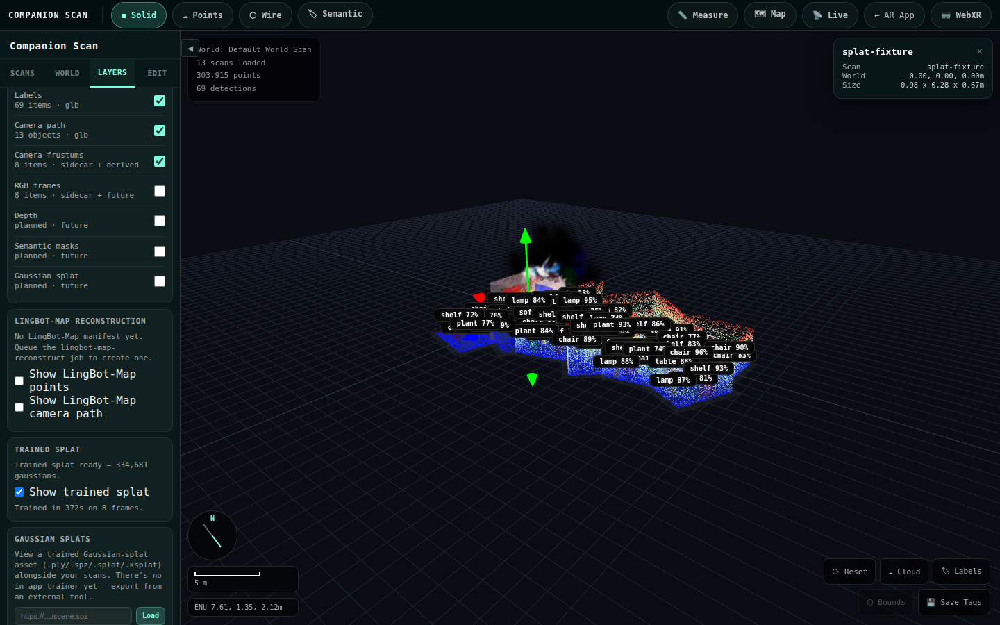
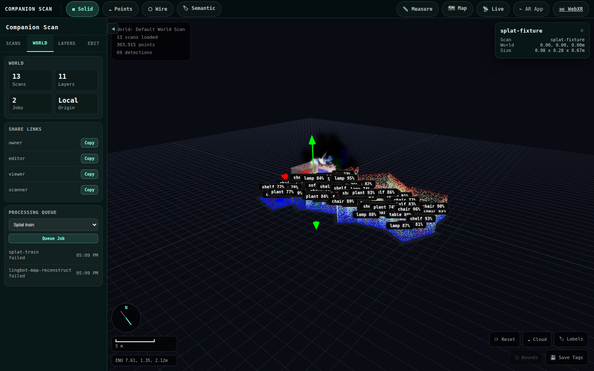

# Splat training (Brush)

This document walks through the end-to-end integration between Companion-Scan
sessions and [Brush](https://github.com/ArthurBrussee/brush) — a fast,
cross-platform Gaussian-splat trainer that runs headless on `wgpu`.

The integration makes the reserved `splat-train` world-job type real: it
converts a scan's keyframe session into a Nerfstudio dataset, spawns the Brush
CLI over it, lands the exported INRIA 3DGS `.ply` as a scan sidecar, and
surfaces it as an auto-loading **Trained Splat** layer in the Companion Scan
Spatial Editor.

## Architecture

```
Mobile app   ──upload .glb──►  Deno server  ──fork──►  brush-cli (Brush)
   │                              │                          │
   └──stream keyframes──►  scans/sessions/<id>/         trains Gaussian splat
                                  │                    on wgpu (GPU1 pin)
                                  ▼                          │
                          world-job pipeline                 ▼
                          (_runSplatTrainJob)         exports splat_{iter}.ply
                                  │                          │
                    session → Nerfstudio dataset             ▼
                    (splat_train_dataset.ts)      copy to SCANS_DIR as
                                  │               <base>.splat.ply + manifest
                                  ▼                          │
                          <base>.splat.ply in SCANS_DIR      │
                                  │◄─────────────────────────┘
                                  ▼
                          Spatial Editor splat layer
                          (src/viewer/splat-layer.ts →
                           splat-viewer.ts → SplatMesh)
```

## Files added by this integration

| File | Purpose |
|------|---------|
| `splat_train_dataset.ts` | Session → Nerfstudio `transforms.json` converter (pure, Deno-runnable, unit-tested). Reads `keyframes.jsonl` + `kf-*.jpg`, derives per-frame intrinsics, builds c2w matrices, links images, seeds init from a LingBot-Map point cloud when present. |
| `server/splat/splat_train.ts` | Deno-side driver that builds the dataset, spawns `brush-cli`, locates the exported `.ply`, lands it, and writes a `splat-train` manifest (mirrors `server/lingbot-map/lingbot_map.ts`). |
| `src/viewer/splat-layer.ts` | Viewer loader that discovers a scan's splat manifest and loads the served `.ply` into a SparkJS `SplatMesh` under the selected scan. |
| `scripts/make-splat-fixture.mjs` | Synthesises a valid 3DGS `.ply` + manifest fixture for the integration test (Brush can't run in CI). |
| `tests/mock-splat-train.spec.ts` | Playwright integration test + screenshot capture. |
| `splat_train.test.ts` | Deno unit tests for the driver + dataset converter. |

## Environment variables

| Var | Default | Used by |
|-----|---------|---------|
| `BRUSH_BIN` | `~/brush/target/release/brush-cli` | Server — the Brush CLI binary. If missing/unrunnable the job records a `skipped` manifest with a remediation hint. |
| `BRUSH_DEVICE` | *(unset)* | Server — forwarded as `CUBECL_WGPU_DEFAULT_DEVICE` only when set. Selects the wgpu adapter (**not** HIP). Leave unset on a single-GPU host and on Apple Silicon, where there is no `DiscreteGpu` and a stale pin selects nothing. Set `DiscreteGpu(1)` only on the multi-GPU AMD box, to reach the non-Ollama 7900 XTX and avoid the `llvmpipe` software adapter. |
| `BRUSH_TRAIN_ITERS` | `15000` | Total training iterations. |
| `BRUSH_SH_DEGREE` | `2` | Spherical-harmonic degree of the splats. |
| `BRUSH_MAX_RES` | `1280` | Max image resolution loaded into training. |

## Setup (one time, on the inference box)

Brush is `wgpu`-based, so this works on Metal, Vulkan and DX12 — an Apple
Silicon Mac is a perfectly good trainer and needs no CUDA.

```bash
# 1. Build Brush (Rust). Needs rustc >= 1.95 — burn/cubecl/rerun all refuse
#    to compile below it. `rustup toolchain install 1.95` and `cargo +1.95 …`
#    if your default stable is older.
git clone https://github.com/ArthurBrussee/brush ~/brush
cd ~/brush && cargo build --release -p brush-cli
```

Two things about that command that bite:

- **`-p brush-cli`, not `--bin brush-cli`.** The workspace sets
  `default-members = ["apps/brush-app"]`, so `--bin` is scoped to that package
  and fails with `no bin target named 'brush-cli'` — while unhelpfully
  reporting `available bin in 'brush-cli' package: brush-cli`.
- **The binary lands in `~/brush/target/release/`, not `~/brush/src/target/`.**
  Upstream has no `src/` directory any more (it is `apps/` + `crates/`).

```bash
# 2. Point the server at it (the default already assumes this path).
export BRUSH_BIN=~/brush/target/release/brush-cli

# 3. Only on a multi-GPU host: pin the wgpu adapter (NOT HIP_VISIBLE_DEVICES).
#    Leave unset everywhere else — a pin naming an absent adapter selects nothing.
# export BRUSH_DEVICE="DiscreteGpu(1)"

# Sanity-check the flags the driver relies on:
~/brush/target/release/brush-cli --help
```

**Verified on Linux, 2026-08-26 (first Linux setup of this pipeline).** Both halves install
entirely under `$HOME` — no `sudo`, no system packages — which matters because the box this was
done on has no passwordless sudo:

```bash
# Rust, user-local. The repo needs >= 1.95; stable resolved to 1.98.0.
curl --proto '=https' --tlsv1.2 -sSf https://sh.rustup.rs | sh -s -- -y --profile minimal
. "$HOME/.cargo/env"
git clone --depth 1 https://github.com/ArthurBrussee/brush ~/brush
cd ~/brush && cargo build --release -p brush-cli      # 4m28s on an RTX 4080 laptop

# COLMAP without apt: micromamba is a single user-local binary, conda-forge ships a CUDA build.
curl -Ls https://micro.mamba.pm/api/micromamba/linux-64/latest | tar -xj bin/micromamba
export MAMBA_ROOT_PREFIX=$HOME/.local/micromamba
./bin/micromamba create -y -n colmap -c conda-forge colmap   # got COLMAP 3.13.0 with CUDA
```

The resulting paths, which is what `BRUSH_BIN` / `COLMAP_BIN` want:

```
BRUSH_BIN=$HOME/brush/target/release/brush-cli
COLMAP_BIN=$HOME/.local/micromamba/envs/colmap/bin/colmap
```

Two notes worth keeping:

- **`.env` is not read by the server.** Nothing in `package.json` or `deno.json` passes
  `--env-file`, and `server/main.ts` only ever calls `Deno.env.get`. Putting `BRUSH_BIN` in
  `.env` alone does nothing — export it into the shell that runs `npm start`
  (`set -a; . ./.env; set +a` works).
- **Check the driver's flags against the build you got.** `server/splat/splat_train.ts` passes
  `--total-train-iters`, `--sh-degree`, `--max-resolution`, `--export-every`, `--export-path`,
  `--export-name` and `--eval-every`; all seven exist in the build above, but Brush is a moving
  target and a missing flag surfaces as a training failure, not a config error.

## Camera poses are a prerequisite

Brush trains from posed images, so every frame needs a camera pose. Keyframes
streamed from a live WebXR/SLAM session carry one; `photo-ingest` and video
sessions do not. For those, a solver must run first, and `splat-train`
auto-chains one (`SPLAT_TRAIN_AUTO_POSES=0` to opt out):

| Provider | Job | Writes | Needs |
|---|---|---|---|
| COLMAP | `colmap-poses` | `colmap.poses.json` + `colmap.point-cloud.ply` | CPU only |
| LingBot-Map | `lingbot-map-reconstruct` | `lingbot-map.poses.json` + `lingbot-map.point-cloud.ply` | GPU |

Both write the same format, so `buildBrushDataset` reads either through one
path (ADR 0001); COLMAP is tried first because it is the one that can run
anywhere. See [`colmap-poses.md`](colmap-poses.md).

## Data path — session → Nerfstudio dataset

`splat_train_dataset.ts` writes a `brush-dataset/` subdirectory inside the
session:

```
scans/sessions/<id>/brush-dataset/
├── transforms.json     fl_x/fl_y/cx/cy/w/h + frames[] (file_path + 4×4 c2w)
├── images/kf-*.jpg     symlinked (fallback: copied) from the session
└── sparse_pc.ply       (optional) copy of lingbot-map.point-cloud.ply for init
```

Convention notes baked in from the spike:

- **No axis flip.** Companion-Scan / WebXR / three.js poses are already in the
  OpenGL/Blender camera-to-world convention Nerfstudio expects. The pose
  position + quaternion drop straight into the 4×4 `transform_matrix`.
- **Real image dims.** Frame width/height are read from the actual JPEG's
  Start-Of-Frame marker, never trusted from `keyframes.jsonl` (the phone
  downscales frames, so the recorded dims can drift). `fl_x`/`fl_y` are derived
  from the recorded vertical FOV (or client `fx`/`fy`) scaled to real pixels.
- **Seeded init.** When a prior `lingbot-map-reconstruct` job left a
  `lingbot-map.point-cloud.ply`, it is copied in as `sparse_pc.ply` and
  referenced from `transforms.json` (`ply_file_path`). Brush's PLY importer
  accepts a plain xyz(+rgb) cloud as SfM init; otherwise Brush random-inits
  inside the camera frustums.

## Brush invocation

```
brush-cli <brush-dataset/> \
  --total-train-iters $BRUSH_TRAIN_ITERS \
  --sh-degree $BRUSH_SH_DEGREE \
  --max-resolution $BRUSH_MAX_RES \
  --export-every $BRUSH_TRAIN_ITERS \
  --export-path <brush-dataset/exports> \
  --export-name splat_{iter}.ply \
  --eval-every $BRUSH_TRAIN_ITERS
```

The positional dataset argument auto-disables Brush's GUI (headless). The GPU
is pinned via `CUBECL_WGPU_DEFAULT_DEVICE=$BRUSH_DEVICE` in the child's env.
Brush does not write a manifest — the driver counts gaussians from the exported
PLY header and writes the `splat-train` manifest itself.

## Triggering a training run from the editor

1. Open the Companion Scan Spatial Editor (`/editor?project=<id>`).
2. Select a scan that has streamed keyframes.
3. In the right drawer, use **Reconstruct** to queue `Splat train` for the
   selected scan.



4. Confirm the training action. The local coordinator
   transitions `queued → processing → completed`. On success the job surfaces a
   `splat-ply` artifact (the `.ply` + gaussian count + manifest link).
5. Switch to the **Layers** tab. The **Trained Splat** section reports the
   gaussian count and the toggle drives the splat's visibility on the selected
   scan without a reload.




## Triggering a training run from curl

```bash
curl -X POST http://localhost:8000/worlds/default/jobs \
  -H 'Content-Type: application/json' \
  -d '{"type":"splat-train","scanId":"<scanId>"}'
```

Subscribe to `/events` (WebSocket) for `world-job-update` frames.

## Artifact layout

After a successful run the scan directory contains:

```
scans/
├── <base>.glb                       ←  original SLAM scan from the mobile app
├── <base>.splat.ply                 ←  trained Gaussian splat (this integration)
├── <base>.compressed.ply            ←  optional compressed variant (if Brush emits one)
└── <base>.splat-train.manifest.json ←  run index: status/gaussianCount/params/timing
```

and inside the session:

```
scans/sessions/<sessionId>/brush-dataset/…   ←  the Nerfstudio dataset Brush trained on
```

All three sidecars are served through the gated `/scans/…` route via a suffix
allowlist (`.splat.ply`, `.compressed.ply`, `.splat-train.manifest.json`), with
the same path-traversal guard as the `.glb` route.

## Skipping / error contract

The driver never hard-crashes the server; every run writes a manifest:

| `status` | When | UI shows |
|----------|------|----------|
| `ok` | Brush produced a `.ply` | Gaussian count + splat layer link |
| `skipped` | `BRUSH_BIN` missing/unrunnable, or the scan has no keyframes | `skippedReason` + a `remediation` hint |
| `error` | Dataset build failed, Brush exited non-zero, or no `.ply` was exported | Error message + stderr tail |

## Tests

```bash
# Deno unit tests — driver validation, arg assembly, dataset converter, skip fallback
npm run test:splat:unit

# Playwright integration — synthetic fixture + UI + screenshots
npm run test:splat:make-fixture      # one-time (re-run after edits)
API_URL=http://localhost:8000 VITE_URL=http://localhost:5173 \
  npx playwright test --project=chromium-mock mock-splat-train
```

The Playwright fixture is fully synthetic: `scripts/make-splat-fixture.mjs`
writes a valid INRIA 3DGS `.ply` and the `<base>.splat-train.manifest.json` the
world job would have written. The real trainer is a GPU binary that can't run
in CI, but the served-`.ply` → `SplatMesh` data path is identical to a real run.

## Limitations

- A real end-to-end Brush training run has **not** been exercised in CI —
  feasibility was proven by a manual spike (a training run produced a valid
  `.ply` on this box). The integration wiring, dataset conversion, artifact
  serving, and viewer load are all tested; the actual `brush-cli` spawn is
  covered only by the synthetic fixture + the injected-spawn unit test.
- **The splat has no metres.** Brush inherits the pose solver's frame, and
  monocular SfM is scale-blind — COLMAP's output is correct only up to an
  unknown scale factor, at an arbitrary origin. `colmap-poses` gravity-aligns
  the model (world +Y up), which fixes orientation but not size. Metres come
  only from the separate, explicitly-queued `splat-align` job, which fits a
  7-DoF similarity against a *calibrated* scan — and which skips outright when
  the scan is uncalibrated. Until that has run and reported an `ok`, treat any
  dimension read off a splat as unitless. See
  [`splat-align.md`](splat-align.md).
- The trained splat is attached under the scan's root transform, so gizmo edits
  move it with the scan. Precise cross-scan alignment still needs an
  `align-scan` pass; `splat-align` addresses scale and frame, not scan-to-scan
  registration.
- Brush does not emit a compressed PLY by default; the `.compressed.ply` sidecar
  is best-effort (only landed if a compressed variant appears in the export dir).

## Screenshots

Real Brush output (334,681 gaussians, 15k iterations, trained on beta-1's second
RX 7900 XTX in ~6 minutes) loaded in the Spatial Editor:


The Trained Splat layer panel for a scan with a completed run, and the
processing-queue entry that launches one:





(The `viewer-splat-panel*.png` shots are captured automatically by
`tests/mock-splat-train.spec.ts` on every run with the synthetic fixture.)
