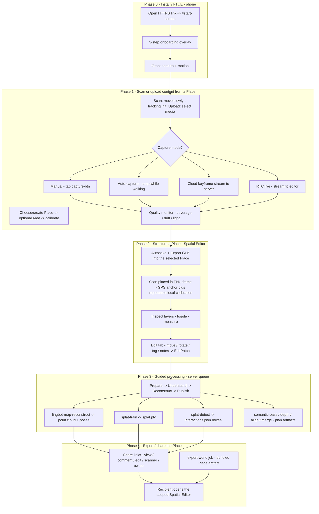
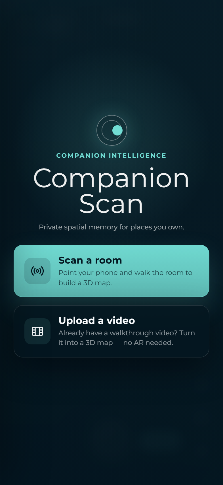
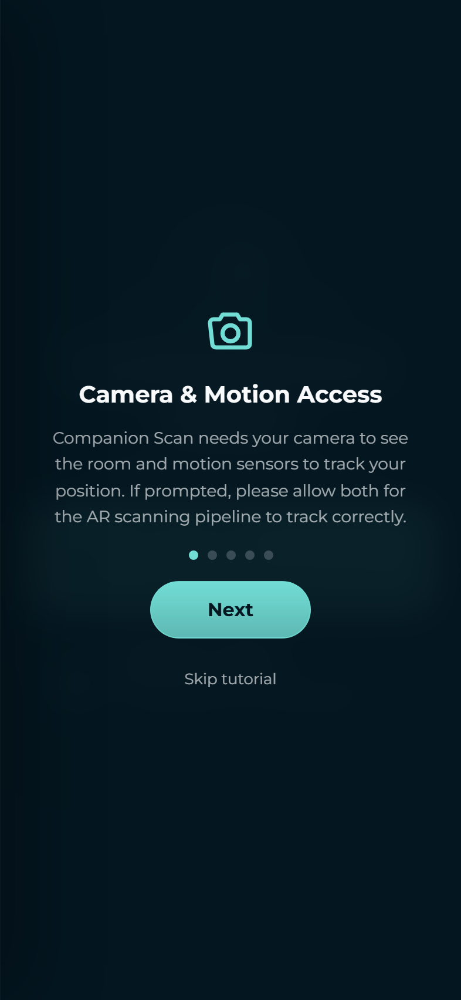
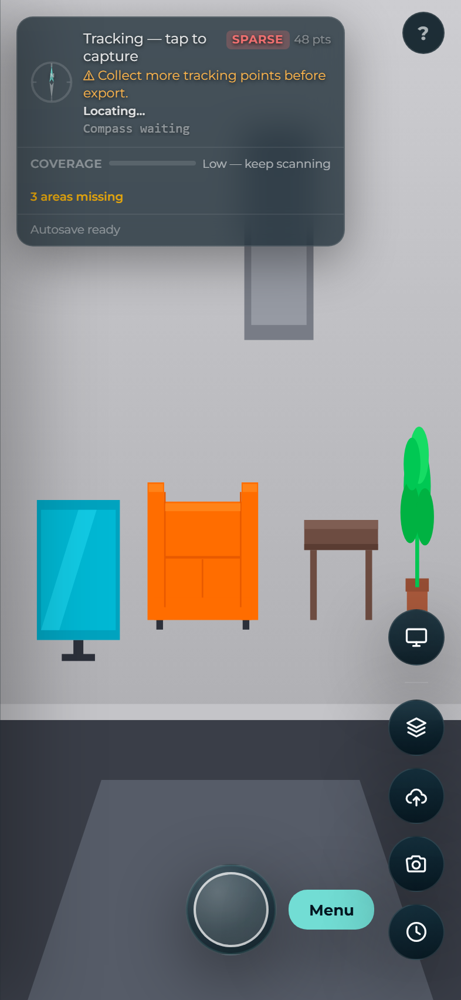
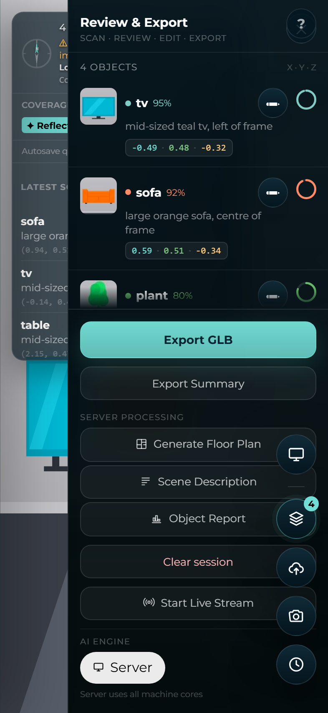
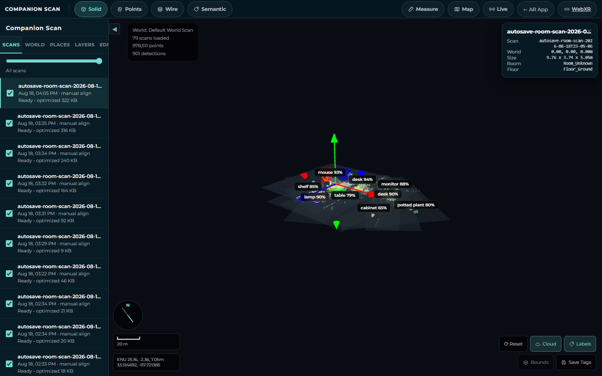
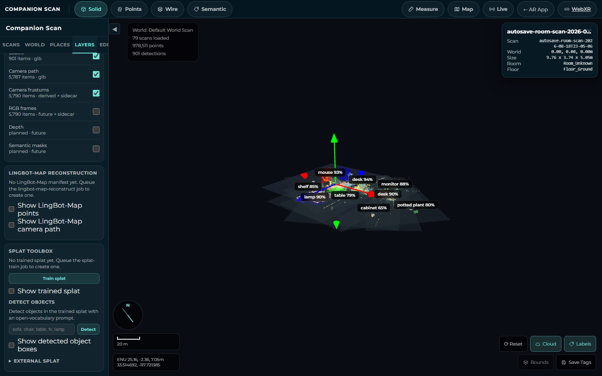
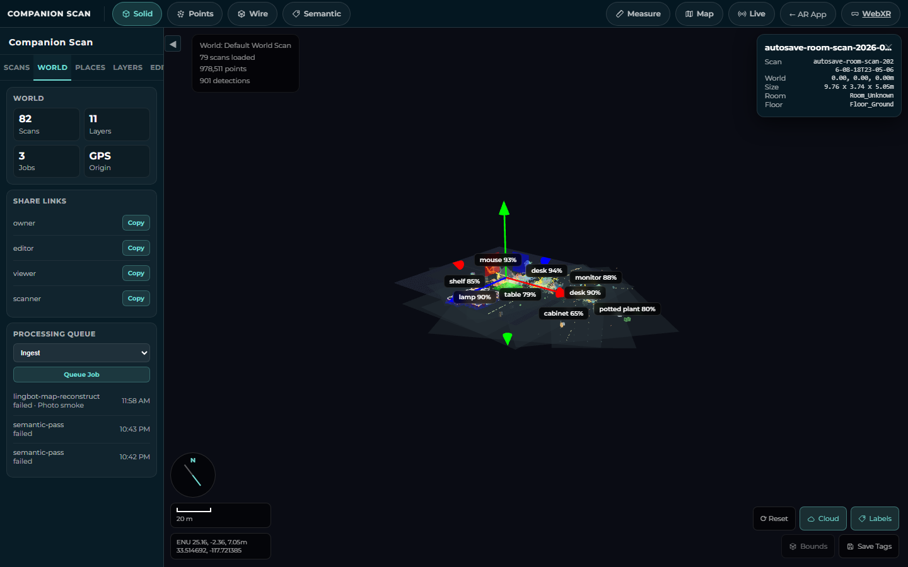
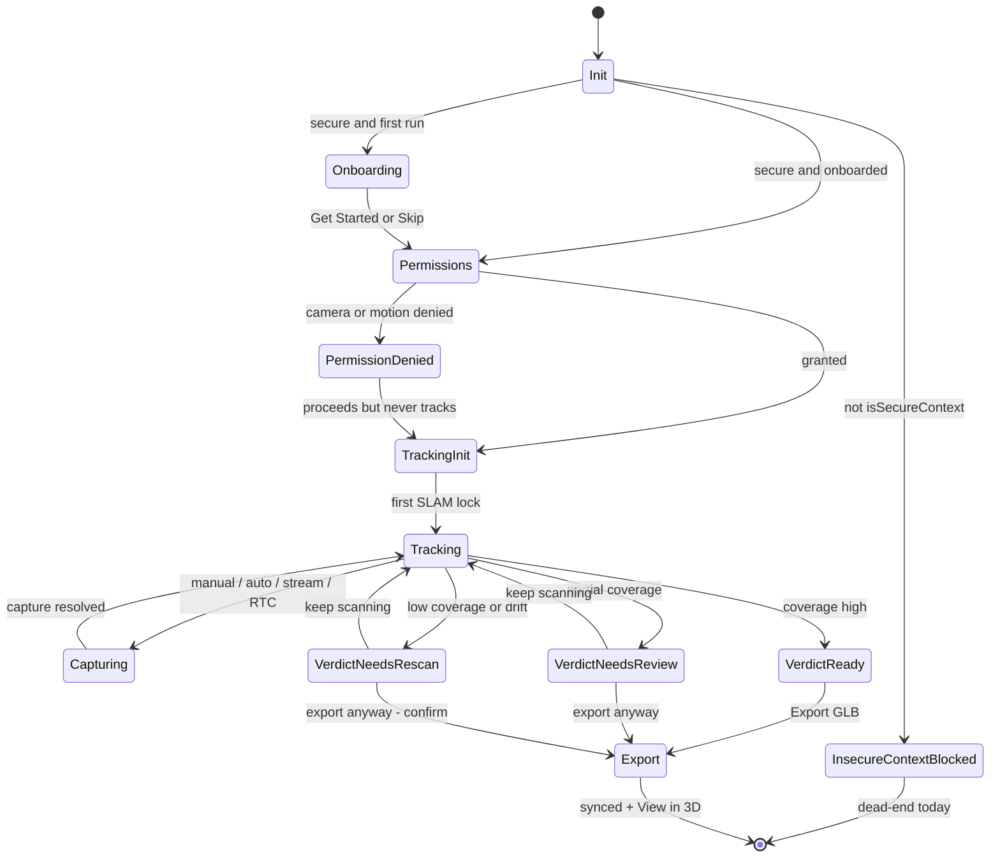

# UX Flow & FTUE Spec — CI-Spatial

> Design doc for contributors and designers. Describes how the everyday-user experience *should* flow, grounded in what exists in the code today. IDs, labels, and copy quoted here are verified against the tree at HEAD. Where something is a recommendation rather than current behavior, it is marked **[proposed]**.

**Related docs:** [README.md](../README.md) · [../architecture.md](../architecture.md) (canonical system design) · [UI_MANUAL.md](./UI_MANUAL.md) (exhaustive control catalog) · [../roadmap.md](../roadmap.md) (timelines / shipped-vs-planned)

This doc sits between ../architecture.md (the engineer's system sequence) and UI_MANUAL.md (the surface-by-surface control reference). It owns the *narrative*: the first-time journey, the mental model of the four capture pipelines, and the FTUE improvement backlog.

> **Current product vocabulary:** the user starts with a **Place**, may choose
> an **Area** such as a room or floor, then creates or uploads a **Scan**. The
> desktop destination is the **Companion Scan Spatial Editor** at `/editor`.
> See [PLACE_SCAN_DESIGN.md](PLACE_SCAN_DESIGN.md) for the canonical contract;
> legacy `WorldProject` language in implementation details refers to the
> compatible ENU scene record, not a separate user concept.

**📸 Screenshot gallery:** [ui-flow/](./ui-flow/) shows mobile + desktop screenshots of every flow below, generated automatically from the running app by [`tests/mock-ui-mobile.spec.ts`](../../tests/mock-ui-mobile.spec.ts) and [`tests/mock-ui-desktop.spec.ts`](../../tests/mock-ui-desktop.spec.ts). Representative shots are embedded per phase in §4.

---

## 1. Purpose & the everyday-user persona

### Who this is for

The **everyday user** is a non-expert who owns a place — a home, a workshop, a rental, a small shop — and wants to **digitize it into a private, structured, explorable map they control**. They are not a 3D artist, a photogrammetry hobbyist, or a SLAM engineer. They will not read tooltips, will not know what "ENU" or "gaussian splat" means, and will judge the product by one question: *"Did I capture enough, and can I go look at it?"*

Their intent is concrete:

- Walk through a room with their phone and have it "understand" the space.
- End up with something they can open later, explore in 3D, label, and share with a specific person (a contractor, an insurer, a family member) — without it being public.
- Do all of this without learning a pipeline.

Everything in this doc is measured against that persona. Jargon, hidden verdicts, and dead-end developer copy are treated as bugs, not details.

### What a "4D map" is (one paragraph)

A **4D map** in CI-Spatial is a `WorldProject` (`src/world/types.ts`): an anchored spatial container living in a single `LocalFrame` of type `ENU_Y_UP` — units in **meters**, axes **x = east, y = up, z = north**, anchored at an `originGeoPose` (lat/lng/altitude/bearing). It holds one or more `ScanManifest`s, each carrying typed **layers** — `points`, `mesh`, `floor`, `detections`, `labels`, `cameraPath`, `cameraFrustums`, `rgbFrames`, `depth`, `splat`, `semanticMasks` — so geometry, semantics, and provenance are addressable separately instead of fused into one flat mesh (that is the *structured* part). The **4th dimension is time**: it does not live in a single mesh but in the per-frame observation stream (`FrameObservation.timestamp` + pose/intrinsics/frustum — the camera's path through the space over capture time), in each scan's `capturedAt`, and in the append-only `EditPatch[]` edit history (every patch stamped `createdAt`). Because of that time axis, one world can hold **multiple scans of the same place captured at different moments** and replay the camera trajectory — the map is a time-series of posed observations composed into one anchored frame, not a static snapshot.

---

## 2. End-to-end journey map

Five phases. The first decision is always the **Place** (and, when useful, an
**Area**). Phases 0–1 happen on the phone through **Scan a Place** or **Upload
Content from a Place**. Phases 2–4 happen in the **Companion Scan Spatial
Editor** (`/editor`, implemented by `viewer.html`) plus the async server job
queue.

---

## 3. FTUE spec

### 3.1 Current onboarding (verified)

The first painted, interactive surface for a first-time user is the **onboarding overlay** (`#onboarding-overlay`, z-index 25) stacked on top of `#start-screen` (z-index 20). It is gated on the `localStorage` key **`companion-scan-onboarded`** (constant `ONBOARD_KEY`) and shows only when `!skipOnboarding && !localStorage.getItem(ONBOARD_KEY)`.

The three steps, quoted verbatim from `index.html`:

| Step | Icon | Title (`.onboard-title`) | Description (`.onboard-desc`) |
|---|---|---|---|
| 0 | 📸 | **Camera & Motion Access** | "Companion Scan needs your camera to see the room and motion sensors to track your position. You'll be prompted to allow both." |
| 1 | 🔄 | **Scan Your Space** | "Move slowly and steadily around the room. Point at different surfaces — the app builds a 3D point cloud in real time. Tap the capture button to identify objects with AI." |
| 2 | 💾 | **Export & Open Place** | "When done, export your scan as a .glb file. Open the Spatial Editor to explore, label, and compose scans in the same Place." |

**Controls:** `#onboard-next-btn` (label flips to **`Get Started`** on the last step), three `.onboard-dot` progress dots, and `#onboard-skip` (**`Skip tutorial`**). On finish or skip, `finish()` writes `localStorage['companion-scan-onboarded'] = '1'` and hides the overlay.

**Skip paths:** `skipOnboarding = searchParams.has('mock') || searchParams.get('onboarding') === '0'`. So **`?onboarding=0`** or **any `?mock`** value bypasses the overlay entirely (`?mock=webxr` additionally installs the iwer WebXR emulation runtime).

**Re-entry:** the `#help-btn` (`?`, top-right, revealed after onboarding resolves) re-plays the overlay from step 0.

**Place step:** after the onboarding overlay resolves and before the scanner can open, `#place-sheet` identifies the current place from geolocation. It lists saved places within 100 m, one row per named place even when several share coordinates. `New place` lets the user accept the current fix or edit latitude/longitude and save a new project; selecting an existing row reuses that project. `Decide later` keeps the scan unassigned.

**Permission timing:** after onboarding and place selection resolve, the flow blocks on a `Start AR` click. Inside that click handler, *before any await*, it synchronously calls `DeviceOrientationEvent.requestPermission()` / `DeviceMotionEvent.requestPermission()` (the iOS 13+ motion prompt). The **camera** prompt fires slightly later, inside `provider.start(canvas)`.

**Readiness:** that permission call cannot be buffered and replayed later — it must sit in a real, await-free gesture handler — so the handler *is* the tap, and the only question is how early it can exist. It is attached at the top of `main()` (section 0), before the IndexedDB stores and the inference router's model load, none of which the button needs. A tap during boot is therefore honoured: it dismisses the start screen, requests motion permission inside the genuine gesture, and AR starts when section 5 is reached. `#start-ar-btn` still ships `disabled aria-busy="true"` with a `Preparing…` line in the static markup, and `setStartButtonState('ready')` clears it — that now covers only the ~50 ms until section 0 runs, plus the case where the bundle never loads at all, where staying disabled is the honest state. The same helper puts the card into a terminal `unavailable` state on the boot paths that give up (insecure context, no AR runtime, a crash in `main()`).

Because an early tap removes the start screen, `showArHelp()` — whose `#ar-help` element lives inside it — falls back to `#permission-error-banner` (a sibling that survives) when the screen is already gone, so "no AR runtime" cannot end as a blank screen.

### 3.2 Prioritized FTUE improvements

Ordered by value to the everyday user. Each is grounded in a specific, verified gap.

1. **Surface the completion verdict + a Done/Finish affordance on the phone (highest value).**
   The quality monitor already computes a verdict — `ScanQualitySummary.status` is `ready` / `needs-review` / `needs-rescan` plus a `recommendations[]` array (`quality-monitor.ts`). But it is **only written into the GLB and shown in the Spatial Editor** — never rendered on the phone. The everyday user's core question ("do I have enough?") is answerable in code but invisible where it matters.
   → Render `qualityMonitor.summary(...)` as a status chip in the HUD (`✓ Ready to export` / `Review recommended` / `Keep scanning`) with the top recommendation, and add a **`Done / Finish scan`** control near `#capture-btn` that opens the panel scrolled to Export. Make "finished" a real, visible state.

2. **Fix the help-button onboarding-key leak.**
   `#help-btn` currently **deletes** `companion-scan-onboarded` to replay and only rewrites it if the user reaches the last step. Close the app mid-replay and the key stays deleted → **full FTUE re-triggers on next launch**. It also binds a fresh advance handler on every tap without removing the prior ones, so repeated taps stack duplicate handlers and `Next` jumps multiple steps.
   → Drive replay from a parameter (do not delete the key); restore the key unconditionally on dismiss; bind the advance listener exactly once.

3. **Humanize permission + secure-context failures.**
   Motion/camera denial is caught with only `console.warn` — the user proceeds into a session that never tracks, seeing `Move camera to initialise tracking…` forever with no explanation. And the insecure-context bail shows developer copy (`HTTPS required — … run: tailscale cert <host>`) with a dead greyed `Start AR` button.
   → Replace silent denial with a persistent, OS-specific banner ("Enable in Settings → Safari → Motion & Orientation", plus camera re-enable steps). Replace the insecure-context copy with a human message ("This page must be opened over a secure https link — ask for the correct link"); keep the `tailscale` hint in the console only.

4. **Disambiguate the three capture modes.**
   Manual (`#capture-btn`), auto-capture (`📷 #auto-capture-btn`), and cloud keyframe streaming (`☁️ #stream-btn`) are three different data pipelines whose only differentiation is `title` tooltips that never appear on touch. The capture button itself is a blank circle with no shutter glyph.
   → Add a one-time labelled coach-mark sequence using outcome language ("Auto-snap as you walk", "Send frames for 3D/splat reconstruction"); give `#capture-btn` a shutter glyph and a distinct recording state when auto-capture is active; fold streaming into onboarding step 1's copy (today it mentions only "tap the capture button").

5. **Group the action rail.**
   `#scanner-action-rail` interleaves scan-tools (`📷` auto-capture, `☰` panel, `☁️` stream) with *navigate-away* controls (`🥽` runtime switch, `🖥` Spatial Editor) in one undifferentiated emoji row. Tapping `🥽` or `🖥` performs a full navigation and silently abandons the live session.
   → Split into a scan-tools cluster and a nav cluster; add short labels or first-use coach-marks; guard `🥽`/`🖥` with a "leave scan?" confirm when the session has unsaved points.

6. **Close the loop after export.**
   After `Export GLB` the button reads `Exported` and the status is `Scan exported & synced ✓`, but nothing tells the user the scan is now openable in the viewer (and autosave already uploaded it silently).
   → On successful export, surface a **`View in 3D →`** link (reuse the video-upload `#upload-video-open` pattern). Gate *manual* export behind a confirm when `status === 'needs-rescan'`, surfacing the recommendations.

### 3.3 Proposed improved onboarding step list **[proposed]**

Rework the overlay to teach outcomes and set expectations for the four capture modes and the "you'll know when you're done" verdict:

| Step | Working title | Intent |
|---|---|---|
| 0 | **Allow camera & motion** | Same permission ask, but preview the OS prompts and pre-empt denial ("if you tap Don't Allow, tracking won't work — you can re-enable in Settings"). |
| 1 | **Sweep the room slowly** | Animated sweep hint; explain the live point cloud and that moving too fast loses tracking. |
| 2 | **Three ways to capture** | Tap to identify objects · Auto-snap as you walk · Send frames for 3D/splat reconstruction. One line each, outcome language. |
| 3 | **We'll tell you when you have enough** | Introduce the coverage bar and the Ready / Review / Keep-scanning verdict so it isn't a surprise mid-scan. |
| 4 | **Finish & view in 3D** | Export a `.glb`, then open the desktop world to explore, label, and share. End on the `View in 3D →` promise. |

---

## 4. Per-phase flow detail

### Phase 0 — Install / FTUE (phone)

 

**User goal:** open the link, understand what the app does, grant access, and get to scanning without friction.

**Screens/controls today:**
- `#start-screen` — brand eyebrow `Companion Intelligence`, title **`Companion Scan`**, subtitle **`Private spatial memory for places you own.`**, primary CTA **`Start AR`** (`#start-ar-btn`), quiet secondary **`or upload a walkthrough video`** (`#upload-video-btn` → hidden `#upload-video-input`), and a conditional `#ar-help` block (shown only when no AR runtime is found).
- `#onboarding-overlay` — the 3 steps in §3.1.
- Permission prompts — iOS motion (from the `Start AR` click), then camera (from `provider.start`).

**Guidance signals:** `#status-text` walks `Press Start AR to begin` → `Move camera to initialise tracking…`. On first SLAM lock it flips once to `Tracking — tap to capture`. `#start-ar-btn` is enabled well *before* the status reaches `Press Start AR to begin` — it goes live at the top of the boot, and that status is only the prompt shown if the user hasn't already tapped. See **Readiness** in §3.1.

**Gaps:**
- Insecure-context bail shows developer copy + a dead greyed button; `main()` returns before onboarding ever runs.
- Motion/camera denial is `console.warn`-only — the user lands in a session that never tracks with no explanation.

**Recommended improvements:** items 2, 3 in §3.2; the reworked step list in §3.3.

---

### Phase 1 — Scan a room (phone)

 

**User goal:** capture the space well enough to be worth exploring later, and know when that's true.

The everyday user must understand there are **four distinct capture pipelines**, which today look nearly identical:

| Mode | Control | What it actually does |
|---|---|---|
| **Manual capture** | `#capture-btn` (center circle) | On tap: `Capturing next frame…` → `Analysing…` → `N objects detected`; runs on-device (or WebGPU/server) inference, spawns AR pins, shows the `#infer-dialog` "Latest scan" card. |
| **Auto-capture** | `📷 #auto-capture-btn` (+`#auto-capture-count`) | Pose-delta triggered snapshots as you walk. Status `Auto-capture ON — move camera to scan`; button gets `.active`. |
| **Cloud keyframe streaming** | `☁️ #stream-btn` (+`#stream-count`) | Streams RGB keyframes to the server, seeding `sessionId`-keyed reconstruction jobs (lingbot-map, splat-train need this). |
| **RTC live** | `#rtc-stream-btn` (`LIVE · tap to stop`, hidden until active) / `📡 Start Live Stream` in the panel | Live WebRTC stream to the desktop editor's Live Feed — the editor grows a live point cloud + moving frustum in real time. |

**Screens/controls today:**
- Live HUD: `#capture-btn`, `#scanner-action-rail` (`🥽 #xr-mode-link` · `☰ #panel-toggle` · `🖥 #viewer-link` · `☁️ #stream-btn` · `📷 #auto-capture-btn` · `🕒 #history-btn`), `#help-btn`.
- `#quality-overlay`: coverage bar (`Cov` + `#quality-coverage-text`), drift/light/reflection badges, `#quality-missing` ("N areas missing").
- Top-left HUD: compass ring, `#status-text`, `#scan-stats` ("N pts"), `#geo-chip` (`Locating…` / coords), `#autosave-status`.
- `#infer-dialog` "Latest scan" card (auto-shows per capture, auto-dismisses ~4 s).
- `#side-panel` (`☰`): header **`Review & Export`**, step strip `Scan · Review · Edit · Export`, per-object cards, footer actions (`Export GLB`, `Export Summary`, `Server Processing`: `🗺 Generate Floor Plan`, `✍ Scene Description`, `📊 Object Report`, `Clear session`, `📡 Start Live Stream`, `AI Engine` toggle `🖥 Server` / `⚡ WebGPU`).
- `#history-drawer` (`🕒`): `Scan Memory`, Leaflet geomap, session cards.

**Guidance signals:** coverage color (green ≥80 / amber ≥50 / red) + `coverageLabel()` text (`Low — keep scanning` / `Partial — scan more surfaces` / `Good` / `Excellent`); drift badges (`⚡ Fast` / `↗ Speed`) + one-shot `⚠ Moving too fast — slow down`; `🌑 Low light` / `✦ Refl` badges; `N areas missing` from a 4×4 floor-grid density check; autosave cycle (`Autosave queued` → `Saving scan…` → `Autosaved <name> · HH:MM`).

**Gaps:**
- The **verdict** (`ready` / `needs-review` / `needs-rescan` + `recommendations[]`) is never shown on the phone.
- No "done/finish" affordance; export is buried in the side panel.
- The four capture pipelines are visually indistinct; the capture button is a blank circle.
- `🥽` / `🖥` navigate away mid-session without confirmation.
- WebGPU vs server inference is **opt-in** via `localStorage['infer-mode']` (the `AI Engine` toggle) — not auto-detected. Server-side is the default.
- `needs-rescan` scans autosave and upload silently anyway; the user only learns the verdict later on desktop.

**Note on inference (for accuracy):** default inference is `INFERENCE_MODE=ollama` with `OLLAMA_MODEL=qwen3-vl:4b`. `onnx` mode runs `LiquidAI/LFM2.5-VL-1.6B-ONNX`; `mock` mode is the deterministic colour-blob CV engine used in tests. See [../architecture.md](../architecture.md) for the full inference explainer.

**Recommended improvements:** items 1, 4, 5, 6 in §3.2; an animated sweep hint before first SLAM lock.

---

### Phase 2 — Structure into the 4D map (desktop editor)

**User goal:** open the world, see scans placed correctly, and organize/label/compose them.

**Screens/controls today** (the **Companion Scan Spatial Editor** at `/editor?project=<id>`, implemented by `viewer.html`; legacy token/API paths remain compatible):
- **Top toolbar** — render modes (one active): `◼ Solid` (`#mode-solid`), `☁ Points` (`#mode-points`), `⬡ Wire` (`#mode-wire`), `🏷 Semantic` (`#mode-semantic`); spatial tools `📏 Measure` (`#btn-measure`, two-click metric distance, real meters since the world is metric ENU), `🗺 Map` (`#btn-geomap`, Leaflet pins per GPS-tagged scan), `📡 Live` (`#btn-livefeed`, WebRTC PiP); nav `🥽 WebXR` (`#webxr-link`), `← AR App` (`#back-link`).
- **Sidebar tabs** (`.sidebar-tab`): **Scans / World / Layers / Edit**.
  - **Scans** (`#scan-list`): `.scan-item` per scan with `.scan-visible` checkbox, name, `.scan-meta` (`<date> · accuracy N.Nm` or `manual align`), `.scan-status` (`<status> · NN% coverage`). Selecting a scan attaches the transform gizmo and jumps to Edit.
  - **Project**: Place details, Area hierarchy, scan/layer/job counts, GIS/local origin, and the time-range control live in the left drawer. **Share** is a top-bar menu with view/comment/edit/scanner/owner links. **Guided Processing** (Prepare, Understand, Reconstruct, Publish) and the advanced queue live in the right drawer.
  - **Layers** (`#layers-panel-content`): GLB+sidecar layers (`#layer-list` — Point cloud, Meshes, Floors, Detections, Labels, Camera path, Camera frustums, RGB frames, Depth, Semantic masks; `splat` excluded here; `.layer-meta` = `<count> · <source>` where source ∈ glb/sidecar/derived/future, count falls back to literal `planned`); LingBot-Map Reconstruction section (`#lingbot-map-status`, point/path toggles); Splat Toolbox (see Phase 3).
  - **Edit** (`#tab-edit`): empty-state `#edit-no-selection`; on selection — Selected Object (`#edit-obj-name`, `#edit-obj-meta`), Transform (`#transform-translate` "Move" / `#transform-rotate` "Rotate" / `#transform-scale` "Scale" + `#edit-save-transform` "Save Transform"), Semantic Tag (`#tag-grid`, 34 chips from `SEMANTIC_TAGS`), Notes (`#edit-notes` + `#edit-save-notes`), Visibility (`#edit-hide-object` "Hide Object (saved as patch)").
- **Viewport HUD** — `⟳ Reset` (`#btn-reset-camera`), `☁ Cloud`, `🏷 Labels`, `⬡ Bounds`, `💾 Save Tags`; `#world-hud` compass, adaptive meter scale bar, ENU/geo coordinate readout; `#hud-info` counts; `#inspector-panel` on object click.

**How placement works (verified):**
- The world frame is always `{ type:'ENU_Y_UP', units:'meters', axes:{x:east,y:up,z:north} }`, anchored at `originGeoPose` (inferred from the first GPS-tagged scan; else null → `#world-origin-label` shows `Local`).
- **GPS scans** are auto-placed at their true east/up/north offset via `geoToEnu`, with compass bearing baked into `localToWorld`.
- **No-GPS scans** ("manual align") land on a fallback 3 m grid (6-wide); `accuracyM` is null. Video-ingest scans get the same grid placement.
- **Manual alignment today** = select the scan, drag the transform gizmo, hit **Save Transform** → POSTs an `EditPatch` (`scope:'scan'`); reload re-applies the matrix. This is fully functional and persistent.

**Guidance signals:** scan-meta accuracy/coverage strings; the compass, scale bar, and ENU/geo coordinate readout track the orbit camera continuously; layer counts and source tags in the Layers tab.

**Gaps:**
- The editor is a flat panel of always-on controls — there is no "1. Import 2. Align 3. Reconstruct 4. Export" sequence telling a non-expert what to do next.
- Heavy unexplained jargon ("ENU", "Extract layers", "Merge points", "semantic pass").
- `align-scan` and `merge-points` *look* like automated registration but are placeholders — a user who queues `align-scan` sees "completed" and wonders why nothing moved. Real alignment today is the manual gizmo.
- **Time across *scans* is stored but not scrubbable.** `capturedAt`, per-frame timestamps, and the ordered `EditPatch[]` history all exist, but there is no timeline / scrubber / before-vs-after diff spanning them; comparing two visits is still a matter of toggling `.scan-visible` checkboxes. A *single* asset can now animate — a `splat4d` person sequence plays on its own clock — but that is one capture moving, not the map's timeline. The two senses of "4D" are distinguished in ADR 0006.

**Where "4D" (time) is visible today:** the **Camera path** layer draws the phone's real capture trajectory as an orange line through every frame pose; **Camera frustums** show oriented view cones along that path; **RGB frames** (off by default) hang the actual photos in space at their poses; multiple scans of the same place coexist and toggle independently; and the **Live Feed** (`📡`) is the clearest 4D moment — while someone walks the room the editor grows a live point cloud and a moving device frustum in real time. A **4D person** layer (`splat4d`), produced by a person capture, plays a splat sequence on a loop.

**Recommended improvements:** add a lightweight guided sequence for first-time worlds; relabel/explain jobs at point of use; visually distinguish placeholder vs real jobs; introduce a time scrubber / scan-diff as a later iteration.

---

### Phase 3 — Reconstruction / detection jobs (server queue)

**User goal:** turn raw scans into richer artifacts (dense point clouds, splats, detected objects) without understanding the pipeline.

**One queue, two UI surfaces — do not conflate them:**
- The **Guided Processing** drawer shows the editor-driven stages — preparation, understanding, reconstruction, and publishing — with the advanced queue available for expert use.
- **`optimize-scan`** — the GLB optimizer that writes `.opt.glb` / `.lodN.glb` / `.manifest.json` — runs through the *same* WorldJob queue since the 01-merge-jobs wave (`docs/adr/0003-merged-job-system.md`; it used to be a separate `jobs.ts` system), but deliberately keeps its original UI surface: transient scan-status text ("Optimization queued…" / "Optimizing (quantize/draco/LODs)…"), filtered *out* of the Processing Queue list so upload bursts can't crowd out the reconstruction jobs that panel exists to show. This is where **progressive LOD** comes from.

**World job types (13):** `ingest`, `extract-layers`, `align-scan`, `merge-points`, `semantic-pass`, `depth-reconstruct`, `lingbot-map-reconstruct`, `splat-train`, `splat-detect`, `splat-finish`, `memory-push`, `export-world`, `optimize-scan`. The Queue-Job dropdown exposes 10 of them (`#job-type` → `POST /worlds/:slug/jobs`); the other three are reached differently — `splat-detect` from the Splat Toolbox, `optimize-scan` automatically on upload (see above), and `memory-push` only via the API, with no UI entry point. Keep these distinct from the **sync `/process-scan` actions** (`object-count`, `scene-description`, `floor-plan`) — a different route and pipeline, surfaced on the phone panel's `Server Processing` block.

**Screens/controls today:**
- **Guided Processing** (right drawer): stage actions queue the relevant selected-scan jobs; **Advanced queue** retains `#job-type`, `#btn-queue-job`, and `#job-list` for expert use.
- **Splat Toolbox** (Layers tab, `#splat-toolbox-section`): `#btn-splat-train` "Train splat"; `#splat-download-link` "Download .ply" (hidden until trained); `#splat-layer-toggle` "Show trained splat"; Detect objects — `#splat-detect-prompt` (placeholder `sofa, chair, table, tv, lamp`) + `#btn-splat-detect` "Detect" + `#splat-detect-toggle` "Show detected object boxes"; External splat `
` — `#splat-url-input` + `#btn-load-splat-url` "Load", `#splat-file-input` "Load from file…" (`.ply,.spz,.splat,.ksplat,.sog,.zip`).

**What each job writes (✅ = real file when the worker is wired; ⚠ = plan/placeholder metadata only):**

| Job | Real? | Artifact / where it surfaces |
|---|---|---|
| `ingest` | ⚠ | `ingest-report`; job list only |
| `extract-layers` | ⚠ | `layer-manifest`; Layers-tab counts |
| `align-scan` | ⚠ | `alignment-report` (`method: local-placeholder-open3d-ready`); sets status → `aligned`; requires ≥2 scans |
| `merge-points` | ⚠ | `merge-points-report`; job list only |
| `semantic-pass` | ⚠ | `semantic-report`; status → ready |
| `depth-reconstruct` | ⚠ | `depth-plan`; job list only |
| `lingbot-map-reconstruct` | ✅ | `lingbot-map.manifest.json` + `.point-cloud.ply` + `.poses.json` + `.lingbot.glb`; **Layers → LingBot-Map Reconstruction** section |
| `splat-train` | ✅ | `.splat.ply` (+ `.compressed.ply` + manifest); **Splat Toolbox** status "Trained splat ready — N gaussians", toggle, Download .ply |
| `splat-detect` | ✅ | `.interactions.json` (+ manifest); **Splat Toolbox → Detect objects**; 3D boxes + labels in viewport |
| `splat-finish` | ✅ | `.sog` + `.compressed.ply` (+ manifest); auto-chains after `splat-train` unless `SPLAT_FINISH_AUTO=0` |
| `memory-push` | ✅ | `memory-event` (a `capture.scan` push to CI-Server); job list only — inert unless `CI_SERVER_URL` + token are set |
| `export-world` | ⚠ | `world-export-plan` at `/worlds/<slug>`; job list only — **not yet a bundled download** |
| `optimize-scan` | ✅ | `.opt.glb` + `.lodN.glb` + `.manifest.json`; surfaces as the per-scan status chip and progressive LOD loading — deliberately **not** in the job list (see above) |

**Guidance signals:** on the `/events` WebSocket, a `world-job-update` with `status:completed` for the three real job types invalidates the scan's cached layer and re-runs the relevant panel refresh, so Layers updates without a manual reload. Failure reasons (`jobFailureReason`) are human-ish: `depth-reconstruct` / `lingbot-map-reconstruct` / `splat-train` fail fast without a `sessionId` ("requires RGB keyframe observations. Start keyframe streaming before export."); `align-scan` needs ≥2 scans; missing binaries (Brush, splat-analyzer, lingbot python) yield a **`skipped` manifest with a remediation hint** — the job still shows `completed`.

**Gaps:**
- **Planned-vs-real is invisible.** Seven of thirteen job types write only plan/placeholder metadata yet report `completed` identically to the real ones. The distinction is only legible if the user reads status fine-print.
- **When-to-run-which is undocumented in-UI.** `splat-detect` needs a trained `.splat.ply` (or lingbot cloud) first; `splat-train` needs a keyframe session; video-ingest scans silently need `lingbot-map-reconstruct` before training. The only feedback is a failure string *after* running.
- **Job outputs aren't linked from where jobs launch.** `#job-list` shows type/status/time; results surface in a different tab (Layers) after re-selecting the scan. `#splat-download-link` is the sole download affordance.
- Two queues both called "jobs" (`optimize-scan` LOD text vs the World queue) blur one mental model.

**Recommended improvements:** badge placeholder jobs distinctly from real ones; disable/annotate jobs whose prerequisites aren't met; link artifacts from the job list; unify "jobs" naming or clearly separate "optimizing" from "processing."

---

### Phase 4 — Export / share the world

**User goal:** hand a specific person a private, explorable copy — scoped to what they should see.

**Screens/controls today:**
- **Share** (top bar, `#share-links`): copyable **view / comment / edit / scanner / owner** capability links sourced from `/worlds/<slug>/share`. Recipients open only the granted Place in the Spatial Editor.
- **Publish** (right drawer): exports or syncs an approved Place; `export-world` remains the compatibility job name until the server API is renamed.

**Guidance signals:** the World-tab stat tiles (scan/layer/job counts, origin label) give a sense of world completeness before sharing.

**Gaps:**
- On the **phone** side the loop doesn't close: after `Export GLB` there's no `View in 3D →` link back to the world.
- `export-world` looks like it produced a download but only writes a manifest; roles are functional but the "make a shareable bundle" action is not yet a first-class button.

**Recommended improvements:** promote `export-world` to a labelled "Export / Share this world" button that produces a real bundle; add the phone-side `View in 3D →` (§3.2 item 6); show role capabilities inline (what each role can do) so an owner shares confidently.

---

## 5. Scanner state model

The mobile scanner's lifecycle, from load to a quality verdict and export. The verdict states (`ready` / `needs-review` / `needs-rescan`) are computed today but **not yet surfaced on the phone** — see §3.2 item 1.

---

## 6. Accessibility & mobile-ergonomics notes

Building on the merged accessibility/onboarding work:

- **Safe-area insets.** All fixed HUD chrome (`#scanner-action-rail`, `#capture-btn`, `#quality-overlay`, `#help-btn`, top-left status cluster) must respect `env(safe-area-inset-*)` so nothing hides behind notches, home indicators, or rounded corners. The capture button in particular sits low-center and must clear the home indicator on tall phones.
- **Tap targets.** `#capture-btn` is a large (~78 px) target — good. The action-rail emoji buttons are smaller and denser; keep each ≥ 44×44 px and add spacing between the scan-tools and nav clusters (§3.2 item 5) so users don't navigate away by mistake.
- **Reduced motion.** Any proposed animated cues (the sweep hint, the auto-capture recording pulse) must honor `prefers-reduced-motion: reduce` and degrade to a static equivalent.
- **Labels over glyphs.** Emoji-only controls (`🥽 ☰ 🖥 ☁️ 📷 🕒`) are opaque to screen readers and to sighted non-experts alike. Every control needs an accurate `aria-label` (the capture button already has `aria-label="Capture"`), and the highest-traffic ones should carry visible text or first-use coach-marks.
- **Status is announced.** `#status-text` carries the primary feedback loop; it should live in an `aria-live` region so tracking/capture/verdict changes are announced, not just painted.
- **Color is not the only signal.** The coverage bar and drift/light badges encode state in color (green/amber/red). Pair each with text (`coverageLabel()` already does) and an icon so color-blind users get the same verdict.
- **One-handed reach.** Primary actions (capture, done/finish, panel) should sit within thumb reach at the bottom; navigation-away controls can sit higher, reinforcing the scan-tools-vs-nav split.

---

## 7. Open questions / next design iterations

1. **Guided world flow.** Should the desktop editor gain an explicit, dismissible "Import → Align → Reconstruct → Export" wizard for first-time worlds, or stay a flat expert panel with better in-context hints? What's the right default for a non-expert vs a returning power user?
2. **Placeholder-vs-real legibility.** What's the clearest way to show that `align-scan` / `merge-points` / `export-world` currently record intent rather than produce artifacts — a badge, a disabled state, a "coming soon" tag — without lying about capability?
3. **Time navigation.** The data for a real 4D experience exists (`capturedAt`, per-frame timestamps, `EditPatch[]` history). What's the first useful slice — a two-scan before/after toggle, a camera-path scrubber, or an edit-history timeline?
4. **Verdict-gated export.** Once the verdict is on the phone, how hard should `needs-rescan` gate export — a soft confirm, or a stronger nudge? How do we avoid nagging users who legitimately want a partial scan?
5. **Capture-mode defaults.** Should keyframe streaming be on by default (so reconstruction jobs "just work" later) or stay opt-in to save bandwidth? How do we teach the tradeoff without a wall of text?
6. **Job prerequisites in-UI.** Should the editor auto-chain dependent jobs (e.g. auto-run `lingbot-map-reconstruct` before `splat-train` for video-ingest scans) or just surface the ordering as guidance?
7. **Share confidence.** How do we communicate view/comment/edit/scanner/owner capability boundaries at the moment of sharing so an owner knows exactly what a recipient will and will not be able to do?

---

*See also: [../architecture.md](../architecture.md) · [README.md](../README.md) · [UI_MANUAL.md](./UI_MANUAL.md) · [../roadmap.md](../roadmap.md)*
