# UI / UX Flow — Screenshot Gallery

Mobile (scanner/uploader) and desktop (Companion Scan Spatial Editor) screenshots of **every everyday-user
flow**, captured automatically from the running app in the deterministic mock
runtime (`?mock=xr8`, `INFERENCE_MODE=mock`).

These illustrate the narrative in [../UX_FLOW.md](../UX_FLOW.md); the exact
control catalog lives in [../UI_MANUAL.md](../UI_MANUAL.md); the system design is
in [../../architecture.md](../../architecture.md).

> **How these are generated.** [`tests/mock-ui-mobile.spec.ts`](../../tests/mock-ui-mobile.spec.ts)
> and [`tests/mock-ui-desktop.spec.ts`](../../tests/mock-ui-desktop.spec.ts) drive
> the app through each state and write the PNGs here. Regenerate with:
> ```bash
> PORT=8100 INFERENCE_MODE=mock deno run --allow-net --allow-read --allow-write \
>   --allow-env --allow-ffi --allow-run main.ts &
> TAILSCALE_HOSTNAME=localhost API_TARGET=http://localhost:8100 npx vite --host &
> VITE_URL=https://localhost:5173 API_URL=http://localhost:8100 \
>   CHROMIUM_EXECUTABLE_PATH=<chrome> \
>   npx playwright test --project=chromium-mock mock-ui-mobile mock-ui-desktop
> ```

---

## 📱 Mobile — the phone scanner (`index.html`)

UX_FLOW **Phase 0 (Install / FTUE)** and **Phase 1 (Scan a room)**.

### Phase 0 — Install / FTUE

| Start screen | Onboarding 1/3 | Onboarding 2/3 | Onboarding 3/3 |
|---|---|---|---|
| 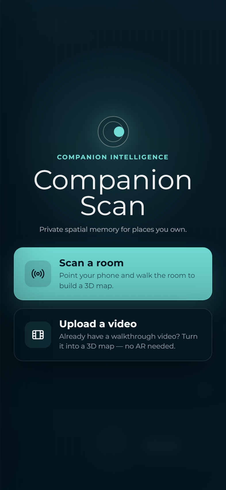 | 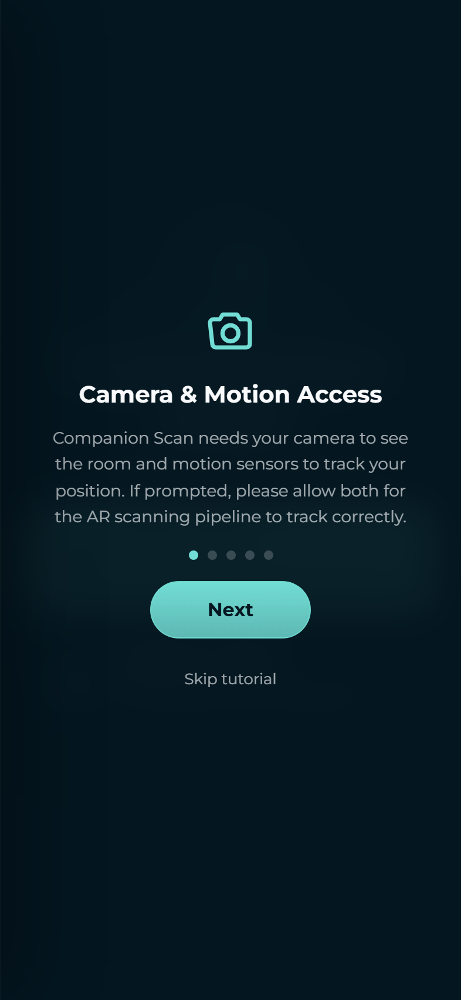 | 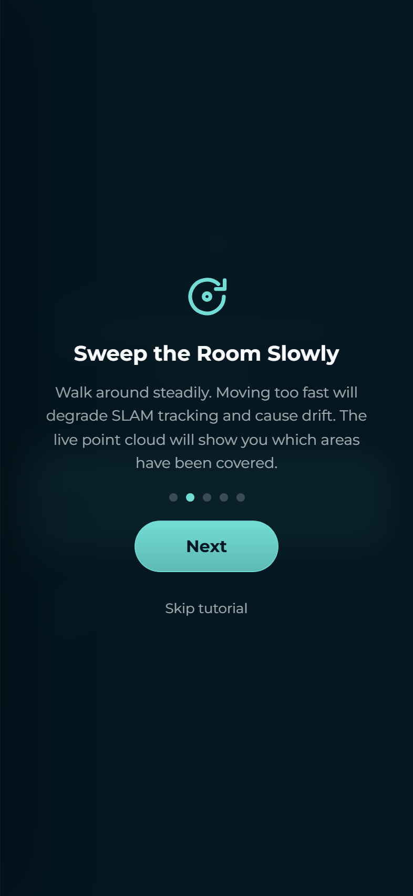 | 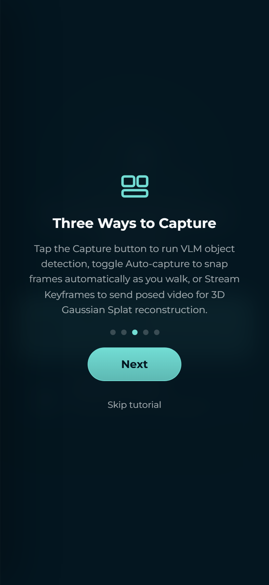 |
| `#start-screen`: title, subtitle, **Start AR**, and the quiet *upload a walkthrough video* path. | **Camera & Motion Access** — the permission-priming step. | **Scan Your Space** — how to sweep the room. | **Export & View in 3D** — the payoff; button reads **Get Started**. |

### Phase 1 — Scan a room

| Live scanning HUD | Capture → detection | Review & Export panel |
|---|---|---|
| 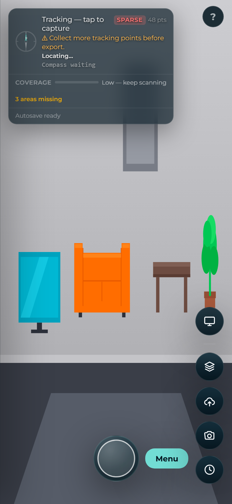 | 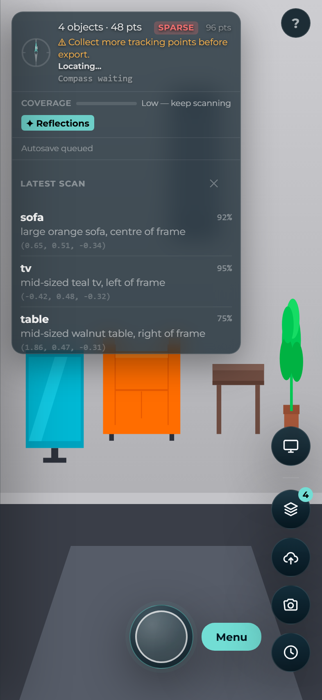 | 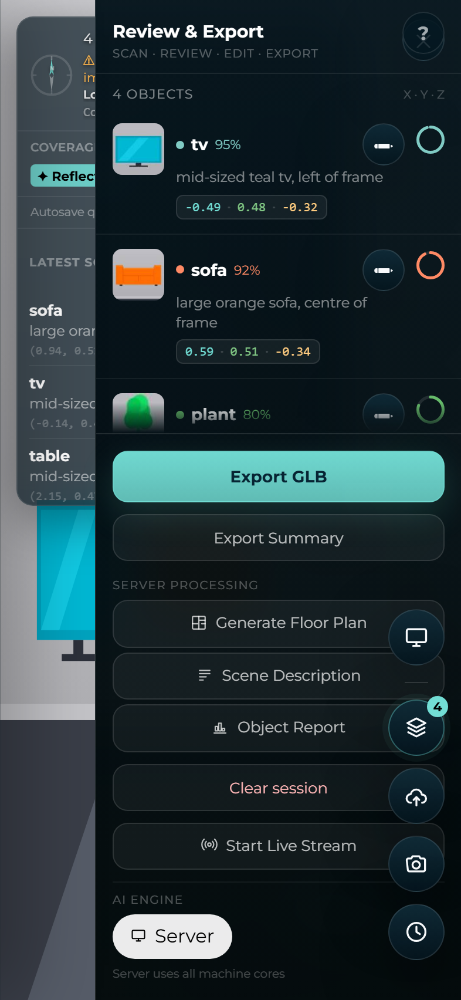 |
| Status `Tracking — tap to capture`, live point count, the coverage bar (`Low — keep scanning`), *N areas missing*, and the action rail (`☰ 🖥 ☁️ 📷 🕒`). | Tapping the capture button runs `/infer` and pops the **Latest scan** card with the detected object. | The `☰` side panel: per-object cards, **Export GLB / Summary**, Server Processing actions, and the `Server / WebGPU` engine toggle. |

| History drawer | Walkthrough-video upload |
|---|---|
| 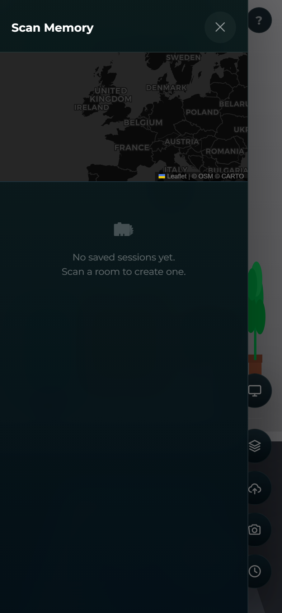 | 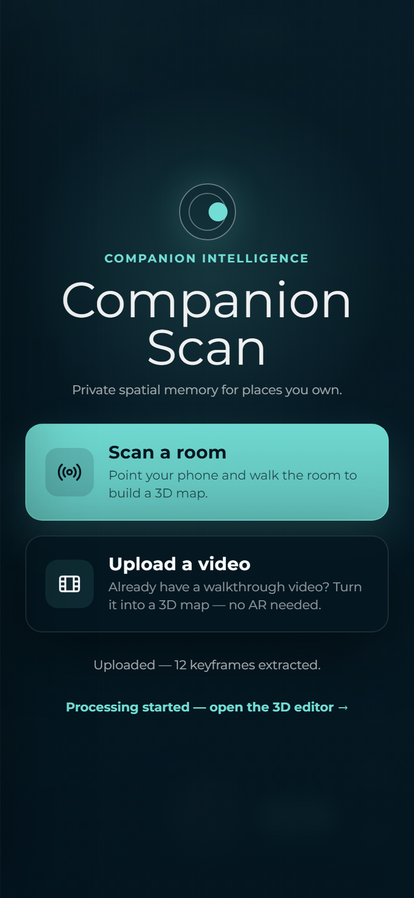 |
| `🕒` **Scan Memory** — past sessions + a geomap of where they were captured. | The no-AR path: upload a walkthrough video, which `/ingest-video` turns into a session scan, then **View in 3D →**. |

---

## 🖥 Desktop — Companion Scan Spatial Editor (`/editor`, implemented by `viewer.html`)

UX_FLOW **Phase 2 (Structure)**, **Phase 3 (Process)**, and **Phase 4 (Export / Share)**.

### Phase 2 — Structure the 4D map

| Editor overview | Scans tab | Edit tab (scan selected) |
|---|---|---|
|  | 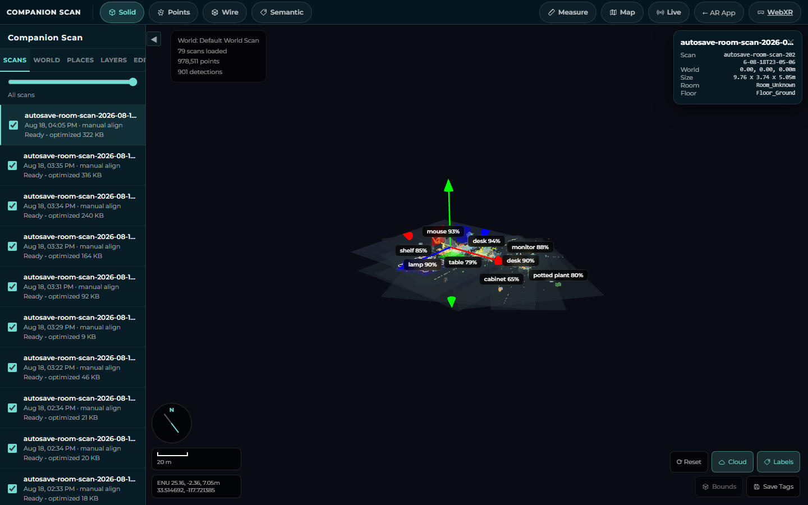 | 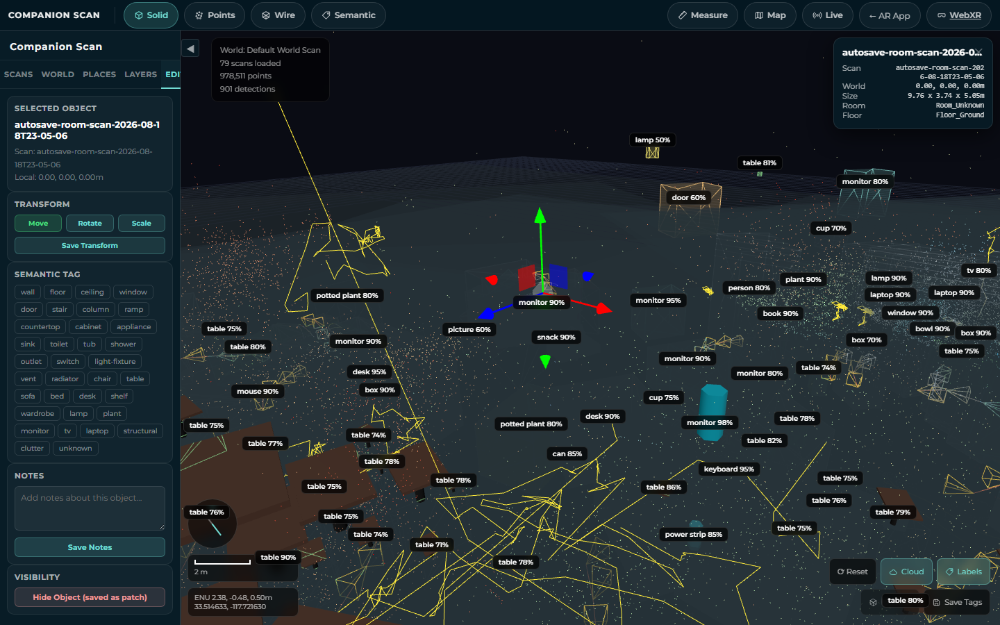 |
| The room point cloud placed in the ENU frame with detection labels, camera frustums, compass, scale bar, and coordinate readout. | The **Scans** list — each scan with its capture time, alignment, and quality/coverage status. | Selecting a scan attaches the transform gizmo and opens **Move / Rotate / Scale**, the 34-chip semantic tag grid, notes, and visibility. |

| Layers tab | Render: Points | Render: Semantic |
|---|---|---|
| 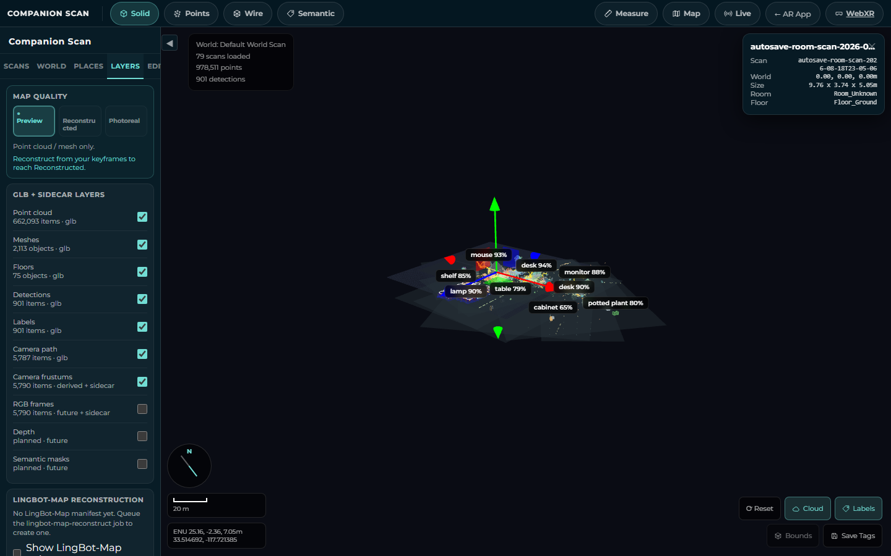 | 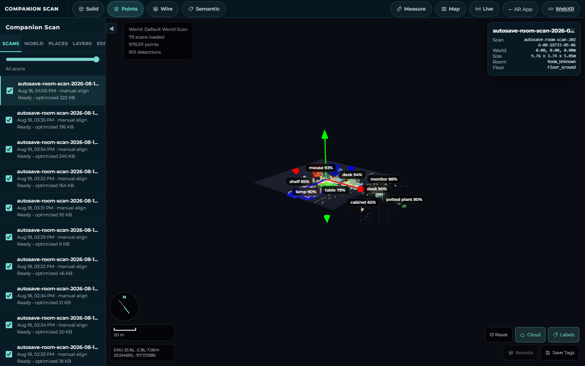 | 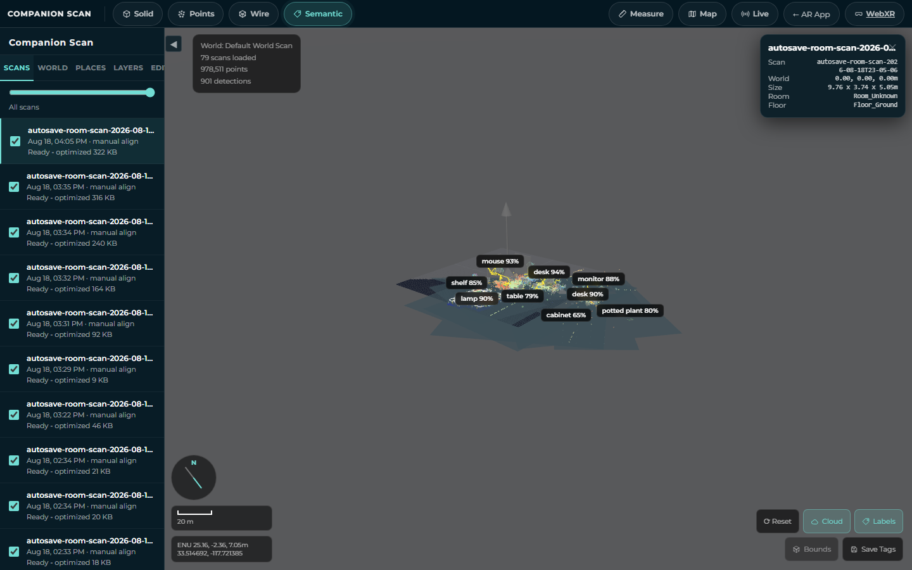 |
| Typed, toggleable layers (points, mesh, floor, detections, labels, camera path/frustums, RGB frames, depth, semantic masks) + the LingBot-Map and Splat sections. | `☁ Points` mode shows only the raw point cloud. | `🏷 Semantic` mode recolors geometry by semantic tag. |

| Measure tool | Geomap drawer |
|---|---|
| 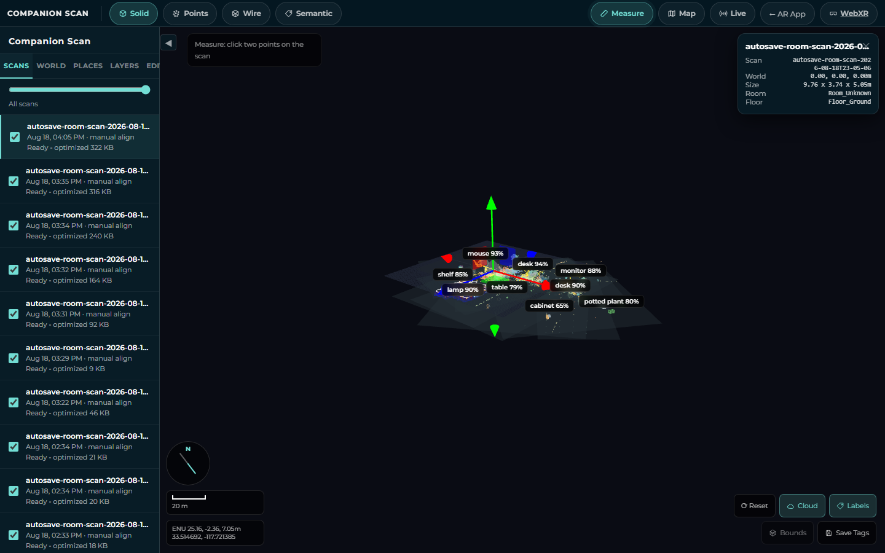 | 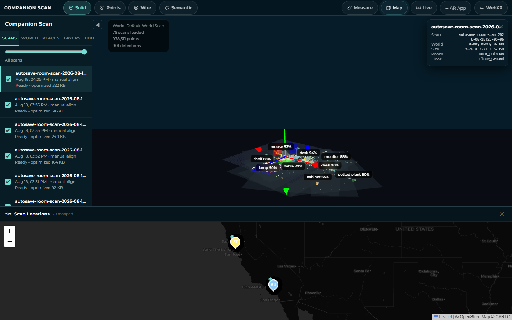 |
| `📏 Measure` — click two points for a real metric distance (the world is metric ENU). | `🗺 Map` — every GPS-tagged scan pinned on a Leaflet map. |

### Phase 3 — Reconstruction / detection jobs

| Splat Toolbox | Edit tab (empty) |
|---|---|
| 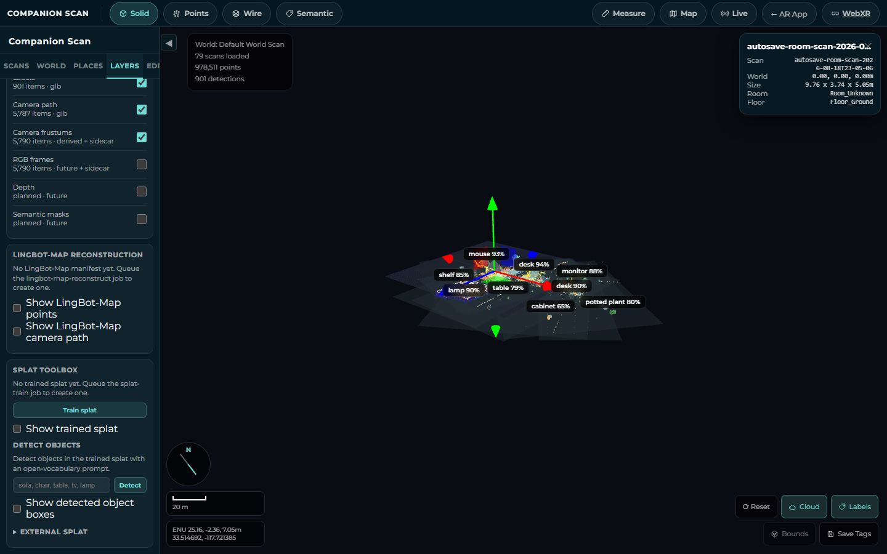 | 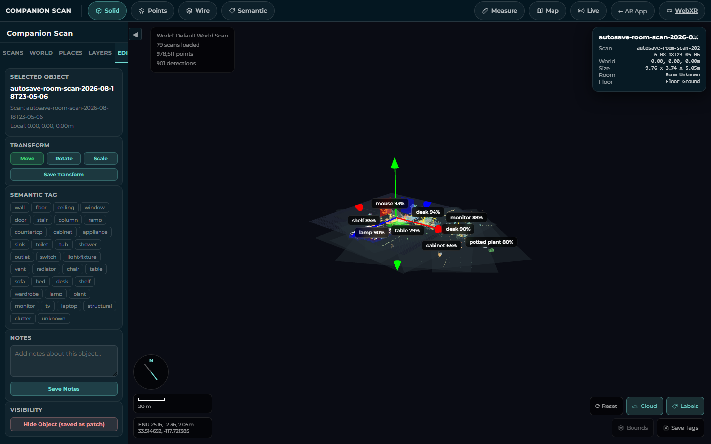 |
| **Train splat** (Brush 3DGS), **Detect** objects over the splat (OWLv2), download `.ply`, and load external splats. | The Edit empty-state prompt before a scan or object is selected. |

### Phase 4 — Export / share the world

| Project details and guided processing |
|---|
| 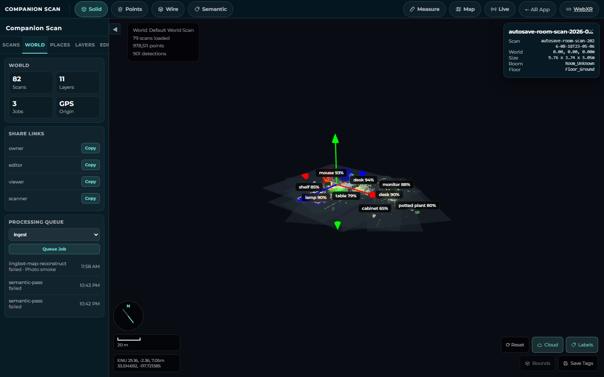 |
| Place/project stats, role-scoped **Share** (view / comment / edit / scanner / owner), and the right-drawer guided processing flow. |
